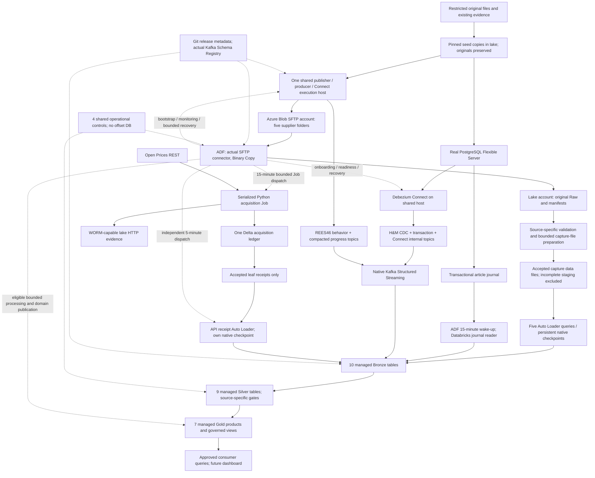

# Azure Databricks enterprise retail data platform architecture

**Revision A4 — 30 October 2026 — one DEV environment**

**Status: proposed architecture for review; implementation is stopped.**  
**Destination: harshitarav/azure-databricks-project, verified default branch main, root architecture.md.**

This document corrects the existing A3 architecture and retains its verified source evidence, business products and justified infrastructure. The earlier A2 audit remains as traceable history. It preserves eight logical integrations and four genuine interfaces: PostgreSQL, SFTP, REST and Kafka. Large ingestion, validation, joins, reconciliation and transformations use distributed Spark workers. Small serialized control work does not require a large Spark cluster.

Only this Markdown document is authorized for updating and recording. Nothing here approves implementation, fault execution, paid resources, deployment or production readiness. Original files and existing implementation artifacts remain in their current locations. Their existence does not establish that their runtime behavior satisfies this architecture.

**Evidence labels:** VERIFIED means directly read in the supplied contracts, retained evidence or official service documentation; SELECTED means a simulated business or architectural policy; GATE means proof required later. All new runtime tests in this document are **NOT EXECUTED**.

## 0. A4 corrections and four independently justified ingestion patterns

A3 incorrectly removed Auto Loader from the five SFTP integrations. **That decision is superseded.** Every SFTP source now follows downloaded seed → simulated Azure SFTP supplier → ADF SFTP acquisition → ADLS Gen2 Raw/staging → Auto Loader → managed Bronze → source-specific Silver → business Gold.

ADF is the enterprise orchestrator for eligible bounded work, not a replacement for source clients or Spark. It initiates the scheduled Open Prices acquisition and independent receipt workflows, PostgreSQL initialization and article polling, all five SFTP acquisition/Auto Loader workflows, selected domain Gold publication, reconciliation and controlled recovery. Continuous Debezium, the transactional Kafka producer and native streaming queries retain their native lifecycle/state.

| Pattern | Selected acquisition and staging | Bronze execution and authority | Why this pattern is different |
|---|---|---|---|
| PostgreSQL | Real database initialized from the approved H&M seed; sealed article snapshot/journal; Debezium consistent customer/purchase snapshot then WAL | Articles bounded JDBC/sealed capture; customers/purchases native Kafka-to-Delta; source journal, slot and Connect offsets remain authoritative | ADF coordinates real database snapshot/cutover and bounded recovery; no SFTP or Auto Loader inserted into WAL CDC |
| Five SFTP datasets | Actual Azure Blob SFTP source → ADF Binary Copy → immutable original Raw → verified record-capture data files in isolated accepted staging | Five source-specific Auto Loader queries with persistent checkpoints; idempotent per-file target commits, then whole-delivery reconciliation/marker/ACK | Original files and source ordinals are preserved; accepted data files, not incomplete Raw or trigger-only receipts, feed cloudFiles |
| Open Prices REST | Actual REST → serialized Python → immutable HTTP evidence → one acquisition ledger → accepted receipts | Independent receipt Auto Loader → idempotent ITEM/WINDOW_COMMIT Bronze | ADF owns the 15/5-minute wake-ups; it neither issues provider pages nor owns the API acquisition frontier |
| REES46 Kafka | Independent CSV-seeded producer → actual transactional Kafka and real registry; no ADLS event staging | Direct native Kafka Structured Streaming → native Delta append/checkpoint | ADF coordinates startup readiness, monitoring and bounded recovery; no per-record, transaction or micro-batch activities |

**Source-specific SFTP handling is mandatory:** quote-aware CSV, original open JSONL, native Parquet types and station-aware TOA5 headers are validated by their own adapters. To preserve deterministic original ordinals and avoid unsplittable-gzip limitations, Auto Loader consumes bounded technical capture **data** files prepared after verified Raw (§7). Sharing this file-ingestion pattern across SFTP does not make PostgreSQL, REST or Kafka file-ingestion patterns.

### 0.1 Precise changes from A3

| ID / class | A3 decision corrected or clarified | A4 selected decision / affected contract |
|---|---|---|
| A4-01 CORRECT | A09/AM-03 removed SFTP Auto Loader | Restore Auto Loader for all five SFTP sources; A3 removal is explicitly revoked. R01–R10 source payload/identity decisions remain intact. |
| A4-02 ADD | ADF duties around PostgreSQL initialization were incomplete | ADF coordinates source readiness, sealed article FULL, native Debezium snapshot/cutover proof, capture readiness and bounded database recovery. No CDC table polling replacement. |
| A4-03 CORRECT | D10/A3 native Job cron owns API 15/5-minute schedules | **ADF exclusively owns both schedules**; remove/disable the corresponding native Job cron bindings. Keep the same two configured Jobs, independent receipt path, ledger, HTTP limits and ownership/fencing. Material orchestration amendment OA-API-02, not a provider/schema MINOR. |
| A4-04 CORRECT | A3 claimed one atomic Bronze write for an entire SFTP package | Auto Loader can commit multiple file batches. DATA + FILE_COMMIT are atomic per bounded target write; a separately verified DELIVERY_COMMIT authorizes the whole package. Partial Bronze never authorizes Silver/Gold or ACK. Receiver ingestion protocol R2/2.0.0. |
| A4-05 ADD | Accepted-file visibility, empty files and original ordinal mapping were unspecified | Freeze/verify capture set, publish only closed verified capture data into accepted staging, retain one file-control row even for zero source rows, use persistent per-source native checkpoints. |
| A4-06 CORRECT | Multiple source workflows could compete to refresh shared Gold products | One designated writer per product: native H&M conformance for G01/G02; source workflows for G03/G05/G06; ADF domain-product workflows for G04/G07. |
| A4-07 ADD | Cross-source readiness and stale Gold need explicit coordination | Product-specific dependency/version sets and publication debt; no global barrier across unrelated domains; commit-aware readiness, not activity-success inference. |
| A4-08 KEEP | Source counts, 275 identified DQ rules plus OFF categories, API/Kafka R2 semantics, one DEV and 31 managed tables | Preserve them; extend only affected receiver/orchestration contracts and qualification scenarios. |
| A4-09 KEEP | A3 separated SFTP hosting from lake WORM compatibility | Retain one supplier account and one lake account because the documented SFTP/WORM conflict is real; accepted staging is a container in that same lake account, not another account. |
| A4-10 ADD | Cost/freshness excluded SFTP preparation and native file discovery work | Count preparation, capture storage, Auto Loader discovery/micro-batches, reconciliation and ADF dispatch delays; no new measured result or SLA claim. |

A4 is proposed for architecture approval. Original source documents, code, configuration and already completed implementation work are not changed by these decisions.

## 1. Retained A2 audit and A3 history with A4 resolutions

A2 was recovered in full from the existing conversation “Design source simulation and ingest (2),” architecture revision A2, 30 October 2026. The older local ARCHITECTURE.md dated 29 October and the identical older Downloads/version1 architecture copies are supporting history, not A2. The superseded repository/path mentioned in A2 is not this document's destination.

Severity P0 blocks correctness or safe activation; P1 blocks the stated operational objective; P2 is an improvement or deferred qualification. KEEP, CORRECT, SIMPLIFY, ADD and DEFER describe the audit outcome, not execution status.

| ID | Severity / class | A2 concern and evidence | Selected resolution | Sections |
|---|---|---|---|---|
| A01 | P0 CORRECT | A2 assumes OpenSSH SFTP on a source VM; user requires Azure Blob SFTP | Azure-managed supplier endpoint, five logical folders, actual ADF SFTP source connector | 4, 7 |
| A02 | P0 CORRECT | A2 combines SFTP and protected immutable API evidence in one account; Microsoft feature matrix marks account-level SFTP incompatible with container WORM | Two storage accounts: SFTP supplier account and HNS lake account with SFTP disabled. Keep the existing API immutability guarantee | 4, 7, 12 |
| A03 | P1 SIMPLIFY | A2 assumes a 1 TiB source disk without a working-set calculation | Shared execution host, initially 512 GiB data disk; immutable seeds in lake; working-set admission and 30% free-space gate | 4, 5 |
| A04 | P1 CORRECT | A2 puts PostgreSQL, supplier workloads, Connect and the Kafka producer on one host | Select managed PostgreSQL Flexible Server; share one small execution VM only for publishers, producer and Connect | 4, 6 |
| A05 | P1 KEEP with justification | VNet injection/NAT are not universal requirements, but private JDBC to the actual PostgreSQL source must work | Keep one small VNet and explicit egress for this selected private database topology; compare less costly public alternatives explicitly | 4 |
| A06 | P1 CORRECT | E16 drivers/four E16 workers for every history and E8 streams are unmeasured starting assumptions | Four D8-class historical workers; smaller incremental and streaming profiles; scale after measured bottlenecks | 11 |
| A07 | P1 CORRECT | A2 API control adds two workers despite the approved API decision specifying single-node compute | Restore separate single-node acquisition and receipt Jobs; preserve ownership and independence | 8, 11 |
| A08 | P0 KEEP | Newer API decision separates REST acceptance from Bronze and rejects export bootstrap | Keep REST-only Python, one guarded Delta ledger, immutable evidence, accepted receipts and Auto Loader | 8 |
| A09 | P0 CORRECT in A4 | A3 removed the required Auto Loader stage after SFTP acquisition | A4 restores five source-specific Auto Loader queries and native file checkpoints; see A4-01/A4-04 and §7 | 7, 9, 13 |
| A10 | P1 CORRECT | A2 mostly assigns ADF SFTP duties and leaves other enterprise responsibilities implicit | ADF owns file acquisition, article scheduling, finite onboarding/recovery/reconciliation and batch dependencies; native Jobs own continuous capture; ADF owns the approved API acquisition/receipt schedules | 9 |
| A11 | P0 CORRECT | Timed-out ADF activity is not proof a Databricks run stopped | Deterministic Jobs run-now token, run-ID lookup, actual terminal evidence, then controlled repair/new execution | 9, 16 |
| A12 | P0 CORRECT | Separate Delta table writes cannot provide a single ACID publication | Same-table completion markers where needed; bounded stage receipts and frozen input versions; no global transaction claim | 13–15 |
| A13 | P0 CORRECT | A2's “305 source rules” suggests 30 executable OFF predicates | Preserve 275 identified rules across seven contracts plus OFF's 30 prose categories. New OFF executable definitions need an explicit reviewed mapping | 3, 14 |
| A14 | P0 KEEP | REES46 and review payload repetition represents original occurrences | Never use content-hash deduplication for business occurrence identity | 3, 5, 14–15 |
| A15 | P0 KEEP | H&M R3 records six exponent prices and 243,127 values needing more than 18 fractional digits | Retain lexical amount + unconstrained source NUMERIC; exact fit/round-trip before DECIMAL(38,21) projection | 6, 14–15 |
| A16 | P0 ADD | A2 lacks fully specified Gold grains, KPIs, correction and publication behavior | Seven focused physical Gold products plus business views; dimension and funnel definitions below | 13, 15 |
| A17 | P1 CORRECT | Five-minute discovery nearly exhausts a five-minute READY-to-Raw target | One-minute active polling for OFF, Amazon metadata and Campbell; explicitly amend their previous five-minute choice and Campbell Event Grid choice | 9, 17 |
| A18 | P1 CORRECT | 30-minute API acceptance + 15-minute receipt processing ignores receipt-publication delay | Allocate an explicit publication budget and a combined latency inequality; monitor acceptance-to-receipt debt | 8, 17 |
| A19 | P0 KEEP | Two REES46 topics, transaction/progress semantics, raw-preserving inspection and native Bronze recovery are accepted | Preserve R2 exactly; H&M/Connect topics are distinct native CDC state, not REES46 additions | 10 |
| A20 | P1 CORRECT | Pricing one eCKU as a service total ignores traffic, storage and possible higher SLA capacity | Price billed eCKU-hours plus all usage; do not purchase or claim the 99.99% option without its capacity requirement | 4, 19 |
| A21 | P0 ADD | H&M cross-table CDC completeness/order and native offset loss need an actual design | One Connect worker/connector, explicit internal and CDC topics, transaction metadata, baseline and transaction-apply gates | 6, 13–14 |
| A22 | P0 ADD | A2's failure table does not specify executable Spark failure demonstrations | Risk-based catalogue with isolated fixtures, observations, recovery and pass criteria | 16 |
| A23 | P1 CORRECT | Four days does not prove a full 85.2-hour stream plus setup and all-source qualification | Four-day implementation sequence, representative gates and a separate full-scale qualification window | 20–21 |
| A24 | P0 KEEP | Native checkpoints, source journals and the API ledger have different owners | Preserve their boundaries; shared controls report milestones and never replace source/native progress | 13–14 |
| A26 | P0 ADD | Article journal cadence can lag the faster purchase CDC publication | Publish exact purchase facts with explicit pending article enrichment; gate attribute-complete analytics separately | 14–17 |
| A25 | P2 DEFER | Always-on large SQL warehouses, private-endpoint mesh, HA Kafka operations and extra environments | No additional environment, control DB, custom service or permanent BI compute. Add only through a justified future decision | 4, 19–20 |

## 2. Source authorities and traceable evidence

Original contract root: `C:\Users\harsh\OneDrive\Desktop\DE PREP\AZURE PROJECT\datasources\SOURCE SIDE CONTRACT RULES`. Documents D01–D08 are in `Source profiling`; D09–D11 are in `Source frequency decision`.

All eleven supplied files were read or matched against the existing complete extraction and SHA-256 index. The original file hashes and retained extracted-text hashes agree with that index. This is document verification, not dataset re-profiling. D11 is **UTF-8 Markdown with a .docx extension**, not an OOXML ZIP; its actual text was read accordingly.

| Doc | Exact authority | SHA-256 |
|---|---|---|
| D01 | POSTGRESQL_HM_ENTERPRISE_SOURCE_CONTRACT_R3.docx | dac3fb8360ee1e142282a459f80ecc29d28ea9221aad264a5b0101ec7284cd4e |
| D02 | REES46_SFTP_CSV_ENTERPRISE_SOURCE_CONTRACT_R1.docx | 71f47a8174daa9cb6a650bb7ce5d93debde6029bc910bb2d2dcdecf993e7e8ee |
| D03 | SFTP JSON.docx | 8f485571b28d714efb68afff2565650138fba133831d2c1ad38d02a757264ce3 |
| D04 | AMAZON_ELECTRONICS_SFTP_PARQUET_ENTERPRISE_SOURCE_CONTRACT_R1.docx | b4105ee9bfb21a43cdbbb3b6d86cb4c4a01bda4db49b45a7e5ad09c7a27cae83 |
| D05 | AMAZON_ELECTRONICS_REVIEWS_JSONL_ENTERPRISE_SOURCE_CONTRACT_R1.docx | 94c49156cdb5d68cd26f675d9907d56e314463b4a1bdd2d9a934c68a7862093 d |
| D06 | CAMPBELL_TOA5_DAT_ENTERPRISE_SFTP_SOURCE_CONTRACT_R1.docx | 75a3f0bd80a3e0d2001d513e7394b70ccf81abc4b6df36182eaaf9d62aa9f1b6 |
| D07 | OPEN_PRICES_API_ENTERPRISE_SOURCE_CONTRACT_R1.docx | b159b13afdf2f0d386f222b2cdd6c1dcbcb062b06c2d98bc2ce6b9907cd2ef34 |
| D08 | REES46_KAFKA_STREAMING_ENTERPRISE_SOURCE_CONTRACT_R1.docx | 17251856048c618d2d9d55c33c6e5f121be2f720c85aac20b659821016d3ff84 |
| D09 | Source frequency decision.docx | c8cb5f93c526f52a08a018ea8ece995afce508707f49f38c8338b90a3277ec61 |
| D10 | API CODEX IMPLEMENTATION DECISION.docx | 2af2702b08db1d40bd27abe67d8775debde522cf10e1e2237733204c5ff235b5 |
| D11 | KAFKA CODEX IMPLEMENTATION DECISION.docx | b600caf945db56b3ec5d387c1de5b77af501043cdc51ca20350b12fdcf0996e9 |

Precedence: this user's explicit boundaries govern; D10 supersedes conflicting older API proposals; D11 supersedes conflicting older Kafka proposals; D09 supplies downstream cadence/business objectives; otherwise D01–D08 retain their source semantics. A4 and the retained A3 amendments are proposed, not silently active source-contract edits. A4-01 explicitly supersedes the A3 SFTP Auto Loader removal; OA-API-02 changes only the orchestration binding of D10.

Existing work remains in the original workspace, including `rees46-kafka`, source contracts/evidence and `azure-databricks-data-platform`. No migration or implementation correction occurs in this phase. The inaccessible historical `source-contracts/contracts.v1.json` catalogue **has not been recovered or bytewise reconciled**. Existing extracted YAML and generated rules do not establish that it has.

## 3. Source-contract-to-architecture traceability

R01 discovery/business rules; R02 registry; R03 schema; R04 behavior; R05 compatibility; R06 drift; R07 DQ; R08 freshness; R09 retention/replay; R10 operational metadata. These matrices cover all 80 source-side requirement slots. Locations refer to the named requirement in the source document, not guessed rendered page numbers.

### 3.1 H&M PostgreSQL — D01 R3, cadence D09

| Requirement | Preserved source decision and architectural realization |
|---|---|
| R01 | 105,542 articles, 1,371,980 customers, 31,788,324 purchase occurrences; verified cutover allocation; source files are not historical CDC. Initialize real PostgreSQL (§5–6). |
| R02 | Version physical PostgreSQL/catalog expectations, journal envelope, CSV identities and decoder releases in Git; inspect actual pg_catalog before activation. |
| R03 | Exact ID strings, source flags/nulls, price lexeme and unconstrained NUMERIC; native purchase occurrence ID; candidate exact DECIMAL(38,21), never DECIMAL(38,18) rounding (§6,14). |
| R04 | Baseline + transactional articles journal; customers/purchases real snapshot/WAL CDC; first-use master activation and one source day per ten elapsed minutes (§6). |
| R05 | Reviewed compatible additions; identity/required/type/CDC semantic changes need migration and material versioning; no fabricated master history. |
| R06 | Compare actual CSV, DDL, journal and Debezium envelopes with pinned release; stop incompatible apply; retain raw CDC. |
| R07 | All 36 HM-ART/HM-CUS/HM-TRX/HM-CDC/HM-JNL/HM-ALL predicates and dispositions remain authoritative; initialize, validate, reconcile and fault-test at original scope (§14). |
| R08 | Articles 15-minute polling; p99 B/S/G/consumer 30/40/50/60 minutes. CDC continuous, 5/8/12/15 minutes; operational commit clock (§17). |
| R09 | Seeds active+365 d; unacknowledged journal never purged; acknowledged images ≥90 d; WAL capacity ≥7 days measured peak; Kafka 14 d; Raw/Bronze365 d; native recovery (§12,18). |
| R10 | Source action/version/journal membership, actual WAL/transaction identity, target UUID/version and true ACK. MAX(sequence), t_dat or updated_at is never the journal authority (§6,13). |

### 3.2 REES46 SFTP CSV — D02 R1, cadence D09

| Requirement | Preserved source decision and architectural realization |
|---|---|
| R01 | Seven months, 411,709,736 independent occurrences, 17,668,345,567 gzip bytes / 56,577,978,747 decoded bytes; accepted repeats/blanks/bursts (§5). |
| R02 | Exact nine-column v1, package manifest and approved April v2 decoder/fingerprints retained. |
| R03 | UTC event-time lexeme; exact string identifiers and price; optional brand/category/session; v2 appends nullable sim_export_quality only. |
| R04 | Monthly event exports; November r2 full-month replacement changes ordinal108 price566.30→566.31; delayed/missing/empty/replay cases retained (§5,7). |
| R05 | Registered nullable April addition is compatible; identity/order/type changes require explicit migration. |
| R06 | Check gzip/CRC, header order, width, version and source membership; retain rejected attempt; no mergeSchema. |
| R07 | REE-001…036 remain intact; no content dedup or invented currency/product FK; source-channel separation enforced (§14). |
| R08 | Next-month first day02:00UTC, ADF10 min; R/B/S/G60/120/180/240 min, dashboard270 min, business08:00UTC (§17). |
| R09 | Seed365 d after run, acknowledged supplier90 d, Raw/Bronze365 d, quarantine90 d, audit400 d; same revision exact bytes; retain r1/r2 (§12,18). |
| R10 | Month, delivery/revision/attempt, original gzip hash + one-based logical CSV ordinal, manifest/capture-set SHA, native file checkpoint, per-file and delivery completion/ACK; later months cannot close a March gap. |

### 3.3 OpenFoodFacts JSONL — D03 R1, cadence D09

| Requirement | Preserved source decision and architectural realization |
|---|---|
| R01 | 4,832,131 objects, 13,230,181,102 gzip / 83,825,990,194 decoded bytes; 4,832,069 nonblank distinct codes; 61 conflicting groups + one blank; 4,832,008 canonical keys and123 exception occurrences. |
| R02 | Git catalogue for closed delivery envelope and open publisher content, separate from publisher schema_version; no new registry service. |
| R03 | Exact code strings/zeros, full original nested JSON and unknown optional members retained; no exhaustive flattening of334,949 observed paths. |
| R04 | Immutable FULL + ten hourly journal-backed DELTAs; INSERT/UPDATE/RETIRE/DELETE; canonical keys only for keyed source mutations; no snapshot-diff CDC (§5,7). |
| R05 | Nullable sim_supplier_quality and sim_supplier_context.review_note reviewed as simulated additions; protected identity/type changes are material. |
| R06 | Open content captured; typed protected activation gated; schema99 held; tombstones explicit, absence never deletion. |
| R07 | Preserve all30 category statements; they are not30 original executable IDs. Complete operators, scope and tolerances before activation (§14). |
| R08 | D09 FULL12/24/30/36 h to R/B/S/G, consumer40 h target/48 h deadline; hourlyDELTA; active polling amended to1 min to address5 min Raw target (§17). |
| R09 | Seed active+365 d; supplier/journal90 d after ACK, unacknowledged retained; Raw/Bronze365 d; audit400 d; RTO4 h objective only. |
| R10 | Source generation/snapshot, source sequence/version/transaction, exact parts/membership, predecessor, empty flag, revisions; receiver receipts separately owned. |

### 3.4 Amazon metadata Parquet — D04 R1, cadence D09

| Requirement | Preserved source decision and architectural realization |
|---|---|
| R01 | Ten original SNAPPY shards,1,610,012 products,1,955,009,715 bytes,1,620 row groups; unique exact parent_asin, including six lowercase identifiers. |
| R02 | Git subjects full_native, delta_envelope and delta_after; native type/fingerprint/version retained; no SFTP registry service. |
| R03 |16 native fields; rating_number int64, average_rating double, price/details/bought_together strings, images/videos native structs of lists; no cast to invented price/currency (§14). |
| R04 | FULL boundary0 then ten transactional journal exports; sealed endpoints2,10,12,13,15,17,18,18,20,21; empty eighth export; preserve every committed operation. |
| R05 | V2 nullable after.sim_supplier_quality; schema99 string rating_number is breaking and held; reserialize same sealed membership for repair. |
| R06 | Footer plus full page decoding, exact nested types and compatible versions; physical footer readability alone is insufficient. |
| R07 | All AMZ-DQ-001…036 retain predicates/tolerances/dispositions, including exact FULL keyset/multiset and journal atomicity. |
| R08 | Hourly sealHH:30/publish followingHH:00; D09 stage targets; polling amended5→1 min active; source fault calendar remains visible (§17). |
| R09 | Source/Raw/decoder retention and original keyset/multiset identities unchanged; replay same operations, explicit revisions; no current-state replacement for journal history. |
| R10 | Source action/change/version/transaction/sequence, exact source range and after/tombstone, manifest parts, predecessor, target commit and idempotent ACK. |

### 3.5 Amazon reviews JSONL — D05 R1, cadence D09

| Requirement | Preserved source decision and architectural realization |
|---|---|
| R01 |43,886,944 objects /22,616,233,652 original bytes; FULL43,883,164 +3,780 original occurrences over13 days;477,968 excess repeated payload occurrences retained. |
| R02 | Original/full/daily/envelope/fixture schemas versioned separately in Git; keep original decoder. |
| R03 | Ten source fields; epoch milliseconds, boolean verified_purchase, original strings/nested images/rating/helpful_vote; no verified standalone review ID. |
| R04 | Source SHA + original line ordinal is occurrence identity; daily membership by UTC timestamp; synthetic CREATE/EDIT/RETRACT isolated and labeled. |
| R05 | Optional envelope sim_export_quality compatible after review; timestamp unit/key/nested breaking changes held. |
| R06 | Nonmonotonic timestamps are allowed; preserve unknown optional content pending typed review; bad types retain raw. |
| R07 | REV-001…036 intact; preserve two zero ratings, four negative helpful_vote values, blanks and full105,328-byte maximum observed record (§14). |
| R08 | One original day per10elapsedmin; ADF1 min active/15 min recovery-only; initial FULL and daily stage targets fromD09 (§17). |
| R09 | Original source active+365 d; exports≥90 d after ACK; Raw/Bronze365 d; stable original ordinal across replay; original history ends13Sep2023. |
| R10 | Exact original-day/ordinal membership, immutable revision/parts/manifest, native Auto Loader checkpoint, per-file/whole-delivery reconciliation and actual Bronze receipt before ACK. |

### 3.6 Campbell TOA5 DAT — D06 R1, cadence D09

| Requirement | Preserved source decision and architectural realization |
|---|---|
| R01 | Seven files45,438 observations; initial41,105 +190station-days4,333; native gaps/anomaly lexemes preserved (§5). |
| R02 | Station/logger/program/header-fingerprint registry and four schema families; no standalone registry service. |
| R03 | Exact four TOA5 header records; station-specific20/21/27 columns and units; raw naive time + timestamp_ntz; original RECORD not globally unique. |
| R04 | Historical cutover10Jun2016 logger time; daily station packages/explicit empty files; GNLA2 v2 from13Jun appends nullable sim_quality_flag. |
| R05 | V2 adds header name, empty unit and Smp processing entry; registered station-family change only; no universal normalized header. |
| R06 | Compare all four native header records before typing; preserve verified wind-direction unit conflict; explicit UTF-8 text handling prevents reader-induced mojibake. |
| R07 | DAT-DQ-001…040 intact; NAN/-99/+999 preserved/flagged by field; RECORD999 is legitimate; never interpolate missing source observations. |
| R08 | Source due02:00UTC; replace Event Grid +5 min backup with1 min activeADF polling; maintain station-specific completeness and D09 targets (§17). |
| R09 | Source active+365 d; acknowledged deliveries90 d; Raw/Bronze365 d; exact old headers for replay; no fabricated new logger epoch. |
| R10 | Station/date/revision, logger identity, original file/ordinal and four-header fingerprint, bytes/SHA/rows, native file checkpoint and verified delivery completion before independent station ACK. |

### 3.7 Open Prices REST — D07 R1 superseded where specified by D10

| Requirement | Preserved decision and architectural realization |
|---|---|
| R01 |335,600-record export is pinned historical profile only; current live floor/population discovered through REST. No native CDC or historical snapshot claim (§8). |
| R02 | Pin actual provider OpenAPI/schema separately from internal manifest/envelope schemas and exact source release. |
| R03 | Positive integral price.id; original numeric lexemes, nullable/type-specific fields and nested product/location/proof content retained; export schema not imposed on REST. |
| R04 | REST-only fresh bootstrap + bounded created-time tail,30 min overlap, weekly REST re-observation; no export bridge; one serialized requester. |
| R05 | Material acquisition changes recorded asR2/2.0.0; source field evolution separately classified; no automatic MINOR. |
| R06 | Missing pages/invalid IDs/bounds/envelope block acceptance; noncritical item failures retained with qualification, no loss of raw. |
| R07 | OPR-DQ-001…045 retained at proper scope; export-only baselines do not become live count assertions; actual compared API/export fields only. |
| R08 | ADF exclusively schedules the existing acquisition/receipt Jobs at 15/5 minutes under OA-API-02; five-minute horizon and 30/15/45-minute targets retain all latency gates (§17). |
| R09 | Raw≥365 d, evidence≥400 d, receipts≥365 d, native checkpoint protected; no source refetch for same retained accepted response. |
| R10 | One ledger HEAD/commands/events, exact attempt/page/window/root manifests, post-acceptance receipts, target observation and WINDOW_COMMIT; separate native Auto Loader checkpoint. |

### 3.8 REES46 Kafka — D08 R1 superseded where specified by D11

| Requirement | Preserved decision and architectural realization |
|---|---|
| R01 | Same411,709,736 original events, separate interface; source-derived peak estimate8,415/s, not measured Kafka capacity. |
| R02 | Actual Schema Registry catalog and IDs; FULL_TRANSITIVE; no invented registry IDs. |
| R03 |R2 retail.rees46.ingest.BehaviorEvent; nine original fields + required source_file_month/scenario_id and essential source/run/attempt clocks. |
| R04 | One independent transactional producer; behavior and compacted control topics;60×; bounded real-source ordinal fixtures, not a general CDC engine. |
| R05 | R2/2.0.0 material change; v2 only nullable sim_device_context with defaultnull; old/new decoders pinned. |
| R06 | Unknown IDs/bad Avro/DQ failures preserve raw Kafka record and error class in Bronze; no per-record registry request. |
| R07 | KAF-DQ-001…046 retained, with D11 application-attempt clarification for023; source, inspection, global reconciliation and isolated fault scopes remain distinct. |
| R08 |6 partitions,14 days,10sec trigger,150000max offsets; broker/publish→Bronze p95≤30 s, p99≤120 s; no historical-event-time freshness claim. |
| R09 | Native checkpoint, retained control summaries and isolated verified recovery; new topic generation never silently continues old physical history. |
| R10 | Behavior+summary+next progress in one transaction; exact monthly ordinal/content reconciliation; physical offsets and logical IDs counted separately. |

### 3.9 Controlled gaps and amendments

| Amendment | Type / affected authority | Exact selected change; approval/qualification boundary |
|---|---|---|
| AM-01 | Material transport/deployment; five SFTP contracts R04/R10 | Azure Blob SFTP replaces OpenSSH. Local publisher fsync is allowed; remote fsync/rename-overwrite is not assumed. Close, read-back integrity, unused-name finalization and READY establish publication. |
| AM-02 | Material storage topology; A2 and D10 deployment binding | Separate SFTP account from WORM-capable lake account; preserve API semantics/retention. No payload schema change. |
| AM-03 | Superseded A3 receiver decision | **Revoked by A4-01.** Auto Loader is mandatory for all five SFTP sources; persistent native file checkpoints supplement receiver delivery/target completion evidence. |
| AM-04 | Scheduling/SLO; D03/D04/D06 + D09 | OFF/metadata5→1 min active discovery; Campbell Event Grid primary removed in favor of1 min polling. Keep targets as runtime gates, not achieved SLAs. |
| AM-05 | Existing simulated selection, not source evidence; D03 R04 | Ten OFF DELTAs selected as2,8,2,1,2,2,1,0,2,1 operations; endpoints2,10,12,13,15,17,18,18,20,21. Detailed key/action/fixture manifest remains a pre-activation gate. |
| AM-06 | DQ definition gap; D03 R07 | No claim of30 original executable IDs. Review a project category→predicate mapping with exact operator, scope, severity, tolerance, owner and expected fixture before activation. |
| AM-07 | New business design | Seven physical Gold products and governed views replace A2's five incompletely specified aggregates; business approval is part of architecture review. |
| AM-08 | Compute/deployment only | Restore D10 single-node API Jobs; lower unqualified E16/E8 defaults; retain R2 Kafka benchmark baseline until measurements justify change. |
| AM-09 | Existing D10/D11 material overlays | API REST-only/ledger/receipt R2 and Kafka envelope/attempt/recovery R2 remain2.0.0; no claim they are schema MINOR changes. |
| AM-11 | New business completeness policy; D01/D09 | Preserve timely purchase facts with pending article dimensions; attribute-complete views follow article freshness. Never drop facts through an inner join. |
| AM-12 | Rule/metric qualification; D06 R07 and Gold | Preserve original sensor-quality predicates; specify the field-specific trusted-statistics dictionary/test oracle before advertising those metrics as qualified. |
| AM-10 | Missing historical catalogue | contracts.v1.json remains unavailable. Before later contract migration, reconcile accessible R3 Word/current implementation differences; do not claim historic file recovery. |

A4-01 through A4-10 and OA-API-02 are added to this controlled amendment register. Receiver ingestion protocol R2/2.0.0 governs accepted capture files, per-file completion and whole-delivery finalization; it does not rewrite source payload schema v1/v2 or claim a provider change. All amendments remain proposed until the user approves this architecture. Payload schema ordinals, semantic contract versions, infrastructure binding revisions and architecture revision are separate version domains.

## 4. Corrected topology, hosting and resource decisions

### 4.1 Minimum selected resource inventory

One DEV does not mean one storage account regardless of feature conflicts. The second account below preserves the required SFTP and WORM capabilities without adding a service or weakening the API contract.

| Resource / size assumption | Why required and dependencies | Alternative considered / selected outcome | Billing, idle and active requirement |
|---|---|---|---|
| One project DEV resource group | Ownership/tags/budget; workspace also has service-managed resources | Reuse suitable existing group | No group fee; resources need separate cost authorization |
| One Premium Databricks workspace + one discovered UC catalog | Distributed Spark, Jobs, managed Delta/UC | No additional workspace, environment or metastore | VM+DBU during compute; storage persists when compute stops |
| One HNS GPv2 lake account, SFTP disabled | Raw, protected HTTP/evidence/receipts, seeds, mutable state and managed-table root if needed | Reuse compatible project ADLS account | GiB-month, operations, retrieval/egress; no hourly compute; retention costs persist |
| One HNS GPv2 supplier account, SFTP enabled only in active windows | Actual managed SFTP endpoint; separate deliveries and ACK containers | Reusing lake conflicts with WORM; choose this minimum extra account | SFTP-enabled hours + storage/operations; disabling SFTP stops its hourly feature charge, not storage |
| One ADF + Azure IR in selected region | PostgreSQL onboarding/articles, five SFTP/Auto Loader lifecycles, API15/5-minute dispatch, domain Gold, reconciliation and recovery | No SHIR unless public SFTP reachability is later prohibited | Activity/copy runtime/meters; no paid Mapping Data Flows selected; stop triggers outside service windows |
| One Key Vault | Shared scoped credential references | No per-source vault | Operation/storage charges; retain required secrets safely |
| One Access Connector MI/storage credential | UC lake access | Reuse suitable connector | No separate compute; do not mistake it for arbitrary SDK credentials |
| One PostgreSQL Flexible Server, GP D2ds_v5-class,2 vCPU/8 GiB, initial128 GiB storage | Real H&M source, durable WAL/slots and backups; private connectivity | Shared self-managed database is cheaper nominally but increases contention/recovery work; managed selected (§6) | Compute while running, provisioned storage/backups while stopped; grow capacity before activation if WAL budget requires |
| One shared execution VM, D4as_v5-class,4 vCPU/16 GiB,64 GiB OS + initially512 GiB data disk | Continuous Connect, independent REES46 producer, scheduled publishers and their durable source journals | PC only for attended tests; containers considered below | VM billed running; managed disks persist/bill when deallocated; active during source simulation |
| One Confluent Cloud Standard cluster in a supported Azure region + registry | Real Kafka transactions, compaction, native CDC transport and real schema IDs | Basic/self-managed/Event Hubs compared in§10 | Billed capacity, traffic, retained storage and governance; idle cost must be checked, not assumed zero |
| One small VNet:2Databricks subnets,1execution subnet,1PostgreSQL delegated subnet | Private articles JDBC and source-to-Connect database traffic | Public DB with changing client egress rejected for this selection | VNet itself no hourly fee; size/address/quota verified before deployment |
| One private PostgreSQL DNS zone/link | Resolve managed private database from VM and Databricks | No private-endpoint mesh | DNS query/zone fees; persists while stopped |
| One NAT gateway + one Standard outbound IP, unless a compatible shared egress exists | Explicit outbound from private execution/Databricks compute, stable Kafka/storage allowlist source | No standalone VM public IP; existing approved egress may replace NAT | Gateway/IP hours + processed bytes even when idle; cannot call “VM stopped” complete cost shutdown |
| Shared Monitor/action group + bounded diagnostics destination | ADF/Jobs/WAL/Kafka/SLO/cost incident evidence | Native service notifications first; no custom monitoring service | Alert/log ingestion/retention charges; sample/redact verbose Spark logs |
| GitHub repository + federated deployment identity | Reviewed immutable releases to DEV | No new repository/workflows in this phase | Runner/artifact use subject to account quota |
| Optional future on-demand SQL endpoint | Only if dashboard/query access actually requires it | Consumer validation can initially use approved Jobs/queries | Not provisioned or included as an always-running requirement |

All creation, paid enablement and capacity increases require explicit authorization. These are selected resources, not claims they already exist.

### 4.2 Network alternatives and selected boundary

| Alternative | Works when | Assessment |
|---|---|---|
| Default Databricks managed network + public PostgreSQL TLS with exact egress allowlists | Stable actual Databricks outbound addresses are known and maintained | Could remove customer VNet/NAT. New job clusters/worker egress can change; do not use “allow all Azure” or unrestricted5432 as a workaround. Not selected. |
| Existing compatible private network/egress | User supplies it and permissions/routes/quota work | Reuse it; do not duplicate NAT or subnets. No such host/network is assumed verified. |
| Private Flexible Server + injected classic compute | Direct private JDBC, stable outbound Kafka/API/SFTP connectivity required | Selected. Two dedicated Databricks subnets; separate delegated PostgreSQL subnet and DNS; explicit egress. |

Databricks documents explicit outbound connectivity for new VNets after31March2026. NAT is the selected method for this topology, not a requirement for every possible Databricks design. [VNet injection](https://learn.microsoft.com/en-us/azure/databricks/security/network/classic/vnet-inject)

Database5432 accepts only Databricks/execution-subnet traffic and TLS with hostname/certificate verification. No public PostgreSQL exposure. Execution VM has no public inbound SSH/SFTP/Connect8083; use approved control-plane administration such as Azure Run Command. Connect REST remains loopback or protected internal access.

SFTP supplier endpoint remains authenticated public SSH2 on22; allow the chosen Azure IR regional addresses and NAT egress, plus the user's current IP only for approved attended publishing. Storage endpoint DNS is used; no invented static storage IP. Lake HTTPS uses authenticated access and supported selected-network/trusted-service configuration for ADF/UC. Actual firewall/routing/host-key tests are pre-activation gates; no assumption that “trusted services” permits arbitrary SDK access. Kafka/Registry use TLS and actual scoped API credentials/IP policy.

### 4.3 Source publisher execution options

| Option | Availability, staging and durable state | Cost/tradeoff | Decision |
|---|---|---|---|
| Development PC | Original files already local; SQLite/journals on durable local disk; SFTP outbound22 allowed; resumable publication | Lowest incremental hosting cost; stops when PC sleeps/offline and depends on upload bandwidth | Supported for explicitly attended DEV slices. Never claim unattended SLOs while off. |
| Shared scheduled containers/jobs | Stage seeds to Blob; each job must use a valid durable source catalog and exclusive ownership | Cheap when idle, but SQLite on an ephemeral filesystem is invalid; durable-filesystem/cross-process fencing work adds dependencies | Defer as the continuous Connect/85 h producer already needs durable hosting. Do not add a database/file service just for these jobs. |
| Existing compatible host | Proven uptime, supported runtime/disk/network/backup and sufficient capacity | Potentially cheaper; ownership/availability cannot be assumed | Reuse if actually supplied and qualified. |
| One shared cloud execution VM | Durable source journals/caches, service supervision, independent producer/Connect; managed identity pulls approved seeds and secrets | Modest continuous CPU/disk cost; bounded resource contention must be tested | Selected for unattended simulation. It runs **no SFTP server** and no managed PostgreSQL process. |

The VM is justified by continuous source clients and durable publisher state, not by the removed OpenSSH design. Keep OFF and Amazon supplier catalog/journal databases separate on its durable disk. Single-owner SQLite WAL with synchronous durability is an implementation choice inherited from existing work; immutable action receipts, backups/seals and fencing are required. Do not put active SQLite databases on Blob or an unqualified shared network filesystem.

Initial512 GiB is a capacity hypothesis. Known raw populations include83.83 GB OFF JSON,22.62 GB reviews,56.58 GB REES46 decoded CSV and1.96 GB metadata. Cache only necessary seeds; catalog payloads, indexes, temporary exports, retained unacknowledged work and 30% free reserve must fit a measured working-set plan. Pause admission or resize with approval before pressure; never delete required history to stay within a nominal size.

## 5. Full seed-to-interface initialization and delivery plan

Immutable original files remain in the original local source folders. After later authorization, hash-matched seed copies may be staged to restricted lake seed storage for the source systems. This staging is not target ingestion: all eight integrations still cross their mandated genuine interface.

### 5.1 Verified allocations

| Source | Exact allocation / source evidence |
|---|---|
| H&M | Articles102,847initial+2,695reserved=105,542; customers1,354,442+17,538=1,371,980; purchases30,990,055+798,269=31,788,324. CSV bytes36,127,865+207,135,859+3,488,002,253=3,731,265,977. |
| REES46, both interfaces | Oct42,448,764; Nov67,501,979; Dec67,542,878; Jan55,967,041; Feb55,318,565; Mar56,341,241; Apr66,589,268. Sum411,709,736. Views385,746,849; carts19,114,063; purchases6,848,824. Repeated payload excess1,384,422. |
| OFF | FULL4,832,131 includes4,832,008 canonical occurrences plus123 identity exceptions. Distinct nonblank codes4,832,069 includes61 ambiguous codes. These counts are not interchangeable. |
| Amazon metadata | FULL1,610,012 unique case-sensitive parent_asin in ten original shards; no original historical CUD chronology. |
| Amazon reviews | FULL43,883,164 before2023-09-01UTC; reserved3,780; total43,886,944. Source line order is not event-time order. |
| Campbell |41,105 historical +4,333 incremental=45,438;190station-day files across7stations and4schema families. |
| Open Prices | Historical profile335,600; live count/floor deliberately unknown until legitimate REST discovery. No bulk-export bootstrap. |

Reviews daily counts for1–13September2023 are **749,609,518,495,393,366,250,158,84,82,44,28,4**. Preserve disjoint original ordinal membership across FULL and these days; do not derive original ordinals from filtered output positions.

| Campbell station / family | Initial rows | Increment rows | Daily packages |
|---|---:|---:|---:|
| BLTA2 / GLBA_BARTLETT |832|1,745|73|
| GNLA2 / GLBA_NUNATAK_QUEEN |6,949|1,069|45|
| GQIA2 / GLBA_NUNATAK_QUEEN |6,922|1,045|44|
| CKPA2 / KLGO_T107 |1,212|57|9|
| DWSA2 / KLGO_T109 |7,724|109|5|
| GOTA2 / KLGO_T107 |8,740|131|6|
| SPCA2 / KLGO_T107 |8,726|177|8|

### 5.2 H&M database integration — twelve initialization obligations

1. **Have:** articles.csv, customers.csv, transactions_train.csv and the existing verified split/evidence references; source byte hashes are in D01.
2. **Seeds:** restricted unchanged originals; later hash-matched lake copies and bounded importer cache.
3. **System first:** real PostgreSQL database, roles, source tables/journal/action receipts, publication/slot, actual Kafka and Connect.
4. **Initialize:** quote-aware bounded COPY/import into source staging; durable source-owned import receipts; activate exact initial allocation and FK-consistent master population only after reconciliation.
5. **Interface:** articles via PostgreSQL sealed journal/JDBC; customers/purchases via actual Debezium pgoutput/WAL and Kafka.
6. **FULL:** repeatable-read article baseline with fixed visible J0 membership; Debezium consistent snapshot of initial customers/purchases.
7. **Changes:** source transactions activate first-used reserved masters before purchases; approved CREATE/UPDATE/DELETE/rollback/late-commit fixtures use source-owned action IDs.
8. **Publication:** one original purchase day per10elapsedmin for1–22Sep2020; no invented within-day retailer transaction time.
9. **Discovery:** ADF15 min articles; connector and native Kafka capture continuously during active source operation.
10. **State:** source journal seals/ACK; Connect Kafka offsets and replication slot; native consumer checkpoints. Shared controls are evidence only.
11. **Layers:** raw baseline/journal/CDC Bronze; ordered SCD2 masters/current purchase occurrences in Silver; exact-unit purchase products in Gold.
12. **Recovery:** retained seals/WAL/Kafka/native checkpoint first; lost slot/history requires declared generation and reconciled resnapshot, never silent JDBC substitution.

### 5.3 REES46 SFTP CSV

1. **Have:** seven pinned original monthly files/evidence.
2. **Seeds:** local originals; restricted lake copies; supplier cache retains exact gzip identities.
3. **System:** managed SFTP endpoint and source publisher.
4. **Initialize:** verify seed release; publish October initial month package; preserve complete original bytes and provenance.
5. **Interface:** supplier SFTP → actual ADF SFTP Binary Copy → original lake Raw → verified accepted capture data → Auto Loader → Bronze.
6. **FULL:** October42,448,764; historical onboarding can explicitly backfill the remaining contracted months without claiming a normal monthly run.
7. **Changes:** subsequent month-close files; November r2 full-month replacement at ordinal108; April v2 sim_export_quality.
8. **Publication:** next-month first day02:00UTC on the simulated source calendar; original late/missing/empty cases retained.
9. **Discovery:** ADF10 min.
10. **State:** source immutable delivery/revision; one persistent Auto Loader checkpoint per source/query generation; receiver source_deliveries and actual per-file/delivery target completion.
11. **Layers:** all captured revisions in Bronze; eligible revisions in Silver with one approved active revision per month; SFTP-only business activity/funnel Gold.
12. **Recovery:** retry same revision exact bytes; new attempt identity; raw replay with stable ordinals; gaps hold contiguous completeness, not evidence retention.

### 5.4 OpenFoodFacts JSONL

1. **Have:** original openfoodfacts-products.jsonl.gz and existing complete profile.
2. **Seeds:** restricted original/copy; no new dump or reprofiling substituted.
3. **System:** independent source catalog/journal and managed supplier endpoint.
4. **Initialize:** import only4,832,008 unambiguous keys into mutable canonical catalog; retain all123 exceptions in FULL provenance.
5. **Interface:** actual SFTP → ADF Binary Copy → original Raw → validated capture data → native Auto Loader → Bronze.
6. **FULL:** all4,832,131 original occurrences, original nested payloads intact; bounded package parts may be generated only with exact original ordinal mapping.
7. **Changes:** ten source-journal DELTAs; INSERT/UPDATE/RETIRE/DELETE; selected21-operation allocation explicitly simulated; no upstream historical CDC assertion.
8. **Publication:** hourly, within10 min after window close.
9. **Discovery:**1 min while active, explicit amendment of5 min.
10. **State:** source transactional sequence/action receipt/sealed membership; native Auto Loader file checkpoint and receiver per-file/whole-delivery completion receipts.
11. **Layers:** original JSON/envelope Bronze; canonical current state plus identity-exception view in Silver; approved product view and catalog quality Gold.
12. **Recovery:** same action returns same receipt; re-export same sealed membership; schema99/revision conflict holds range; no arbitrary duplicate-code winner.

### 5.5 Amazon metadata Parquet

1. **Have:** ten original SNAPPY Parquet shards and verified keyset/record multiset evidence.
2. **Seeds:** restricted exact shard copies; source cache only.
3. **System:** independent source catalog/journal and managed SFTP.
4. **Initialize:** exact1,610,012-key import; initial versions0, snapshot boundary0, no synthetic original INSERT history.
5. **Interface:** real SFTP → ADF Binary Copy → original Parquet Raw → verified schema-preserving capture data → Auto Loader → Bronze.
6. **FULL:** all ten original shards; validate all footers/pages/native nested types and keyset/multiset.
7. **Changes:** hourly journal exports preserve INSERT→DELETE and repeated UPDATE commits; explicit tombstones and RETIRE state; approved title-update fixture remains simulated.
8. **Publication:** normal sealHH:30, followingHH:00; exact ten-export fault calendar retained.
9. **Discovery:**1 min active by amendment.
10. **State:** source head lock/sequence/version/action receipt, seal and distinct ACK high; native Auto Loader checkpoint plus verified file/delivery receiver receipts.
11. **Layers:** complete physical snapshots/operations Bronze; case-sensitive current Silver; product dimension view, review relation and catalog quality Gold.
12. **Recovery:** original same-revision retransmit; corrected Parquet schema/parts with new revision and same business membership; new business correction uses new journal sequence.

### 5.6 Amazon reviews JSONL

1. **Have:** original22.616 GB Electronics review JSONL and complete occurrence/day profile.
2. **Seeds:** exact restricted original/copy.
3. **System:** occurrence-preserving publisher and managed SFTP.
4. **Initialize:** one streaming source pass assigns original line ordinal before selecting FULL/daily membership; no natural-key or payload dedup.
5. **Interface:** actual SFTP JSONL gzip → ADF → original Raw → capture data with verified original ordinals → Auto Loader → Bronze.
6. **FULL:**43,883,164 pre-cutover occurrences.
7. **Changes:**3,780 reserved original occurrences over13UTCdays; fixture-only CREATE/EDIT/RETRACT is not original edit history.
8. **Publication:** one original day per10elapsedmin in the approved controlled replay; expectations stop at13Sep2023.
9. **Discovery:**1 min active;15 min recovery-only, restoring1 min when time-sensitive work resumes.
10. **State:** source exact day/original-ordinal mapping, immutable revisions, native Auto Loader checkpoint and receiver file/delivery completion.
11. **Layers:** full original lines/types/ordinal Bronze; occurrence Silver; original review activity/rating distribution and explicitly current-metadata association Gold.
12. **Recovery:** stable original source hash+ordinal; disjoint baseline/day coverage; retransmit/replay cannot create another business occurrence.

### 5.7 Campbell TOA5 DAT

1. **Have:** seven original DAT files and exact station/header evidence.
2. **Seeds:** unchanged originals/copies, native bytes/headers retained.
3. **System:** station-aware gateway publisher and managed SFTP.
4. **Initialize:** cut at10Jun2016 raw logger time; seven historical files41,105 rows;190station/day packages4,333 rows.
5. **Interface:** actual SFTP → ADF binary DAT acquisition → original Raw → station/header-preserving capture data → Auto Loader → Bronze.
6. **FULL:** seven contracted historical packages, retaining four native TOA5 header records each.
7. **Changes:** original station-day observations and approved revisions/v2; explicit header-only CKPA2 zero days; no invented missing hours.
8. **Publication:** next simulated day02:00UTC; raw observation time remains timezone unknown.
9. **Discovery:**1 min activeADF; Event Grid removed by amendment.
10. **State:** one persistent source Auto Loader query with independent station/date/revision completion and ACKs; logger reset requires verified new epoch context.
11. **Layers:** lexical/header provenance Bronze; station-specific NTZ/units/quality Silver; comparable measurement/day summaries Gold.
12. **Recovery:** exact old schema/header replay; later valid station packages may capture while the affected station's continuity is held.

### 5.8 Open Prices REST

1. **Have:** public documented prices endpoint and historical profile; old export is not a live ingestion input.
2. **Seeds:** no export seed for acquisition; pin schema/contract artifacts and retain prior profile offline.
3. **System:** real REST access, protected lake evidence, one Delta ledger, acquisition/receipt Jobs.
4. **Initialize:** freeze H0 and discover live earliest created timestamp through REST; explicit empty discovery if empty.
5. **Interface:** real HTTP GET /api/v1/prices; no alternate bulk export.
6. **FULL:** bounded REST historical windows from discovered A0 throughH0, live enumeration consistency only.
7. **Changes:** overlapping created-time tail and weekly full historical REST re-observation; revisions observed, not full CDC/deletion history.
8. **Publication:** provider-controlled, no provider availability/update SLA invented.
9. **Discovery:** ADF schedules the approved acquisition Job every 15 minutes and independent receipt Auto Loader Job every 5 minutes; the five-minute API horizon is unchanged.
10. **State:** one authoritative acquisition_ledger; distinct receipt-consumer native checkpoint and Bronze window markers.
11. **Layers:** exact acquired item occurrences Bronze; observed representations Silver; latest observed price.id and currency-separated observation products Gold.
12. **Recovery:** retained evidence reseal/receipt repair/target idempotency; new live traversal after interruption if incomplete; no stale-export bridge.

### 5.9 REES46 Kafka

1. **Have:** same original seven downloaded REES46 CSV/gzip identities.
2. **Seeds:** original immutable files; hash-matched shared-host cache, not Bronze-fed replay.
3. **System:** managed actual Kafka, actual Schema Registry and independent producer.
4. **Initialize:** verify all source hashes, register/verify real schema IDs, fence lane, recover committed control state.
5. **Interface:** actual transactional Kafka publication; direct native Databricks connector.
6. **FULL:** finite replay of411,709,736 original occurrences at60×.
7. **Changes:** original replay only plus isolated declared duplicate/late/schema/failure fixtures; no general corrections engine.
8. **Publication:** original event-time displacement divided by60 from S0; preserve original/scheduled/enqueued/broker clocks.
9. **Discovery:** continuously active native micro-batches,10sec trigger and150000max offsets.
10. **State:** compacted producer summaries/progress in same Kafka transaction; independent native Bronze checkpoint.
11. **Layers:** one normal raw-preserving Bronze; operational/comparison views only. Do not create a second REES46 business fact competing with SFTP.
12. **Recovery:** same checkpoint; otherwise isolated target/reconciliation/frozen canonical-view cutover; reseed new physical generation if retained history expired.

## 6. Real PostgreSQL and Debezium source design

### 6.1 Hosting comparison and selection

| Option | NUMERIC / WAL / snapshot / restart | Four-day cost and effort | Decision |
|---|---|---|---|
| Flexible Server GP2 vCPU/8 GiB | Native NUMERIC/pgoutput, durable slots/storage, managed backup/PITR; actual parameters/slot restart must be proven | Compute+storage+backup; minimal DB OS work; separate from publisher contention | Selected; initial128 GiB is not proof of7-day WAL capacity |
| Self-managed PostgreSQL on shared VM | Fully valid if fsync/full_page_writes/synchronous durability, persistent WAL, slots, TLS and backups are correctly operated | Avoids managed DB compute, but needs extra disk/memory/backup/restore and competes with Connect/producer | Supported fallback only through a documented change and recovery/capacity gates |
| PostgreSQL on development PC | Real interface/NUMERIC/CDC possible | No incremental Azure DB cost; off/sleep/reboots violate unattended operation; network reachability/slot retention still required | Attended bounded demos only |
| Serverless free/ephemeral hosted database | Depends on persistent logical slots, pgoutput, adequate storage, no forced sleeping/reset | Nominally cheap; exact limits/retention/roles unverified | Not selected; a JDBC-readable service alone does not meet WAL CDC requirements |

Known CSV input is3.73 GB; PostgreSQL heap/index/WAL/backup footprint is larger and not measured. Budget formula: initial source/staging+indexes+temporary load space+7 days measured peak WAL+catch-up reserve+free-space reserve. Import duration cannot be inferred from bytes alone; COPY, constraints/indexes, logical snapshot and Kafka egress must be measured. Initial load uses bounded committed source import units with persisted receipts; an uncertain unit resolves by its receipt, not blind reinsertion.

Use PostgreSQL17 as a supported baseline subject to managed-service/connector compatibility; no HA standby is purchased for this DEV. Set actual logical-replication parameters supported by Flexible Server, pgoutput publication for customers/purchases, replication role, SELECT grants and adequate slots/wal_senders. Check wal_level and actual slot/catalog settings. Do not copy obsolete Single Server CLI parameters without checking the current service. [Flexible Server logical decoding](https://learn.microsoft.com/en-us/azure/postgresql/flexible-server/concepts-logical) [Debezium PostgreSQL](https://debezium.io/documentation/reference/stable/connectors/postgresql.html)

Restarting the same healthy database must preserve its slot; restore/failover is a different gate. PITR availability does not prove that original logical slot/offset continuity survives a restore. An invalidated slot or unavailable WAL becomes an integrity incident and declared recovery generation.

### 6.2 Baseline, journal and exact monetary representation

Seed application columns retain original CSV strings. Purchases add deterministic purchase_id from original seed SHA+one-based logical ordinal; identical source payloads remain different purchases. Initial masters include first-use activation allocation and required dormant originals from D01; future masters activate in the same source transaction before referencing purchases.

Use unconstrained PostgreSQL NUMERIC and a separate exact price_lexeme. Match their mathematical values on every import/mutation; scientific notation is valid. Preserve all six original exponent tokens. Finite exact conversion to Silver DECIMAL(38,21) is gated by no-overflow/no-rounding round-trip; future out-of-range values retain lexical evidence and fail only the trusted projection. Channel1/2 are categorical codes without invented channel labels; price units have no verified currency.

Articles baseline is a repeatable-read snapshot plus a fixed visible journal-member set J0. Materialize/seal the baseline images or retain the consistent source snapshot until capture completes; independent mutable JDBC reads are not a shared snapshot. Subsequent export selects committed unacknowledged members and seals their exact IDs. Allocation order is not commit order: a low sequence committing later must remain eligible. Source mutation+journal image+version+action receipt commit together; seal high and ACK high are separate. Source ACK requires exact sealed membership and actual Bronze commit evidence.

Customers/purchases use a consistent Debezium initial snapshot of the approved baseline. Pause new simulated mutations until snapshot identity/count/FK handoff is reconciled; then begin the reserved replay. Historical purchase t_dat is not source COMMIT time or initial-load freshness.

### 6.3 Connect placement, topics and state

One pinned supported Debezium PostgreSQL connector, tasks.max=1, on a **distributed-mode Kafka Connect worker** on the shared execution host. One worker is sufficient for DEV; it is supervised and restartable, not a custom CDC service.

| Topic / object | Purpose / selected treatment |
|---|---|
| dev.hm.public.customers | Key customer_id;3provisional partitions; full Debezium before/after/source/op/transaction envelope |
| dev.hm.public.transactions_train | Key purchase_id;6provisional partitions; exact price text retained |
| dev.hm.transaction | One partition; native BEGIN/END and expected event/data-collection counts/order |
| dev.hm.heartbeat | One partition if enabled; operational liveness/LSN, never purchase data |
| dev.connect.configs | Native distributed Connect configuration;1 partition, compacted |
| dev.connect.offsets | Native connector offsets;1provisional partition sufficient for one connector, compacted |
| dev.connect.status | Native worker/connector status;1provisional partition, compacted |
| PostgreSQL publication + named slot | Customers/purchases only; pgoutput; do not drop slot on routine connector stop |

All H&M data/transaction/heartbeat topics use the contracted14-day transport retention and current operational timestamps; internal state topics are compacted without destructive TTL/tombstones during dependent operation. RF3/minISR2 where managed service exposes/supports these settings. Names are selected naming conventions; actual cluster/topic UUIDs and creation are future outputs.

Choose Connect JSON converters with schemas enabled and decimal.handling.mode=string, plus original price_lexeme, to avoid an additional H&M Avro registry programme. The full native schema/envelope is retained. No unwrap transformation discards before/source/transaction/tombstone metadata. Enable actual transaction metadata. Connector configuration, slot identity and offsets are native Connect/Kafka state; a local JSON file or Delta control row does not replace them.

The connector is at least once unless an independently proven connector-specific exactly-once mode is explicitly adopted. Silver must tolerate repeated transport delivery of the same native source operation. Identity uses actual connector-version source transaction/LSN/order fields, not LSN alone. Snapshot read identity is baseline generation+entity+source PK. Validate the exact native identity fields before activation; do not fabricate commit_lsn values or assume a PostgreSQL transaction ID never wraps.

### 6.4 Capture and transaction-aware business application

Customers and purchases retain two separate native Kafka-to-Delta capture queries/checkpoints. Purchases capture also retains native transaction metadata as a distinguishable record_kind in its Bronze table. These two target commits are not atomic with each other.

A native continuously supervised H&M workflow can run capture and a separate conformance task concurrently on its shared stream cluster; no dependency waits for a never-ending capture task to finish. Conformance wakes from Bronze append/CDF work at a selected60-second trigger, processes complete source transactions in captured commit order and checks END membership across both tables. Incomplete transactions remain pending in retained Bronze and are re-evaluated; no missing-member skip or extra pending-events table.

Each entity apply is deterministic and idempotent. A transaction-stage receipt is recorded only after all required entity target markers/commits validate. Partial apply is repaired from native operation IDs; Gold waits for the complete stage and uses frozen Silver versions. There is no cross-table ACID claim. Snapshot completeness is a separate gate from ordinary END-event transaction membership.

Monitor connector state, snapshot state, replication slot restart_lsn/confirmed flush positions, retained WAL bytes, source action receipts, transaction counts, source→broker→Bronze lag and source/target reconciliations. R3 WAL-budget warning/incident/admission protection thresholds remain50/75/85%. Never silently drop a slot to resolve disk pressure.

### 6.5 ADF initialization, initial staging and snapshot-to-CDC cutover

ADF has a real finite PostgreSQL onboarding workflow even though it does not copy every database table to ADLS:
1. Verify pinned source/import release, database/role/schema readiness, network/TLS and source-owned import receipts.
2. Admit or observe the approved initializer that loads the downloaded CSVs into the **real PostgreSQL source**. This is a source initialization action, not ingestion of those CSVs directly into Bronze.
3. Validate exact initial counts, original purchase IDs, source NUMERIC/lexical round-trip and actual master/FK constraints. Keep new simulated mutations paused.
4. Seal the article baseline and fixed visible journal J0; invoke its bounded JDBC capture workflow. Use sealed immutable images or a retained consistent source snapshot, not independent mutable range reads.
5. Configure/activate one native Debezium initial snapshot for customers/purchases, with actual publication/slot/internal topic identity. Start native Databricks capture once its dependencies are ready.
6. Wait for actual connector snapshot-completion evidence, correct source baseline capture, native position continuity and exact customer/purchase/source-membership reconciliation.
7. Confirm article baseline and CDC handoff readiness, then authorize the source simulator's reserved replay. Thereafter Connect and Kafka capture continue natively; ADF does not restart them every 15 minutes.
8. Record actual stage/target versions and cutover evidence in existing controls/evidence, not another CDC watermark.

| Initial/staging option | Selected assessment |
|---|---|
| ADF PostgreSQL Copy → ADLS → Bronze for all customers/purchases, then independent CDC snapshot | Reject as the default: duplicates the approved baseline and needs a separately proven consistent snapshot/LSN handoff. Ordinary Copy partitions do not automatically share one repeatable-read snapshot. |
| Sealed article baseline/journal via JDBC; Debezium's own consistent initial snapshot → Kafka → native Bronze | **Selected.** One native snapshot-to-WAL authority for CDC; bounded article units have source-sealed membership and actual target receipts. |
| Immutable database export files for later huge historical recovery | Conditional future bounded recovery option only if a source-owned snapshot/export and matching position/membership are explicitly sealed and reconciled. Not SFTP, not an automatic second baseline. |

No ADLS bulk staging is required for normal CDC records. Their full raw transport/envelope is durable in Kafka/Bronze; original source CSV seed copies and source audit manifests remain retained separately. Articles may retain bounded extraction evidence, but use their source journal/seal—not Auto Loader—as the acquisition authority.

For a source/connector outage, ADF's recovery mode checks actual slot/offset/horizon and native run state, coordinates an exclusive repair/catch-up and verifies source-to-Bronze results. Re-extraction or resnapshot requires a declared generation/continuity decision, not ordinary JDBC polling presented as WAL CDC. The selected private networking and shared execution host already support these actions; no new service is needed.

## 7. Azure Blob SFTP publication, acquisition and ACK

### 7.1 Endpoint, identities and folders

Use one GPv2 HNS **supplier account**, endpoint `<supplier-account>.blob.core.windows.net:22`. The actual account name and SSH host fingerprints are deployment outputs. SFTP uses SSH2, not HTTPS/TLS. Key material and host-key trust are in Key Vault/configured linked services.

One deliveries container has five folders: `rees46-csv`, `openfoodfacts-jsonl`, `amazon-metadata-parquet`, `amazon-reviews-jsonl`, `campbell-dat`. Delivery namespaces include source generation, logical delivery and revision. A separate ordinary ACK container prevents needing receiver write permission over supplier data.

Only **two shared SFTP local users** are selected: publisher and receiver. Publisher has necessary container read/list/create/write/delete for temporary/final publication and ACK read/list; receiver has read/list on deliveries and create/write/read/list on ACKs. No per-source identities, READY-folder ACLs, local-user ownership hierarchy or authorization DB. Configure explicit container permissions without named/default ACLs on the SFTP paths.

Use a fresh SFTP connection bound to each container; the service does not support cross-container traversal/rename within one session. ADF uses actual SFTP-source and SFTP-sink linked-service bindings for deliveries/ACKs with the same shared receiver identity. This is one endpoint and two ordinary container permission scopes, not five permission schemes.

Local-user SSH keys are selected for supported ADF compatibility. The existence of newer Entra SFTP authentication does not imply that the ADF connector supports its SSH-certificate workflow; no managed-identity SFTP authentication is assumed. [SFTP authentication/permissions](https://learn.microsoft.com/en-us/azure/storage/blobs/secure-file-transfer-protocol-support) [ADF SFTP connector](https://learn.microsoft.com/en-us/azure/data-factory/connector-sftp)

### 7.2 Publication protocol adapted to the actual service

1. Source transaction/action receipt and fixed export membership become durable before external publication.
2. Generate each source file locally with the pinned writer/codec, deterministic row membership and required native headers. Local filesystem fsync is used where supported.
3. Upload under an attempt-specific staging name; close the handle. No simultaneous reader/writer or generic random-write resume assumption.
4. Verify complete remote length and read-back SHA against the local finalized bytes.
5. Rename each staged object to its **unused** immutable final name, within the same container, or upload to an unused final name and withhold READY until verified.
6. If final name already exists, compare complete expected identity/bytes: identical is idempotent success; different is an integrity hold. Never rename-overwrite.
7. Upload/close/verify the exact final manifest, then publish READY referencing its SHA as the last object.
8. A failed finalization leaves staging/final objects unaccepted; a directory is not a multi-object transaction.
9. A later correction uses a new revision/manifest; old finalized bytes remain evidence.

Microsoft documents unsupported OpenSSH fsync extension, rename-over-existing errors, cross-container restrictions, lack of shell access, multiprotocol append limitations, absent default Content-MD5, a two-minute idle disconnect and500 GB maximum upload. Clients must reconnect safely and use supported settings; no source file here is assumed splittable because of SFTP. [Blob SFTP limitations](https://learn.microsoft.com/en-us/azure/storage/blobs/secure-file-transfer-protocol-known-issues)

The supplier account has no WORM claim. Trusted publisher code enforces immutability and receiver hashes detect conflicts; original pinned seeds are outside its writable delivery container. The lake retains accepted evidence under separate protection. Microsoft explicitly lists container WORM supported for HNS but unsupported with SFTP enabled. [Storage feature matrix](https://learn.microsoft.com/en-us/azure/storage/blobs/storage-feature-support-in-storage-accounts)

### 7.3 Selected SFTP flow and validation boundary

**Downloaded seed → independent simulated supplier → Azure SFTP → ADF SFTP Binary Copy → original ADLS Raw → validated capture data files → Auto Loader → managed Bronze → eligible Silver → Gold.**

This applies to all five file integrations. “Incremental/DELTA” retains each source's meaning: monthly REES46 event files, OFF/Amazon journal operations, original review-day occurrences and Campbell station-day files. It does not turn all file sources into row-level CDC.

ADF discovers READY, acquires bounded control objects through the SFTP connector and invokes the existing Databricks validation component. Preflight verifies source/revision, exact manifest bytes/SHA, schema release, allowed paths and the expected unique part set against source metadata. It returns a frozen small copy plan. ADF then copies exactly those source parts, using actual SFTP-source Binary Copy, to a unique Raw attempt.

Databricks independently streams landed bytes to verify size/SHA/CRC, complete part membership, source schema/header and exact source scope. Raw becomes RAW_VERIFIED only after those checks. ADF Copy success, READY existence or a source-supplied count alone cannot establish acceptance. Incomplete attempts remain outside every Auto Loader input root.

All input bytes stay in their original native Raw files. Technical capture preparation described next does not replace Raw, change source identities, mutate supplier journals or perform Silver business transformations.

### 7.4 Source-specific capture data files: actual Auto Loader input

Native cloudFiles does not manufacture the original logical CSV/JSONL ordinal required by these contracts. A single large gzip stream also remains unsplittable. Select a bounded **receiver capture-data preparation task** in the existing Databricks validation workflow; no new service or Delta table.

It creates source-specific, explicitly schema-bound Parquet capture files after verified Raw. Auto Loader reads the actual data records in these files into Bronze. This is **not receipt-only Auto Loader followed by an unrelated manual data read**. The API's receipt-driven pattern remains separate.

| Source | Required native validation and technical capture representation | What remains for Silver |
|---|---|---|
| REES46 CSV/gzip | Quote-aware nine-column reader, native header/CRC; original gzip identity and one-based logical data ordinal; exact original record bytes and all original lexical fields; approved v2 extension preserved | Trusted typing, accepted revision/month selection, business activity and correction conformance |
| OpenFoodFacts JSONL/gzip | Stream original records; preserve original logical ordinal and full JSON bytes/open nested content; protected shallow fields only, with presence/null/type metadata | Canonical code/current state, explicit conflict population, journal apply; no forced flattening |
| Amazon metadata Parquet | Native footer plus full page/schema verification; preserve exact case-sensitive parent_asin, all16native fields and images/videos structures; source shard reference and qualified physical row locator where available; FULL and DELTA share a receiver wrapper without changing their native payload semantics | Versioned current product apply, lifecycle/tombstones and review-reference conformance |
| Amazon reviews JSONL/gzip | Original source ordinal assigned before FULL/day selection; full original line/nested content and millisecond clock retained; no content/natural-key dedup; known historical anomalies flagged | Typed occurrence projection, approved fixture lifecycle, parent-reference/business metrics |
| Campbell TOA5 DAT | Exact four native headers, station/logger/schema-family binding, row widths and original lexical tokens; raw file/ordinal and header reference; no timezone assignment or universal sentinel conversion | timestamp_ntz, field/unit-specific quality and approved station-day revision selection |

Use bounded capture parts targeting approximately128 MiB and at most200,000 source DATA rows per part, whichever boundary is reached first. A single record exceeding the qualified runtime envelope is held for an explicit capacity/reader decision; it is not truncated or split. An individual record stays intact; the maximum observed review record is105,328 bytes and is not truncated. Actual file size is measured—compressed size is not an executor-memory bound. Independent Raw files and native Parquet row groups can prepare concurrently; a single gzip initially decodes sequentially, then many capture files support useful distributed reads.

For a complete original file, the quote-aware/logical-line counter binds directly to its pinned original identity. For filtered review FULL/day deliveries and Campbell station-day exports, use the publisher's verified per-record original-ordinal metadata or membership sidecar; a counter inside the filtered delivery is **not** the original global ordinal. Missing mapping holds publication. Never recover ambiguous ordinals by payload-hash matching, because repeated payloads are valid. For REES46 corrections/v2, retain both pinned original-source hash/ordinal for occurrence identity and the actual delivered revision's object hash/record bytes; a corrected gzip hash must not silently create new original occurrences.

The receiver capture schema is separate from the source schema/version. Each source has a pinned capture schema with technical provenance plus its source-specific payload; it is not a universal flattened business schema. Original source v1/v2, operation envelope, schema fingerprint, simulation/scenario and release remain visible. Approved optional simulator extensions use registered nullable receiver fields; unapproved protected changes are held before publication.

Each file contains:
- DATA rows carrying source/delivery/revision identity, original occurrence or operation identity, original evidence/hash/ordinal where applicable, exact payload/typed native fields, source schema, origin/scenario, raw reference and DQ disposition.
- Exactly one CAPTURE_FILE_CONTROL row containing the deterministic capture_file_id, expected DATA count and DATA-membership digest, source/capture schema and original header/evidence references.

The control row is technical, not an original source record. After validation, its metadata is materialized as a FILE_COMMIT target marker rather than a DATA row. It ensures a valid zero-source-row package still produces a discoverable file and completion evidence. It does **not** contain its own physical file SHA: that would be self-referential. Physical file length/SHA are stored in the external frozen capture-set manifest.

A capture-set manifest binds the original source manifest/revision, verified Raw references, selected preparation generation/release, exact accepted paths, file IDs/hashes/lengths/DATA counts, source occurrence/operation coverage and schema fingerprints. Distinguish source generation from receiver preparation/consumer generations. Freeze the winning files; a retry cannot silently substitute different bytes under an accepted name.

### 7.5 Publish only fully validated accepted files

Use a mutable HNS **staging container in the existing lake account**, separate from WORM Raw/evidence and from mutable checkpoints. No additional account, event service or permission hierarchy is required.

Publication order:
1. Verify the complete original delivery in Raw.
2. Write/close capture files under a preparation-only path that Auto Loader never lists.
3. Verify capture-file structure, exact DATA count, source membership/content and schema; freeze the capture-set manifest.
4. Reserve the existing source_deliveries transition for that fixed source/revision/capture set.
5. Publish closed verified files into the accepted root using the actual ADLS Gen2 rename operation within the same filesystem, with non-overwrite conditions. Do not use dbutils.fs.mv as proof of atomic rename or asynchronous copy into a watched path.
6. Reconcile every accepted destination to its frozen file identity and record AL_READY only when the whole selected set is published.
7. ADF invokes the source's Auto Loader processing Job.

The platform runtime principal has explicitly configured SDK authentication and staging-container write scope for this operation; the Access Connector is not an arbitrary SDK identity. Reuse the same principal/Key Vault credential boundary, not another per-source identity. Original Raw/evidence objects stay protected and are not renamed.

Serialize accepted-file publication against that source's active availableNow query. A subsequent preparation may run outside the watched path, but cannot publish its set while the previous source query is active. Per-source Job admission, expected-state guards and terminal-run evidence enforce this; no time-expiring lease takeover. A partial publication remains PUBLISHING, never AL_READY; repair/reconcile it before the next query starts. If a failed/cancelled run on shared compute cannot prove all Spark/SDK writes quiesced, drain and terminate that shared cluster before takeover; a terminal Job flag alone is not proof that an uncertain physical operation stopped. An unexpected file with no matching AL_READY capture manifest is a poison input and fails the batch.

HNS rename is a supported metadata operation; the exact SDK conditional behavior, active-query exclusion and UC/SDK access are qualification gates. Do not infer cross-account/cross-container atomicity. [ADLS namespace](https://learn.microsoft.com/en-us/azure/storage/blobs/data-lake-storage-namespace) [Data Lake file SDK](https://learn.microsoft.com/en-us/python/api/azure-storage-file-datalake/azure.storage.filedatalake.datalakefileclient)

### 7.6 Five persistent Auto Loader queries

ADF invokes availableNow after AL_READY; there is no second native cron or per-delivery fresh checkpoint. One owning Job/query per SFTP source uses:
- A fixed accepted input root for the source/source generation and compatible capture schema.
- Its own persistent native checkpoint and schema location in state; never a checkpoint shared with another source, API, Kafka, delivery or incompatible recovery generation.
- cloudFiles format parquet with an explicit source-specific receiver capture schema.
- Directory listing; no Event Grid, Functions, notification queues or automatic event-resource provisioning.
- includeExistingFiles=true for the first checkpoint initialization; allowOverwrites=false; cleanSource=OFF; no short maxFileAge or modifiedAfter shortcut.
- Initial incremental maxFilesPerTrigger=8 and maxBytesPerTrigger=512 MiB; historical capture starts at32files/2GiB with appropriately bounded Parquet row groups to feed multiple workers. Both are qualified separately from Kafka settings. The byte option is a soft bound; it does not split an individual file across micro-batches.
- No automatic business schema evolution. Select failOnNewColumns where supported by the pinned runtime, and independently verify every physical capture schema/fingerprint. An explicit schema/none mode alone can ignore new columns and is not drift enforcement.

The SFTP queries consume capture **data** files; the separate API query consumes only accepted API receipt files. Neither queries the other's prefix or checkpoint. [Auto Loader](https://learn.microsoft.com/en-us/azure/databricks/ingestion/cloud-object-storage/auto-loader/) [Options](https://learn.microsoft.com/en-us/azure/databricks/spark/api-options) [Schema behavior](https://learn.microsoft.com/en-us/azure/databricks/ingestion/cloud-object-storage/auto-loader/schema)

Before target writing, match source identity, actual accepted path/file ID and its external manifest against AL_READY; compare its DATA/control counts and schema. File metadata is bounded; source populations remain distributed DataFrames. Do not collect all records or a full monthly delivery into the driver.

### 7.7 File-level idempotency and whole-delivery completion

The selected SFTP sink uses foreachBatch with deterministic **insert-only MERGE** semantics for capture rows and technical markers. Native file tracking does not make arbitrary callback writes exactly once.

DATA target identity is source instance/generation + logical delivery/revision + original occurrence ID or source operation ID. It is not micro-batch ID, Spark task order, payload hash or transport attempt. Same identity with different source content is an integrity hold. FILE_COMMIT identifies a particular frozen capture file and its manifest/membership; it is excluded from business row counts.

For each bounded target write, required DATA rows and their FILE_COMMIT markers commit in one Bronze Delta transaction. Retries verify matching existing content/markers and add no duplicate source rows. All incoming rows must be consumed; exceptions propagate. Normal Kafka Bronze remains a native append sink and does not adopt this MERGE pattern.

A delivery may span many micro-batches. Until every expected capture file is committed, Bronze can contain partial retained DATA, but no whole-delivery completion, successful source ACK or eligible Silver input exists.

After the availableNow query terminates successfully, the **same owning processing workflow's finalizer**:
1. Compares exact expected capture-file IDs/counts/hashes with FILE_COMMIT evidence.
2. Independently reconciles original source ordinals/operations, row/content membership, valid/flagged/quarantined accounting and all required source checks against a frozen Bronze version.
3. Holds on missing/extra/conflicting members, a broken source range or critical DQ.
4. Inserts a deterministic DELIVERY_COMMIT in the same Bronze table for the complete logical source revision.
5. Reads back the actual marker/Delta commit; repairs source_deliveries and reconciliation_results.
6. Starts eligible Silver/product tasks and permits the source-specific ACK boundary.

No whole-package ACID write is claimed. The final marker attests previously durable immutable member rows; its own actual Delta version is obtained after commit, never predicted inside its row. Quarantine/completion/current-revision views distinguish captured data from package-ready data.

### 7.8 Native checkpoint versus delivery state

| State | Sole responsibility | Does not prove |
|---|---|---|
| Supplier journal/manifest/READY | Original committed operations and immutable source membership | Receiver capture or business conformance |
| source_deliveries + frozen capture manifest | Validated source/capture set, logical revision/continuity and actual completion receipts | Native file offset advancement |
| Auto Loader checkpoint | Discovered files and successfully completed query batches | Whole source-delivery reconciliation or Silver/Gold publication |
| Bronze DATA/FILE_COMMIT | Actual durable per-file source records | Complete package until DELIVERY_COMMIT |
| Bronze DELIVERY_COMMIT | Exact logical delivery/revision captured and reconciled | Downstream Silver/Gold success |
| ingestion_runs/dq_results/reconciliation_results | Stage outcomes, debt and evidence | A second file checkpoint or source journal |

No new control table is added. Auto Loader discovery order is not source sequence order; Silver reads only completed eligible units and enforces predecessor/source-version rules.

### 7.9 Delivery lifecycle, corrections and ACK

Receiver lifecycle:
EXPECTED → SOURCE_READY → PLAN_VALIDATED → RAW_VERIFIED → CAPTURE_PREPARED → PUBLISHING → AL_READY → BRONZE_PARTIAL → BRONZE_RECONCILED → ACKED.

HELD, REJECTED, LATE, MISSING, CAPTURED_PENDING_PREDECESSOR and SUPERSEDED remain explicit. BRONZE_PARTIAL can be skipped for a one-batch delivery; it never grants completion. A later revision uses new accepted paths and source-revision identity; overwriting watched files is prohibited.

REES46 November r2 becomes business-active only after its full replacement is reconciled; April v2 uses a registered decoder. OFF/Amazon operations retain every journal member, including multiple updates or INSERT then DELETE; corrected export serialization retains the same business membership. Reviews preserve all original FULL/day occurrences; Campbell handles each station independently, including header-only zero days and GNLA2 v2.

ACK requires actual Raw integrity, whole-delivery Bronze completion and source-required reconciliation/continuity. It contains source/generation/delivery/revision, manifest/capture-set references, actual target UUID/version/marker, checkpoint reference, member counts and capture/conformance status. Do not ACK merely because Copy, one micro-batch, a FILE_COMMIT or the streaming Job succeeded without finalization.

A matching lost ACK is repaired by exact receipt read-back, not data reapplication. Critical sequence/identity/DQ holds block accepted ACK/source GC. Silver/Gold publication remains separate from capture ACK; a Gold failure creates publication debt, not a source retransmission.

### 7.10 Partial failure, restart and replay

| Failure | Durable state and required recovery |
|---|---|
| Copy/Raw integrity failure | Retain failed attempt, no AL_READY. Retry exact source revision into a distinct attempt; no checkpoint affected. |
| Preparation/publish crash | Reuse the frozen winning capture set; verify unused/identical final names and finish publishing. No query starts until the whole set is AL_READY. |
| Some files/batches committed, later batch fails | Keep native checkpoint. Retry owning Job; callback MERGEs return matching prior effects. No DELIVERY_COMMIT/ACK for incomplete package. |
| Target write committed, callback response/checkpoint completion lost | Resolve target markers and old writer termination. Replayed batch verifies existing records; native checkpoint completes only after callback succeeds. |
| Auto Loader finished, finalizer failed | File checkpoint may legitimately be complete. Re-run finalizer on the same original delivery and actual target rows, even when availableNow discovers zero new files. |
| Bronze finalizer succeeded, audit/ACK failed | Recover actual DELIVERY_COMMIT/commit identity and repair audit/ACK only. |
| Checkpoint lost/corrupt | Pause owner and prove termination, preserve damage, restore coherent compatible state if possible. Otherwise rebuild in a declared consumer/recovery generation; no guessed file offsets. |
| Retained accepted files unavailable | Rebuild from retained verified Raw with the pinned adapter into a declared new receiver capture generation. Do not pretend regenerated Parquet bytes/file history equal lost originals. |
| Same-target repair | Permitted only with frozen source manifests, exact target row/marker identity uniqueness, content checks and proven single ownership; insert-only callback must be independently qualified. |
| Untrusted target or incompatible state | Isolated recovery target/checkpoint, exact reconciliation and certified canonical-view cutover; preserve old evidence, no overlapping business UNION. |

An unauthorized/corrupt accepted staging file is preserved by exact path/hash and investigated with the source query stopped. Restore a legitimate frozen file, or quarantine an unreferenced receiver artifact under a reviewed incident procedure. If native discovery state cannot resume, use the declared recovery-generation procedure and reconcile every legitimate capture set; never enable generic ignoreCorruptFiles or silently skip expected source members.

Retain accepted capture data for 365 days alongside the source's replay obligations; no cleanSource deletes. Preparation-only unreferenced artifacts are rebuildable and use an explicitly reviewed cleanup policy after incident needs close, never checkpoint cleanup. Historical decoders and capture schema releases remain available.

### 7.11 Service windows and latency/cost boundary

SFTP enabled hours remain billable. Enable before supplier/consumer windows; finish transfer/ACK work before disabling. This does not require continuously running Auto Loader: ADF starts a finite availableNow query only for eligible/debt work, with its persistent checkpoint.

Preflight and small post-copy/Auto Loader tasks may use the selected active incremental cluster during the declared service window. Historical preparation/capture/reconciliation uses the historical profile. All invocation, preparation, accepted-file publication, micro-batch and finalization time counts toward Bronze freshness; no extra polling schedule is inserted between AL_READY and its direct ADF dispatch. Actual latency and additional capture storage are qualification/cost inputs, not measured successes.

## 8. Open Prices API option audit and selected implementation

Auto Loader discovers cloud files. It does **not** call REST endpoints. ADF also does not need to perform the HTTP extraction merely to appear in the orchestration diagram.

### 8.1 Comparison against the actual contract

| Requirement | A: ADF REST → Raw → Bronze | B: Python → Raw → direct controlled Bronze | C: approved Python → Raw/ledger → accepted receipts → Auto Loader |
|---|---|---|---|
| REST-only history | Possible connector pagination, but custom bounded window/split planner still needed | Exact existing Python planner reusable | Exact existing approved planner |
| Created-time bounds/overlap | Dynamic expressions possible; durable source-specific planning still required | Explicit | Explicit |
| One physical request at a time | Activity concurrency alone does not cover transport retries/old timed-out work | Supervised one-worker/session control | Same approved supervised control |
| Mutable pagination | Generic next-page rules do not prove fixed-window membership | Full validation can be coded | Full approved validation preserved |
| Retry-After/absolute deadline | Standard activity retry is insufficient for all approved persisted attempt/cooldown semantics | Python owns exact policy | Same policy |
| Exact response entity bytes | Connector serializers may transform JSON; must prove byte-preserving behavior | Raw entity capture | Approved raw entity capture |
| Work bounds/time/byte caps | Additional control logic required | Explicit leaf/tick caps | Explicit leaf/tick caps |
| Acquisition authority | Would need a controlled replacement of the approved ledger protocol | Keep one ledger | Keep one ledger |
| Acquisition vs Bronze failure | Must design asynchronous separation | Requires bounded accepted-work discovery and idempotent direct consumer | Already separated by retained receipts |
| Receipt/missed-discovery repair | Not inherent | Must replace with an equivalent durable anti-join planner | Existing acceptance/receipt/Bronze anti-joins |
| Native restart/file discovery | Connector state not the approved native file history | Direct consumer scan/progress must be specified | Native Auto Loader checkpoint |
| Observed overlap/version identity | New implementation required | Preserve accepted occurrence IDs | Preserve accepted occurrence IDs |
| Complexity | Rebuilds custom semantics in ADF+Python or weakens them | Can be simpler, but requires material equivalent recovery amendment | One small retained receipt stream, already specified |
| Cost | ADF activities plus custom processing; not automatically cheaper | Could avoid receipt-consumer discovery overhead | Small scheduled single-node consumer; measure actual startup/DBU cost |
| Existing decision | Replaces D10 | Material removal amendment needed | **Preserves D10** |

**Select C.** Auto Loader independently discovers retained accepted API receipts while acquisition can continue through a Bronze outage. Its callback validates ledger acceptance and reads that receipt's bounded immutable HTTP evidence. In contrast, the SFTP Auto Loader queries consume verified capture data files directly. PostgreSQL WAL and Kafka do not use Auto Loader.

### 8.2 REST bootstrap and bounded incremental handoff

At initial admission, obtain verified UTC, take latest nominal quarter-hour D0, and freeze H0=D0−5 min. Set tail_anchor=H0 and tail_acquired_through=NULL. Discover earliest currently exposed created timestamp at/beforeH0 using documented created bounds, supported created ordering, size1/page1. Empty discovery is explicit, not an invented historical start.

History uses calendar-month candidate windows clipped to[A0, H0]. Page size100, order_by=id. Recursively split when total>1,000, expected pages>10, decoded total>64 MiB or qualified time budget cannot complete the leaf. Inclusive children[L, M] and[M, H] intentionally re-observe the boundary. An overflowing minimum timestamp bucket becomes CAPACITY_BLOCKED; do not bypass it with export or claim complete history.

Tail has priority over history but shares the single requester. At each tick freezeH=D−5 min. FirstL=tail_anchor−30 min, thenL=last accepted connected tail frontier−30 min. Resume unfinished original bounds before planning later work. All children of a root must accept before its frontier moves. Bootstrap/weekly sweeps do not independently advance tail state. This eliminates the old unbounded stale-export bridge.

Each traversal fixes all parameters except page number; check full envelope consistency, all expected pages/counts, positive integral IDs, strict ID ordering/no repeats, created timestamps inside bounds and exact page/item membership hashes. Count agreement is necessary, not snapshot proof: manifests say **LIVE_ENUMERATION_NOT_SNAPSHOT**.

Weekly Sunday00:00UTC opens one bounded REST historical sweep only after bootstrap, sharing normal rate budget and not overlapping an unfinished sweep. It observes currently available representations. Old-ID updates between observations, deleted rows and A→B→A transitions never exposed to the reader can be missed. No native CDC, update filter, delete feed or atomic historical snapshot is invented.

### 8.3 HTTP, attempt and work policy retained from D10

| Control | Selected value/behavior |
|---|---|
| Endpoint | Actual documented prices list; not proofs/drafts |
| Session | One persistent supervised HTTP worker, connection pool1, no hidden adapter retries, no unexpected redirects |
| Concurrency / pacing | At most1physical request active; ≥1 second after prior response finishes |
| Timeouts | Connect10 s, read-idle15 s, absolute70 s enforced by parent; terminate/join worker before next send |
| Body limits |32 MiB encoded and32 MiB decoded per page; stream/hash64 KiB chunks; gzip integrity and strict UTF-8/JSON |
| Leaf bounds |≤1,000items,≤10pages,≤64 MiB decoded |
| Tick envelope |480 s total:300tail,150history,30finalization; actual persistent ledger I/O counts in work time |
| Attempts | Six transient attempts; malformed200 at most two body retries inside that budget |
| Retry conditions | Network/timeout/429/5xx; honor valid Retry-After minimum;400 stops invalid request;401/403 incident; no blind redirects |
| Breaker | Six exhausted transients or two consecutive429; initial max(15 min, Retry-After), one half-open probe; repeated cooldown up to1 h except longer provider delay |
| Traversal restarts | At most3per work/24 h before explicit hold |
| Uncertain request outcome | Reserved attempt remains consumed; lost response headers imply conservative1 h cooldown and recorded uncertainty, not proof of an unknowable Retry-After |
| Authentication | Use only provider-required supported authentication; no fabricated API secret requirement for a public GET. Azure storage SDK authentication is separate. |

Preserve encoded HTTP entity bytes after framing removal, not TLS/chunk packets. Keep separate decoded hash/size, status/complete flag and sanitized response headers. Strict JSON rejects duplicate keys/nonfinite values. Token-aware extraction retains exact item substrings; reserialized JSON/VARIANT is not original byte evidence. No public-provider fault injection or load testing.

### 8.4 One acquisition ledger and no competing watermark

One managed Delta `control.acquisition_ledger`: one mutable HEAD, immutable deterministic COMMAND results and EVENT rows. Key(environment, row_id); record_type HEAD/COMMAND/EVENT; revision, writer_epoch, command_id/hash, work/root/traversal/page/attempt identifiers, fixed bounds, manifest URI/hash, payload JSON/hash, actual job/run identity and recorded UTC.

HEAD retains table UUID, one owner job/run/compute identity, revision/epoch, bootstrap generation/horizon/floor/state, tail anchor/frontier, active weekly generation, due-slot outcomes, next request eligibility/breaker and pinned release hashes.

A command validates exactly one HEAD, expected revision/hash/epoch and actual admitted owner. One Serializable Delta transaction updates that HEAD and inserts its command/events. A stale/missing guard must abort **all** inserts; “conditional update did nothing” is not enough. Initialization is deployment-controlled once. Native Delta uniqueness is not assumed. Concurrent-contender integration proof remains a P0 gate.

Only one configured acquisition Job; max_concurrent_runs1, queue disabled, no automatic whole-job HTTP retry. Manual/backfill/recovery use that same Job. No lease-expiry takeover: prove old run terminal and its job cluster terminated, wait the D10 90 s margin, then claim a guarded new epoch. API acquisition identity alone can mutate this ledger.

For an uncertain MERGE, establish old operation termination and look up deterministic command/hash. Matching row returns prior result; absent result after definite termination may retry from current HEAD; conflicting bytes or duplicated HEAD stops recovery. No Azure SQL or extra watermark table.

### 8.5 Acceptance, receipt consumption and crash recovery

Ordered acceptance:
verified complete bodies → immutable page evidence/manifests → complete traversal/window manifest → deterministic receipt bytes prepared → one ledger WORK_ACCEPTED/command/HEAD transaction → read-back acceptance → conditional receipt publication/read-back → RECEIPT_PUBLISHED event. ROOT_ACCEPTED and its frontier effect commit together only when connected required children accept.

Auto Loader monitors **only** flat `.../openprices/ready/v1/<acceptance_id>.json` accepted leaf receipts. It does not monitor raw page folders, prepared/rejected manifests, roots or exports. Directory listing, explicit binary receipt schema, include existing files on a new checkpoint, availableNow and at most8receipts per micro-batch are retained. Receipts≤16 KiB; each window≤64 MiB. No short maxFileAge, modifiedAfter shortcut, cleanSource or lifecycle deletion of its checkpoint.

The receipt must match actual ledger table UUID/acceptance revision, exact fixed receipt bytes, work/manifest hash/count/membership. Prepared evidence or a forged receipt is not acquisition acceptance. Processing one accepted leaf inserts ITEM rows (including classified DQ failures) and WINDOW_COMMIT with guarded WRITER_HEAD in one Bronze transaction; no duplicate by same accepted occurrence on retry. Failures propagate out of foreachBatch, which is at least once and therefore needs this target idempotency. [foreachBatch guarantees](https://learn.microsoft.com/en-us/azure/databricks/structured-streaming/foreach)

Observation identity retains D10's canonical hash inputs: environment, original acceptance_id, page-manifest SHA, selected attempt_id, zero-based item ordinal and raw-item SHA. Same receipt/replay gives same IDs; another accepted overlap/sweep gives new observations. Content hash is comparison evidence, not primary identity. Source price.id remains the business entity key.

| Crash / debt | Recovery without false progress |
|---|---|
| Download/upload incomplete | Attempt consumed; retain incomplete evidence; no acceptance/receipt |
| All complete pages registered | Verify and seal frozen pages offline; no unnecessary GET |
| Acceptance committed, receipt absent | Recreate exact fixed receipt from accepted event; no source refetch |
| Receipt exists, publication event missing | Verify bytes and record event idempotently |
| Bronze window committed, callback/stream checkpoint not completed | Retry receipt, verify same marker/rows and return existing commit; checkpoint completes afterward |
| Auto Loader checkpoint lost | Preserve damaged state; stop writer/prove termination; new consumer generation discovers all retained receipts; target IDs/markers prevent reapplication |
| Poison/unauthorized immutable receipt | Fail batch, investigate; reviewed exclusion of exact path/hash only, never generic ignoreCorruptFiles |
| Ledger lost | Restore valid table/HEAD/events within retained files; otherwise declared new recovery ledger/generation with full evidence reconciliation |

Let A=accepted leaves, R=valid matching receipts, B=verified Bronze windows, F=native file history. A−R is publication debt; R−B is consumer debt; R−A is unauthorized evidence; B−A is an integrity failure. F alone proves neither acceptance nor Bronze completeness. Daily anti-joins plus each scheduled repair tick detect debt. Shared controls mirror these outcomes but do not advance the API frontier.

### 8.6 ADF admission and independent API downstream orchestration

ADF owns two independent schedule bindings under OA-API-02: 15-minute acquisition and 5-minute receipt/business processing. The corresponding native Job cron schedules must be absent/paused in the approved deployment; this document phase changes no runtime configuration. The selected A4 bindings require the same configured D10 Jobs with their actual runtime identities, single-node acquisition/receipt compute, max_concurrent_runs=1, queue disabled and unchanged ledger/native checkpoint boundaries.

An acquisition dispatch passes only allowlisted source/dataset, release, bounded run mode, nominal due-slot and ADF correlation. Normal created-time bounds and catch-up work are planned from the ledger, never supplied as an ADF watermark. Databricks owns one-request HTTP execution, deadlines, persisted retry/breaker, immutable evidence and atomic acceptance.

The receipt dispatch does **not** depend on the current acquisition pipeline succeeding. It drains legitimate retained accepted receipts and repairs window completion independently, then the same receipt/business workflow owns Silver observed history and G06publication. ADF monitors A/R/B/publication debt and initiates controlled replay through the same configured Jobs; it does not re-fetch accepted data or read the API through SFTP.

ADF timeout/response loss requires run-ID/token reconciliation and actual old-owner termination; it cannot bypass D10's90-second margin or uncertain-attempt cooldown. Missed/queued ticks retain their outcome and coalesce from durable accepted coverage. The30/15/45-minute objectives include ADF dispatch/queue time.

## 9. Enterprise-wide ADF orchestration and exclusive execution ownership

### 9.1 Selected orchestration pattern

**ADF coordinates eligible bounded source workflows and selected domain-product workflows. Databricks Jobs owns each submitted workflow's distributed task graph and data retries. Native services own continuous producer/connector/stream execution.**

ADF is not limited to file movement: it owns database onboarding/article scheduling, five SFTP acquisition/Auto Loader lifecycles, both API schedules, cross-input product dispatch, reconciliation, SLA checks and operator-approved bounded recovery. It does not issue API pages, poll CDC tables, run individual Kafka transactions or invoke activities for Spark micro-batches.

One configured ingestion/job owner per source/query scope; one designated writer per Gold product. ADF transport retries reuse the same execution intent/token. They do not create another data run while the existing one is active or uncertain.

### 9.2 Mandatory ownership matrix

| Source or processing stage | Scheduling owner | ADF responsibility | Databricks/connector responsibility | Authoritative state | Retry/recovery owner | Technical justification |
|---|---|---|---|---|---|---|
| PostgreSQL source initialization | Explicit ADF onboarding run, source owner authorizes mutations | Dependency checks, invoke approved source-init action, wait for exact source import receipts/counts | Source importer loads real PostgreSQL; no direct CSV-to-Bronze | Source import/action receipts, actual DB constraints | Source importer/operator; ADF reattaches execution | Source CSVs initialize the database rather than bypass its interface |
| PostgreSQL initial snapshot | ADF finite onboarding workflow | Seal article baseline; activate one native Debezium initial snapshot; start/observe capture; enforce snapshot/cutover gates | JDBC captures sealed article baseline; Debezium consistently snapshots customers/purchases then WAL | Source seal/J0; connector snapshot/slot/offsets; native Bronze commits | Source/connector and their owning Jobs | ADF coordinates FULL without introducing a second inconsistent snapshot authority |
| H&M articles incremental | ADF every 15 minutes | Submit exact bounded journal Job, monitor completion/reconcile/ACK; no native article cron | Job reads sealed PostgreSQL members, writes Bronze and article Silver; emits completed stage | Source journal/seal/ACK and actual target markers | Job data retries; ADF submission/observation | Fixed journal membership, not timestamp/MAXsequence polling |
| PostgreSQL Debezium CDC | Native supervised connector | Once-per-window initialization/readiness, monitoring and controlled recovery only | Continuous pgoutput snapshot/WAL, native transaction metadata/offsets | Slot/WAL and Connect internal topics | Connect/source operator | No unnecessary scheduled restarts or ordinary table polling |
| H&M Kafka Bronze | Native continuous Job | Coordinate initial dependency readiness, observe status/lag, request controlled recovery | Native Kafka-to-Delta capture/checkpoints | Native query checkpoints and Delta commits | Databricks native restart | Per-event/micro-batch ADF would add no correctness |
| SFTP discovery and Raw staging—all 5 | ADF source-specific cadences | READY/manifest/preflight, exact membership/revision check, actual SFTP Binary Copy, validation dispatch | Existing validation task streams landed size/hash/schema | Supplier source manifest; verified Raw; source_deliveries | ADF transport retries; validator holds invalid input | Genuine SFTP acquisition, no Blob-to-Blob shortcut |
| SFTP accepted-file publication | ADF processing workflow admission | Invoke/observe prepare/publish task after RAW_VERIFIED | Source-specific technical capture preparation, frozen manifest, accepted-path publication | Raw + frozen capture-set manifest and AL_READY state | Same source Job, guarded transitions | Excludes incomplete Raw and preserves original ordinals before cloudFiles |
| SFTP Auto Loader Bronze | ADF directly after AL_READY; no second cron | Pass source/scope/release, invoke availableNow Job, verify finalizer/reconciliation, coordinate ACK | Native file discovery/checkpoint; per-file idempotent target writes; whole-delivery finalization | Auto Loader checkpoint + actual FILE_COMMIT/DELIVERY_COMMIT | Job callback/task recovery; ADF reattaches | Native file progress and source package completeness are different |
| Open Prices acquisition | **ADF every 15 minutes only** | Run approved acquisition Job with bounded mode/due-slot/correlation; observe actual state; no provider Copy | Serialized Python, attempt budget, evidence/ledger/acceptance/receipt repair | Single acquisition_ledger | Same acquisition Job; ADF submission recovery | Preserve D10 technical ownership while extending enterprise scheduling |
| API accepted receipts→Bronze | **ADF every 5 minutes independently** | Invoke existing receipt workflow regardless of last acquisition outcome; monitor A/R/B debt | Auto Loader on API receipts, bounded decode, atomic window capture | Native receipt checkpoint + Bronze window markers | Existing receipt Job | Accepted work remains consumable through an acquisition outage |
| Kafka producer | Native host service +60×clock | One-time approved bootstrap/config/registry readiness; monitor progress; bounded replay/recovery requests | Independent source reader, transactions/fencing/control progress | Kafka committed producer summaries/progress | Producer/supervisor, source operator | ADF never handles individual records/transactions |
| Kafka continuous consumer | Native continuous Job | Start once after readiness, monitor/failure escalation, controlled recovery | Native Kafka connector/read_committed/Delta append/checkpoint | Native query checkpoint | Databricks; exclusive recovery operator | No ADLS or Auto Loader in Kafka path |
| Bronze→Silver, SFTP/API/articles | ADF admits bounded source workflow | Submit only eligible source scope; observe actual stage outcome/debt | Internal task dependencies and source-specific DQ/CDC/SCD | Completed Bronze markers/input versions, Silver target commits | Owning processing Job | ADF does not independently re-trigger the same internal Silver task |
| Bronze→Silver, H&M CDC | Native60-second conformance task | Platform monitoring and bounded repair/cutover coordination | Complete native transaction membership/order; apply customer/purchase state | Native CDF/checkpoint + source operation/stage evidence | Native conformance Job | Low-latency continuous dependencies stay close to streaming data |
| Silver→Gold G01/G02 | Native H&M conformance task | Observe publication/freshness; controlled bounded repair only | Sole writer; react to complete CDC and committed article history changes | Bound Silver versions + product commits | Same H&M task | Avoid source article and CDC workflows concurrently writing purchase products |
| Silver→Gold G03/G05/G06 | ADF-owned source workflow | Submit source workflow; observe product task/reconciliation | Sole source-product task for REES SFTP, Campbell or API respectively | Eligible source Silver and product publication | Same workflow | Keep bounded B/S/G task dependencies in one place |
| Silver→Gold G04/G07 | ADF domain-product dispatch, active 1-minute debt check | Admit ready Amazon review/catalog-quality scopes; freeze input readiness; no duplicate source-owned product writer | One designated Job per product, distributed transform/reconcile/publish | Required Silver versions + product marker | Domain-product Job | Shared inputs/products require one owner and explicit multi-input readiness |
| DQ and reconciliation | Inline stage dependencies +ADF scheduled audit | Initiate independent bounded audits, monitor outcomes/holds | Original source-scoped predicates and distributed exact comparisons | Four shared controls/evidence + actual target/source identities | Owning check/task; DE operator for integrity hold | A pass must reference real evaluated scope; audit cannot advance native offsets |
| SLA/freshness monitoring | ADF5-minute platform check; native alerts continuous | Due/calendar/debt/product checks, escalate, observe missed/queued runs | Existing status/check tasks, Spark/connector/broker metrics | Actual timestamps, controls and native telemetry | Named source/DE/business owners | Successful ingestion does not imply fresh Gold/consumer |
| Manual replay/backfill | Explicit ADF operator invocation | Bound source/generation/range/release/target; enforce overlap guard; coordinate pause/recovery | Existing adapter/Job mode, native state or isolated rebuild | Original source/progress authority + declared recovery scope | Same owner after exclusivity/terminal proof | No new offsets database or parallel scheduler |

The same practical ADF source pipeline is parameterized for all five SFTP datasets. Source-specific parsing remains in its declared adapter; shared orchestration is not duplicated into five unrelated control systems.

### 9.3 Seven reusable ADF pipeline patterns

| Planned pipeline | Native activities and bounded purpose | Explicit ownership boundary |
|---|---|---|
| pl_sftp_discover | Schedule → Lookup immutable release → Filter due active sources → bounded ForEach/GetMetadata/READY control lookup → Execute acquisition | No data parsing/business logic or source operation generation |
| pl_sftp_acquire | Control-object Copy → preflight Job → IfCondition/exact Binary Copy ForEach → processing/Auto Loader Job → verify delivery evidence → correct SFTP ACK | Owns between-service handoffs; Job owns prepare/AL/finalize/Silver/product task graph |
| pl_pg_bounded | Manual onboarding or15-minute article trigger; database/source readiness checks; invoke approved initialization/snapshot/journal mode; Until actual completion | Does not poll customers/purchases for changes or restart Connect every tick |
| pl_api_dispatch | Two parameterized schedule bindings: acquisition15minutes and receipts5minutes; run existing configured Job with fixed mode/release/correlation | No provider HTTP loop or second API cursor; no success dependency from acquisition to receipts |
| pl_job_run | Web run-now with deterministic token → Until/Wait/runs-get → qualified terminal output; failure/completion branches | Same token on submission uncertainty; no blind new data attempt |
| pl_product_or_audit | Product/readiness/DQ/reconciliation/SLA mode; Lookup dependencies → invoke the designated bounded Job → publish/alert branch | Only selected product IDs/scopes; does not compete with source-owned/native product writers |
| pl_replay_recover | Explicit source/query/recovery generation and bounded scope; pause/terminal checks → existing recovery Job → reconcile/certify → controlled resume | Manual/approved recovery, not a general custom scheduler |

Use shared SFTP delivery/ACK, lake/Key Vault and Databricks workspace connections; PostgreSQL read/source-operation references are separate appropriate bindings. ADF managed identity authenticates allowed Azure/Databricks management actions; source DB/SFTP/Kafka credentials remain in Key Vault or protected source runtime state.

For private Connect/bootstrap control, use an approved existing source-host management action such as the predeployed lifecycle command invoked through Azure management, or an explicit operator gate. Do not expose Connect REST8083 or add a custom lifecycle service. ADF observes actual connector/snapshot state through existing read-only operational checks.

Use Web→Databricks Jobs run-now for selected classic multi-task Jobs and token control, not an assumed serverless-only shortcut. ADF Web/Lookup outputs stay below documented limits; return small plan/status/evidence references, never source populations. No Mapping Data Flow cluster, Azure SQL metadata DB, Function, Event Grid or external scheduler is added.

### 9.4 Metadata contract and routing

Static, version-controlled release metadata contains:
- source_id, dataset_id, entity and one of POSTGRESQL/SFTP/REST/KAFKA;
- explicit approved adapter, connection/linked-service reference and secret references;
- source cadence, trigger owner and configured Job/query IDs;
- source/Raw/preparation/accepted input roots and bounded source scope;
- source schema, receiver capture schema, DQ definitions/category mappings and fingerprints;
- allowed Bronze/Silver/Gold targets and declared product owner;
- required upstream marker/transaction/revision/coverage dependencies;
- transport retry, Job/task retry, timeout, concurrency, queue/defer and service-window policies;
- expected record/part/range reconciliation, accepted quality disposition and ACK requirement;
- replay mode, source/receiver recovery generation, pinned release and compatibility class.

Use immutable release JSON in the existing state storage for bounded ADF Lookup. No executable SQL/Python from metadata. Validate source/interface/adapter/path/target/release allowlists before submission; wrong routing fails closed.

A readiness contract binds the actual source scope, manifest/capture set, completed upstream table UUID/version/marker, schema/release, DQ disposition, independent reconciliation reference and source-chain eligibility. The processing Job rechecks it; ADF activity success is only a run outcome.

### 9.5 Bounded Job submission, retries and concurrency

The logical source scope is stable across retries. An execution intent adds phase and attempt ordinal; its≤64-character hash becomes the Jobs idempotency token. Acquisition/preflight/processing are different phases, but a transport retry of the same submission uses the same token. Correlate ADF pipeline/run, execution intent, actual Job/run and source scope in existing ingestion_runs and native activity outputs.

ADF owns **submission/observation transport retries**. Databricks owns **task/data retries** and source-specific idempotency. If an ADF activity times out while the child is active, mark ORCHESTRATION_UNKNOWN and reattach; cancellation of the parent does not prove child termination. Reuse the same run token; never launch an overlapping replacement.

After a definite terminal failure, prove data-writer/Spark/SDK quiescence (or terminate the shared cluster if proof is unavailable), inspect target/native state and use controlled task repair or a new execution intent only after old-writer termination. API acquisition keeps D10 max_retries=0 at whole-Job level and persisted per-request retry/breaker budgets; ADF does not override them with generic whole-extractor retries.

Each configured owning Job has max_concurrent_runs=1; API retains queue disabled. ADF pipeline concurrency is bounded. ADF can queue trigger instances: record queue age and have stale runs coalesce or return NO_DUE_WORK based on the actual source authority. Do not claim a missed slot executed successfully. The next API admission plans from its ledger/frontier and current safe horizon, not the old queued trigger's guessed window.

### 9.6 Source workflow task boundaries

| Source workflow | Internal Databricks task graph | ADF completion/readiness decision |
|---|---|---|
| SFTP source | Verify Raw → prepare/verify/publish capture set → availableNow Auto Loader → delivery finalizer/reconciliation → eligible source Silver → source-owned product if assigned | Require actual delivery completion/ACK boundary; product debt tracked separately |
| Articles | Admit sealed baseline/journal → PostgreSQL capture → exact source/Bronze reconcile → ACK → article SCD2/stage receipt | No direct G01/G02 write; native H&M product owner reacts to committed article history |
| API acquisition | Admit same configured owner → bounded REST planning/request/acceptance/receipt repair → due-slot outcome | Record acquisition outcome only; do not gate receipt pipeline on it |
| API receipt/business | Accepted receipt Auto Loader → verified window completion → Silver observed representations → G06recompute/reconcile/publish | Same source Job graph owns these bounded stages; not an independent competing Silver/Gold schedule |
| H&M continuous | Native capture plus independent native conformance/product task | ADF starts/monitors lifecycle, not per-trigger data task dispatch |
| Kafka continuous | Native direct capture/inspection/checkpoint | Observe actual progress; no file staging or repeated scheduled restart |
| Domain G04/G07 | Admit eligible debt → freeze required Silver versions → distributed business transform → exact reconciliation → one product publish | ADF owns this bounded workflow only; source workflows stop at Silver for these shared products |

For a complete SFTP source revision, a later Silver/Gold failure never invalidates Raw or requires another supplier business operation. A retry must inspect target completion and continue the failed stage. Capture ACK follows its source contract; business publication/freshness has its own outcome.

### 9.7 Single Gold writer and cross-source coordination

| Product | Sole normal writer | Trigger/dependency behavior |
|---|---|---|
| G01hm_purchase_fact / G02hm_purchase_daily | Native H&M conformance/product task | Complete source transactions plus committed article-history changes; preserve pending-article policy and repair affected groups |
| G03rees46_activity_daily | REES46 SFTP processing workflow | Completed approved month revision; Kafka cannot write this product |
| G04amazon_review_daily | ADF-owned Amazon review product Job | Review Silver ready; bind approved metadata version for enrichment/coverage. Neither individual supplier workflow writes G04 directly |
| G05campbell_station_daily | Campbell processing workflow | Eligible station-day revision, approved field dictionary; other stations do not block |
| G06openprices_daily | API receipt/business workflow | Verified accepted observations and latest-observed selection; acquisition Job never writes Gold |
| G07catalog_quality_daily | ADF-owned catalog quality product Job | OFF/Amazon domain scopes independent in one table; freeze actual source catalog epoch; source supplier workflows do not concurrently update G07 |

The active 1-minute ADF product debt check is a **wake-up**, not a new business watermark. It admits bounded ready work and returns no-op when current. Immediate dependency dispatch and missed-work sweeps use the same product owner/intent rules. No native cron is enabled for these ADF-owned Jobs.

Cross-source cases:
- One source completes while another is delayed: publish only products whose declared inputs are ready. H&M/Campbell/API do not wait for Amazon/OFF.
- Fresh review occurrences with stale/missing metadata: review activity can remain visible with METADATA_PENDING; enriched product/coverage views explicitly wait for a bound eligible metadata version. Never inner-join away original reviews.
- Multi-input Silver/Gold: freeze exact required commit/transaction/revision versions and approved coverage; no arbitrary latest-table join.
- A correction after Gold: the owning product Job recomputes old and new affected groups and reconciles before publishing; no additive retry.
- Upstream failure when the next tick starts: attach/defer the same owner, inspect actual partial stage commits, and retain publication debt.
- Manual backfill overlaps normal work: same configured owner or exclusive paused recovery scope; no second target writer.
- Continuous stream with periodic products: native stream capture continues; a bounded product owner uses committed snapshots/CDF without controlling source micro-batches. The H&M low-latency native conformance exception remains explicit.
- Bronze fresh but Gold stale: alert by product publication/input scope; do not mark enterprise lifecycle successful from ingestion alone.

### 9.8 ADF and API scheduler migration

OA-API-02 changes the **schedule binding**, not the REST/ledger algorithms: pause the old native acquisition and receipt cron triggers, verify no queued/active conflicting runs, deploy the two ADF schedule bindings stopped, validate actual Job identities/permissions, then enable ADF only after approval and runtime gates. Never leave both schedules active.

Pass source/dataset, approved release, run mode, ADF correlation and nominal due slot; normal request bounds remain planned from the acquisition ledger. Bounded recovery/backfill parameters are separately allowlisted. The actual Databricks job/run identity still controls ledger ownership and shutdown proof. Receipt processing remains independent of acquisition success.

## 10. Kafka service and approved REES46 semantics

### 10.1 Service comparison

| Service | Transactions / read_committed | Compaction / schemas / retention / partitions | Cost/operations | Selection |
|---|---|---|---|---|
| Confluent Cloud Standard | Native Kafka transactional producer and consumer isolation; actual fencing/atomic visibility still tested | Editable compact policy, retention, LogAppendTime and partition count; managed registry, RF3 policy | Public TLS; capacity+traffic+storage/governance; no broker OS operations | Keep existing selected service |
| Confluent Cloud Basic | Compatible basic Kafka capabilities, subject to actual feature/quota proof | Could support a cheaper DEV trial; different limits/governance/SLA | Lower nominal price does not itself prove required capacity/controls | Defer change; avoid untested tier substitution |
| Self-managed Kafka/KRaft + registry | Real transactions possible if correctly configured | Full control | Single broker RF1 cannot demonstrate selected RF3/minISR2 resilience. Three brokers/registry/monitoring add operating burden | Not selected for four-day target |
| Azure Event Hubs Kafka | Current Microsoft docs label transactions public preview in Premium/Dedicated | Compaction exists; service/registry compatibility and required exact semantics need separate proof | A low entry tier is not equivalent to the required transactional design | Do not replace accepted Kafka with a preview-dependent claim |
| Other managed Kafka | Eligible if exact protocol, ACL, schema, retention and cost are verified | No vendor assumed equivalent from a Kafka-compatible label | New qualification/deployment work | No change now |

Microsoft's currently published transaction status is the reason Event Hubs is not selected; this is not a claim Event Hubs lacks all Kafka features. [Event Hubs transaction status](https://learn.microsoft.com/en-us/azure/event-hubs/apache-kafka-transactions)

Confluent documents mutable topic settings including cleanup.policy, retention, timestamp type and partitions. Six partitions and14-day LogAppendTime are explicit configuration, not managed defaults. Do not enable compact, delete for producer progress or insert tombstones while history is required. [Confluent topic settings](https://docs.confluent.io/cloud/current/topics/manage.html)

### 10.2 Preserve the two-topic REES46 source

Behavior:6 partitions, delete policy, retention.ms=1209600000, retention.bytes=-1 subject to paid capacity, LogAppendTime. Control:1 partition, compact policy, unique batch/<sequence> summaries plus progress/lane000; no finite delete TTL. Actual cluster/topic IDs are pinned for a generation; stable transactional.id fences its lane.

One Kafka transaction commits data, the bounded summary and next progress. A normal batch keeps month/file contiguous ordinal range, original/physical counts, actual partition counts/min/max callback offsets and one length-framed source-content SHA across ordinal+nine original strings. A null and an empty string are distinct. No per-offset digest database or third audit topic.

Required client settings remain acks=all, enable.idempotence=true, max.in.flight5, murmur2-compatible user key, zstd, bounded linger/batches/buffer, transaction timeout60 s, message45 s/socket15 s and supervised fatal/abort/uncertain outcomes from D11. Retriable commit retries the same transaction; fatal fencing stops old owner. Never independently advance source position after an ambiguous commit.

Real Schema Registry IDs are deployment outputs verified against pinned writer bytes and subject compatibility. R2 requires month/scenario and essential source/run provenance. Ordinary unknown-ID/Avro/semantic errors produce classified inspection status without filtering raw key/value/headers. Native process failure retries the query rather than falsely accepting a record.

Native Databricks consumer keeps read_committed, includeHeaders, failOnDataLoss=true, startingOffsets=earliest only for a fresh checkpoint, nonshared groupIdPrefix,10sec trigger and150000maxOffsetsPerTrigger. Normal sink is native Delta append, no foreachBatch/MERGE or intermediate raw event landing layer.

### 10.3 Fixture and exact full-source reconciliation retained

Verified October ordinals14 then1 share expected partition0; ordinals3830/3831 are distinct original occurrences with identical source values and expected partition3. Relative releases are0.25 s,30 s,145.666666 s,145.666666 s then one duplicate3830at146.666666 s. A separate600 s delayed1case retains R1's ten-minute scenario. Expected5physical/4logical; actual callback offsets must satisfy O14<O1 and O3830first<O3831<O3830duplicate. Numeric offsets are never predicted.

After SOURCE_DRAINED, freeze control sequence and Bronze version. Prove all monthly original integer ordinals1…N exactly, correct original IDs, source-batch content hashes, actual physical partition accounting, event-type/day anomaly totals, no unaccounted attempts and declared duplicate multiplicity. N distinct in-bounds integers proves full coverage; simple min/max/count does not. Aborted/control-marker offset gaps are not automatically missing committed business records.

D11's existing55local tests and approximately10.7k/s short CPU benchmark are prior local evidence only. No tests were run in this architecture phase. They do not qualify managed Kafka, Linux hosting, Spark Python-worker overhead,85.2 h completeness, SLA or cloud cost.

### 10.4 Appropriate ADF bootstrap, downstream and recovery role

ADF may validate source seed/config/registry/topic readiness, invoke one approved finite bootstrap/start action, observe producer SOURCE_DRAINED/progress and coordinate bounded reconciliation/replay/recovery through the existing native owner. It does not publish records, commit producer transactions or run a workflow per Spark trigger.

Continuous Jobs are started once per approved service window and supervised natively. ADF lifecycle checks return a bounded readiness/run handle; an ADF Until loop must not wait forever for an intentionally continuous stream to “finish.” The platform monitor samples run/lag/retention/coverage at practical intervals and alerts on debt.

**Silver behavior:** an optional governed logical-event **view** over the canonical Bronze selects one valid source event ID for operational analysis, while all committed physical publications remain in Bronze. Same event ID with conflicting original-source content is an integrity hold, not arbitrary latest-wins. No new physical Kafka Silver table or general correction engine is introduced.

**Gold behavior:** operational latency, partition/inspection/physical-versus-logical coverage views remain Kafka-specific. Actual durable commit timing comes from native progress/Delta evidence, not merely a pre-commit row timestamp. REES46 SFTP remains the sole G03business authority; Kafka never contributes another copy to that fact/aggregate.

For native checkpoint/retention failure, ADF coordinates the approved pause, terminal-owner proof, isolated candidate, exact reconciliation and exclusive canonical-view cutover from§18. Source and native checkpoint authorities remain unchanged; no scheduled restart or ADLS/Auto Loader Kafka detour.

## 11. Distributed Spark profiles and execution design

### 11.1 Selected provisional profiles

All SKUs/DBR compatibility/quota are gates. Use supported DBR16.4LTS baseline/pinned patch, dedicated access where versioned streaming readers require executor APIs, and no driver-wide population collect. Nominal RAM is not usable executor heap.

| Profile | Initial driver / workers | Bound / execution | Purpose and reason |
|---|---|---|---|
| HISTORICAL | D8ds_v5 driver +4×D8ds_v5 workers;8 vCPU/32 GiB each | Start4 workers, qualified batch autoscale4–8; one heavy workflow at a time |32 worker vCPU/128 GiB nominal worker RAM; large distributed parse/DQ/joins/reconciliation; no automatic E16 allocation |
| INCREMENTAL | D4ds_v5 driver +2×D4ds_v5 workers | Fixed active service-window cluster for rapid ADF preflight/copy handoff; otherwise finite job compute |8 worker vCPU/32 GiB worker RAM; actual multi-worker transformations and moderate MERGE |
| STREAM-REES46 | D4ds_v5 driver +1D4ds_v5 worker | Preserve D11 provisional baseline; fixed, on-demand; qualify before activation | Six Kafka partitions provide parallel tasks; one worker may be sufficient but is not proved. A measured need can approve2 workers. |
| STREAM-HM | D4ds_v5 driver +2D4ds_v5 workers | Fixed active stream compute; capture/conformance tasks share explicit job cluster | Multiple native sources plus ordered transaction apply; isolate from historical shuffles |
| API-ACQUIRE | D4ds_v5 single node,0 workers | Separate finite job cluster; D10 ownership/termination model | Serial HTTP, bounded disk spooling, small ledger operations; more workers cannot increase allowed request concurrency |
| API-RECEIPTS | D4ds_v5 single node,0 workers | Separate finite availableNow Job |≤8small receipts/batch, bounded window decode, atomic Bronze MERGE; accumulated historical transforms can request HISTORICAL |
| BACKFILL/RECOVERY | Reuse HISTORICAL or INCREMENTAL profile sized to actual scope | Finite isolated target/checkpoint, no concurrent heavy backfill initially | Scope and source parallelism, not a universal largest cluster |
| Interactive/query | Small approved cluster or on-demand SQL only when required |15 min idle termination | Consumer validation; not an always-on new warehouse |

Distributed multi-worker Spark is demonstrated on HISTORICAL and INCREMENTAL/HM workloads. The exceptions for serial API work and the retained REES46 baseline do not redefine large-scale processing as single-node Python.

Do not ordinary-autoscale down continuous classic stream clusters. Resize by controlled restart and compatible checkpoint after measurements. Job clusters terminate on completion; the active incremental existing cluster needs an explicit service-window owner, drain and termination. No idle instance pool initially. Photon is evaluated for substantial supported SQL/DataFrame work, not claimed to accelerate Python HTTP/Avro code. [Structured Streaming production guidance](https://learn.microsoft.com/en-us/azure/databricks/structured-streaming/production)

Concurrent quota at historical maximum includes9D8 nodes=72 vCPU,3incrementalD4 nodes=12,2REESD4 nodes=8,3HMD4 nodes=12, up to2single-nodeAPI nodes=8: **112Databricks vCPU**, before source VM and separate database quota. Ordinary starting history uses40 vCPU. Region/family quotas, subnet capacity and simultaneous driver/worker counts must be checked before approval; no promised autoscale capacity.

### 11.2 Parallelism and deterministic original ordinals

| Input | Acquisition evidence | Useful Spark parallelism / stable identity |
|---|---|---|
| REES46 gzip CSV | Keep original delivered gzip bytes, CRC and registered header | One gzip stream per file is sequential; independent files can run concurrently. Bounded derived work parts after Raw enable later parallel transformations. |
| OFF single large gzip | Original delivered bytes remain accepted Raw | One bounded streaming decode initially; do not binaryFile-load83 GB decoded JSON into a driver/executor byte array. Partition derived records for distributed work. |
| Reviews JSONL/gzip | Exact original record bytes and source ordinal mapping retained in publisher/manifest | Uncompressed JSONL can split by validated record boundaries; gzip parts decode per file. Cutover filtering never renumbers original source lines. |
| Parquet | Exact original shard bytes | File/row-group parallelism across1,620groups; preserve16native fields and nested types. |
| Campbell | Exact four headers and file bytes | Parallel station/package tasks; only small complete headers collected as metadata. |
| Kafka | Physical topic/partition/offset | Six REES46 source partitions cap input parallelism; downstream repartitioning adds a shuffle, not more broker partitions. |
| PostgreSQL journal | Sealed exact IDs/read-consistent membership | Parallel bounded JDBC partitions of a fixed seal only; not arbitrary mutable PK-range polling. |
| API | Serialized HTTP bodies and manifests | No HTTP parallelism; accumulated Bronze/Silver computations can distribute independently. |

**SFTP preparation and parallel capture plan:** use the source-specific versioned readers from§7 to create validated accepted Parquet capture data files after genuine Raw acquisition. Unsplittable streams initially decode sequentially; original ordinals are established before selection, or validated from the publisher's original-ordinal mapping for already filtered deliveries. Capture files retain exact delivered source representation and pinned original lineage. Do not reconstruct ordinals from Spark file order, timestamp sort or repeated payload matching.

Target approximately128 MiB capture parts, bounded DATA row counts and approximately32 MiB Parquet row groups as initial measurement settings; historical Auto Loader starts with32files/2GiB per micro-batch, incremental with8files/512MiB. These soft limits do not prove memory safety or achieved throughput. Record actual native read tasks across workers and subsequent shuffle parallelism; tiny increments cannot manufacture large input parallelism.

Prepared attempts remain outside the watched root. Only a frozen verified winning capture set is published to accepted staging; Auto Loader performs the actual DATA-file ingestion. Preparation task retries use unique temporary outputs and compare/freeze member sets before publication. Raw bytes and original whole-file SHA remain untouched. A tree of derived part hashes is not the original byte-stream SHA.

These receiver capture files are not another external source or source journal, but they are retained, accepted Auto Loader inputs with physical file identities and native checkpoints. They are no longer described as merely disposable state/work artifacts as in A3. A separately declared recovery generation can rebuild them from verified Raw, without claiming regenerated Parquet bytes equal lost files.

Qualify bounded UC/ABFS executor streaming readers in the selected runtime; no whole-file binary load or driver collect of huge gzip/JSONL. Preserve original Parquet field types and source shard/business identity; use a physical row locator only when actually supported/verified. Campbell's native four headers/NTZ semantics remain per-station. API HTTP stays serialized, and PostgreSQL/Kafka do not adopt this file preparation path.

Never use monotonically_increasing_id, partition number, post-shuffle row order, payload hash or a sum of partition counts as original occurrence identity.

### 11.3 Spark execution, joins and maintenance

- Explicit schemas/projections; preserve raw/nested content separately. Avoid Python row UDFs for ordinary typing/joins/DQ; the required Avro inspector is measured separately.
- Initial batch file scan target128 MiB where splittable. Historical shuffle256 partitions initially, incremental64, small control8–16. Batch AQE coalesces/splits skew toward64–128 MiB post-shuffle; revise from actual shuffle sizes/task duration.
- Enable AQE/coalescing/skew joins for supported batch operations. Do not assume AQE changes ordinary streaming state plans; checkpoint-sensitive shuffle/state configurations remain fixed.
- Broadcast only a measured narrow dimension safely under the selected threshold/memory envelope. Do not broadcast all metadata/review text. Large joins default to measured sort-merge; precheck unique dimension keys and expected join cardinality.
- Record input/output partition counts and rows, task p50/p95/max, CPU/memory, spill, shuffle read/write/fetch failures, skew, Python serialization, file pruning and actual physical plans. Compare4/8historical workers only when input parallelism can benefit.
- Resolve demonstrated hot analytical keys with correct preaggregation or scoped salting, followed by unsalted exact aggregation. Never salt native source identities or required Kafka user routing.
- Use deterministic complete MERGE source units with unique target identities; do not flatten all source versions into an arbitrary latest row before SCD2 history apply. Restrict target scans by source/month/affected keys; materialize expensive reused bounded inputs when measurement warrants.
- Keep small tables unpartitioned. Large tables use limited date/month partitioning or supported liquid-clustering keys selected from real access patterns, not user/product cardinality partitions. Start with source event date/month pruning; avoid per-delivery directory explosion.
- Prefer managed-table optimized writes/file tuning; observe128–512 MiB output sizes, not a universal forced value. Compact measured small-file debt outside capture critical paths, not each10 s batch.
- Default no watermark-based dropping in occurrence-preserving Bronze or historical conformance. A future stateful analytical watermark needs a business lateness bound and explicit reconciliation of later corrections.
- Spill is not itself failure. Diagnose oversized partitions, skew, joins and broadcast before increasing memory. Keep source evidence/checkpoints off ephemeral shuffle disks.

No throughput, completion time, cluster adequacy or cost efficiency has been proved by these starting values.

## 12. ADLS storage, immutability and retention

### 12.1 Physical separation and paths

**Supplier SFTP account:**
- `supplier-deliveries/dev/<source>/generation=<g>/delivery=<id>/revision=<r>/staging/attempt=<a>/...`
- Final parts/manifest/READY in the same logical revision's finalized path; no rename across containers.
- `supplier-acks/dev/<source>/generation=<g>/delivery=<id>/revision=<r>/<manifest_sha>.json`.

**Lake account, SFTP disabled:**
- `seeds/dev/<source>/release=<seed_sha>/<original_name>` — restricted source initialization copies.
- `raw/dev/<source>/generation=<g>/delivery=<id>/revision=<r>/attempt=<a>/...` — exact acquired SFTP parts/control objects.
- `evidence/dev/<source>/...` — sealed manifests, validation, reconciliation, recovery and API evidence.
- `evidence/dev/openprices/work=<w>/traversal=<t>/page=
/attempt=<a>/body.bin`, response/validation/page manifests.
- `evidence/dev/openprices/windows/<manifest_sha>.json`, `roots/<manifest_sha>.json`.
- `evidence/dev/openprices/ready/v1/<acceptance_id>.json` — only accepted leaf receipts; separate prefix/volume from body storage.
- `staging/dev/sftp/<source>/source_generation=<g>/prepared/<preparation_attempt>/...` — never watched by Auto Loader.
- `staging/dev/sftp/<source>/source_generation=<g>/accepted/capture_generation=<c>/delivery=<id>/revision=<r>/...` — frozen verified capture DATA files only.
- `state/dev/checkpoints/sftp/<source>/<compatible_query>/consumer_generation=<g>/` — five distinct persistent query scopes.
- `state/dev/checkpoints/<source>/<query>/generation=<g>/` — other native source-specific checkpoints.
- `state/dev/schema-state/<source>/<query>/generation=<g>/`.
- `state/dev/work/<run_id>/` — rebuildable bounded derived artifacts.
- `state/dev/releases/<release_sha>/...` — immutable released config; never a credentials directory.
- `managed/` only if required for the discovered catalog's managed root; never overlap external volumes.
- `tfstate/dev/` mutable locked infrastructure backend, only after later infrastructure approval.

Use UC external locations/volumes for needed Raw/evidence/staging/state roots; staged capture publication and its reader use the same actual lake account, with non-overlapping locations. No DBFS mounts, fabricated managed-table paths, overlap with managed Delta directories or public seed access.

### 12.2 Completion and immutable storage

API bodies/manifests/receipts use new names/conditional creation; matching existing bytes are idempotent success, conflicting bytes are an incident. A partial upload is not accepted merely because an object path exists. Acceptance requires full read-back size/hash, registered selected page membership and the ledger transaction. Manifests hash their exact serialized bytes and do not contain their own self-referential hash.

Use supported **container-level** WORM on the lake evidence container, with minimum400 d for API evidence and at least365 d for receipts/bodies; consolidation to400 d is an explicit deployment/retention choice. HNS has no general Blob-versioning/version-WORM assumption. The supplier account cannot host that policy.

Raw acceptance uses immutable finalized attempt objects and target-bound hashes. Select 365-day container-level WORM for finalized Raw. Use the actual ADF SFTP source with a Binary new block-blob commit sink on the HNS lake account; the lake remains ADLS Gen2 even when its Blob REST protocol performs the write. Qualify this exact multipart/new-object path before enabling the policy. Never assume arbitrary ADLS create/append/overwrite works under WORM. No completion receipt is emitted for an incompatible/partial sink write.

Accepted capture staging is logically immutable under the single-owner protocol and normal container-level authenticated access, but is not under WORM because its preparation-to-accepted HNS rename must work. Keep WORM on original Raw/evidence as selected. No special READY ACL hierarchy or per-folder identity is introduced. No WORM or automatic lifecycle expiry on Delta logs/data/checkpoints, active source journals or native schema/checkpoint directories. Retention locks and legal/rights compatibility need separate explicit authorization; the architecture itself does not irreversibly lock400 days of storage.

### 12.3 Retention matrix

| Object | Required retention / condition | Owner / expiry safeguard |
|---|---|---|
| Pinned seeds | Active simulation +365 days after final run | Source owner; no creation-age lifecycle that expires an active seed |
| Acknowledged SFTP exports/journal images/seals |≥90 days after contiguous accepted ACK; all required revisions | Source owner |
| Unacknowledged source journals/exports | No silent automatic purge | Pause mutation/admission before storage pressure |
| H&M WAL | Capacity for≥7 days measured peak plus outage/catch-up | Source operator; protect slot, monitor50/75/85%budget |
| H&M/REES Kafka data |14 days actual append-time policy and adequate capacity | Broker owner; earliest-offset/horizon checks |
| REES producer summaries/progress; Connect internals | Active/dependent replay lifetime; summaries/audit≥400 d as selected | Unique keys, no destructive delete TTL/tombstones; archives don't become another offset authority |
| SFTP Raw/Bronze |365 days from acquisition/commit, rights permitting | DE; keep exact source/decoder references |
| SFTP accepted capture data/manifests |365 days; capture manifests/evaluation audit400 days; active/dependent native checkpoint obligations unchanged | DE; no cleanSource deletion; regenerated files require a declared preparation/recovery generation |
| API encoded Raw |≥365 days; selected evidence container400 d | Acquisition owner |
| API manifests/evidence |≥400 days | Acquisition/governance |
| API accepted receipts |≥365 days; selected400 d | Acquisition publisher; retained for file rediscovery |
| Quarantine |≥90 days; API evidence retains its stronger period | Steward/DE |
| Native checkpoints/commit receipts | Active +365 days after last dependent capture where source requires | DE; protected backup/copy at a coherent stopped boundary |
| Historical decoders/contracts | Dependent Raw lifetime +35 days | Architect/release owner |
| Minimal audit and source DQ/reconciliation outcomes |400 days | Operations/governance |
| Sensitive debug payloads |≤7 days, restricted and minimized | Operations |
| Silver history/tombstones and current source state | Active consumers plus source replay/correction horizon; baseline365 d historical retention | DE; do not erase operation identity needed for idempotency |
| Gold business rows | Selected365 d rolling historical reporting, or longer approved product need; current products remain active | Business owner; rebuild only while required source evidence exists |

Delta log retention400 d does not imply400 d time travel if obsolete data files were vacuumed after35 d. API ledger/target preserve D10's35 d obsolete-file floor. Enable CDF only where needed; CDF is not permanent change-history storage. Warn before lag7 days and incident well before the actual35 d file/CDF recovery boundary; if history expired, use bounded snapshot reconciliation/backfill. No vacuum override or historical-version certificate is valid without checking all referenced files remain available.

## 13. Unity Catalog, controls and physical table audit

Bind the actual available workspace UC catalog after deployment; reject hive_metastore/system and do not invent “main.” Use schemas bronze, silver, gold, control and files. **Every physical table below is a managed Delta table.** Raw files and volumes are not managed Delta tables. Logical keys are enforced by guarded single writers/validated source uniqueness, not by informational PK declarations.

The A3 normal inventory remains **10Bronze/9Silver/7Gold/5control =31normal physical tables**. Auto Loader state and accepted capture files are native file state/artifacts, not additional managed Delta tables. Retain A3's off_identity_exceptions view over Bronze rather than a duplicate physical copy, and retain its H&M business fact/catalog-quality products and defined daily aggregates. Isolated recovery tables are temporary declared recovery targets in DEV, not a second environment or a permanent parallel data platform.

Common Bronze columns: source/generation/release/schema, logical record or operation identity, record_kind, original evidence reference/hash/ordinal where applicable, operational arrival/commit clocks, DQ disposition and replay lineage. Append/control markers are excluded by business views. All captured rows—including classified row errors—are accounted for. Full physical corruption can block parsing while its exact Raw attempt remains retained.

### 13.1 Ten Bronze tables

| Table / why | Grain and identity | Capture semantics / progress authority | Contract / retention / dependencies / recovery |
|---|---|---|---|
| hm_articles | Baseline article or journal member; source generation+article/version/operation; sealed completion marker | Fixed seal capture; one target transaction per bounded complete seal; source journal ACK only afterward | D01;365 d; PostgreSQL journal→capture; exact seal/raw image replay |
| hm_customers_cdc | Physical Kafka record; cluster/topic UUID+partition+offset | Native append, own checkpoint; retain full source envelope | D01;365 d; Connect→Kafka; native restart/isolated recovery |
| hm_purchases_cdc | Physical purchase or native transaction metadata/tombstone record, record_kind explicit | Native append, own checkpoint; no false cross-table atomicity | D01;365 d; purchase/transaction topics; membership reconciliation |
| rees46_sftp | Original occurrence per delivery revision plus FILE_COMMIT/DELIVERY_COMMIT | Auto Loader data files→idempotent per-file/batch MERGE; package finalizer verifies complete source ordinals/revision | D02;365d; Raw→capture adapter→Auto Loader; all old revisions preserved |
| off_products | Original FULL occurrence or journal operation plus file/delivery markers | Auto Loader capture DATA preserves full JSON/open content; exact source range/exception accounting | D03;365d; Raw→capture adapter→Auto Loader; no conflict-code winner |
| amazon_metadata | Native snapshot product or committed source op plus file/delivery markers | Auto Loader on schema-bound capture DATA; exact native types/version/range; snapshot not synthetic INSERT history | D04;365d; native Parquet Raw→capture→Auto Loader; old decoders retained |
| amazon_reviews | Original review occurrence or isolated fixture op plus file/delivery markers | Auto Loader capture DATA; verified original source ordinal mapping; never content dedup | D05;365d; Raw→capture→Auto Loader; FULL/day membership replay |
| campbell | Native station observation plus file/delivery markers and exact header reference | Auto Loader capture DATA retains raw file/ordinal, logger/date/revision; explicit control row represents a zero-source-row file | D06;365d; Raw→station capture adapter→Auto Loader; no timezone invention |
| openprices_capture | ITEM, WINDOW_COMMIT and WRITER_HEAD | One guarded same-table window MERGE; observation_id from D10; Auto Loader checkpoint afterward | D07+D10;365ddata/400dminimal audit; accepted ledger/receipts→decode; idempotent replay |
| rees46_kafka | Every committed physical Kafka record, including malformed/unknown-ID rows | Direct native append/checkpoint; original key/value/timestamp/type/ordered headers unchanged | D08+D11;365 d; Kafka only; certified isolated cutover |

For SFTP, DATA and FILE_COMMIT are atomic within each idempotent bounded target write; a delivery can span multiple committed micro-batches. After native query completion, the finalizer proves exact complete membership and writes DELIVERY_COMMIT. Until then, partial raw Bronze is retained but not business-ready. Empty source packages have technical file-control/commit rows and zero DATA rows.

Compare logical source content independently of transport attempts, capture-file IDs and ingestion clocks; these operational fields must not make an identical source occurrence appear changed. Same source identity/revision with different payload is a hold. Target markers carry deterministic identity and previously observed evidence, never a guessed version of their own Delta commit. Resolve actual commit evidence after writer quiescence and repair audit/ACK without reapplication.

### 13.2 Nine Silver tables

| Table / why | Grain / key | Update / readiness | Authority, retention, dependencies and recovery |
|---|---|---|---|
| hm_article_history | Source-simulated article version; generation+article_id+source version/position | SCD2 by actual source versions, ordered intervals; baseline observation clearly labeled | D01; history365 d; hm_articles; rebuild affected key history |
| hm_customer_history | Source-simulated customer version; generation+customer_id+native op/version | SCD2 after complete CDC transaction; deletes close explicit current state | D01;365 d; customer CDC + txn proof; operation-id replay |
| hm_purchase_current | One source purchase occurrence; generation+purchase_id | Ordered insert/update/delete; source price text+exact decimal; original multiplicity | D01; current/tombstones and365dhistory/replay need; purchase CDC + txn proof |
| rees46_events | Conformant occurrence per source revision; month+original identity+revision | Append validated revisions with same-table REVISION_COMMIT; canonical view selects one approved revision/month | D02;365 d; rees46_sftp; no67M-row destructive overwrite of prior evidence |
| off_product_current | One unambiguous exact code/source generation | Version-guarded current state, RETIRED/DELETED status; retain operation/tombstone ordering | D03; active+replay horizon; off_products; journal replay |
| amazon_product_current | One exact case-sensitive parent_asin/generation | Version-guarded complete after/tombstone; native Parquet types retained | D04; same; amazon_metadata; snapshot+journal rebuild |
| amazon_review_occurrences | Original occurrence ID; separate namespaced fixture lifecycle identity | Insert original once; fixture edits/retracts explicit; no historical edit inference | D05;365 d; amazon_reviews; day/full reconciliation |
| campbell_observations | Original station/logger observation/revision | Raw NTZ, original units/schema family and quality flags; approved station-day revision selection | D06;365 d; campbell; native header/epoch replay |
| openprices_observations | Accepted acquisition observation_id, source price.id and observed representation | Immutable observed history, not complete native update history; latest-observed view is separate | D07+D10;365 d; openprices_capture; same occurrence replay |

Views: off_identity_exceptions from retained Bronze; rees46_active_events; current/deleted master views; current Amazon/OFF products; API latest observed price; quarantine/partial completeness. Derived views do not create an extra checkpoint authority.

### 13.3 Seven physical Gold tables

| Table | Why materialized / grain / key | Update, source contract and recovery |
|---|---|---|
| hm_purchase_fact |31M+ business-enriched occurrence fact; one generation+purchase_id | Exact price/source date/channel, stable dimension references and completeness flags; affected-key MERGE; D01;§15 |
| hm_purchase_daily | Repeated daily/customer/article/channel queries should not rescan all31M facts | Date+article+channel+scenario cohort; exact count/source-unit totals; recompute affected groups; D01 |
| rees46_activity_daily | Large411M-event daily product/activity workload | UTCdate+product/category/event_type+reporting cohort; SFTP active revision only; replace affected groups; D02 |
| amazon_review_daily |44M-occurrence ratings/activity workload | UTCdate+parent_asin+original/fixture cohort; count/sum/distribution measures; D04/D05 |
| campbell_station_daily | Business environmental summaries/quality at comparable unit grain | Station+logger day+registered measurement+unit/schema context; D06 |
| openprices_daily | Currency/type/day price-observation distribution | Observation date+type+exact product/category key+currency+price_per context+cohort; D07/D10 |
| catalog_quality_daily | Required OFF and Amazon catalog-quality trend product | Source domain+published catalog epoch/as-of date+metric ID, no cross-domain product join; D03/D04 |

Physical Gold products retain data rows and a distinguishable publication marker in one target transaction where publication gating is required. Consumer views expose business rows only. Selected365dhistorical product retention, while current dimensions/products persist as needed. Detailed measures/dependencies are in§15; these are not merely renamed Silver tables.

### 13.4 Five controls, exact scope and boundaries

| Table | Logical key and columns needed | Writer and purpose | Retention / recovery |
|---|---|---|---|
| ingestion_runs | execution_intent_id+stage/task; source/generation/release, parentADF/runID, actual Job/run, attempt, status, start/end, input/target UUID/versions, errorclass, publication/recovery scope | Controlled Job stage writer; records actual outcomes/debt and execution handles. Does not replace native checkpoints |400dminimal; target commit evidence repairs missing audit |
| source_deliveries | source+generation+logical_delivery+revision; manifesthash, exact source range, predecessor, attempt references, state, expected/actual counts, capture-set URI/hash, expected file IDs, checkpoint/consumer-generation reference, target markers, ACK URI/hash, row_revision | Preflight/receiver transition writer with expected-state/version guard; logical continuity and accepted capture receipts |400daudit plus active obligations; rebuild from source seals/Raw/target evidence |
| dq_results | execution+rule/approved category definition+scope+evaluation ID; rule release, evaluated/failed counts, severity/disposition, evidence URI/hash and status | Rule executors append/upsert deterministic evaluation IDs; stores results, not another rule catalogue |400dminimal; rerun only with explicit evaluation identity |
| reconciliation_results | execution+scope+comparison spec; expected/actual counts/membership/digests, target UUID/version, PASS/FAIL/NOT_EXECUTED, reporthash | Independent checks; capture/business/full-coverage status |400 d; retain frozen inputs/files for a certificate's validity |
| acquisition_ledger | environment+row_id; HEAD/COMMAND/EVENT fields and guarded epochs/revision | **API acquisition identity only**; authoritative API frontier/attempt/acceptance state |D10retention; controlled restore and event reconstruction |

SFTP's native file progress remains in its five checkpoints. The capture-set/FILE_COMMIT audit references do not form a duplicate offsets database. Control writes from different scopes are not assumed globally serialized or uniquely constrained by Delta PK declarations. Use deterministic IDs, validated uniqueness, permitted writers and Serializable guarded transitions; race tests are a future P0 gate. No new Azure SQL, DQ-rule Delta catalogue, universal offsets table, source authorization DB or separate publication table.

### 13.5 Atomicity and business visibility

Native Kafka sink completion is its Delta commit/native epoch, not a manually inserted offset row. SFTP DATA+FILE_COMMIT are same-table atomic per bounded write; whole delivery completion is a subsequent independently verified marker, not package-wide ACID across micro-batches. API ITEM rows+WINDOW_COMMIT retain D10's atomic window unit. Source mutation+journal/action receipt is a source transaction. Kafka behavior+summary+progress is a Kafka transaction.

Silver tables and Gold tables commit independently. A stage receipt references actual completed target UUID/versions and exact source scope. Silver reads only SFTP DELIVERY_COMMIT units, verified API WINDOW_COMMIT units or complete native CDC transaction stages; FILE_COMMIT alone is not sufficient. Dependent work reads those frozen versions and verifies all required markers before starting. No stage reports success because one of several required table writes succeeded.

Gold materializations recompute affected groups, including deleted old groups, and update business rows+the product's publication marker in one target transaction. A reader sees one Delta snapshot; audit repair after that commit does not reapply the data. A cross-product “all domains published together” transaction is not offered.

A dimension/fact view using multiple physical sources publishes an explicit bound input-version set. Either use fixed-version views refreshed at the product's validated publication, or expose a governed query contract that binds those versions. Do not join arbitrary latest independent table states and call that a consistent release.

## 14. Schema, DQ, CDC/SCD and reconciliation architecture

### 14.1 Schema registration and evolution

The original eleven source documents and exact prior decoders remain the authorities. Later Git registration reuses inspected existing work; this phase creates no catalogue/config. Initial discovery uses the already verified evidence, with runtime schema conformance checks rather than a new dataset profile.

Workflow: discover actual header/footer/envelope → compare registered native/semantic fingerprint → classify → enforce raw capture/hold/quarantine → approve/register immutable version → activate a pinned decoder at a declared boundary → retain old decoder through replay retention.

| Change | Enforcement |
|---|---|
| Identical registered schema | Continue and record exact fingerprint |
| Approved nullable addition/default | Use registered compatible decoder; exact payload version retained |
| New open OFF nested attribute | Preserve raw/open content; observe drift; typed protected use waits for registration |
| Unknown protected field/version | Preserve Raw; hold trusted typed activation as contract requires |
| Key/case/timestamp unit/required-field/type change | Breaking, explicit migration/new generation where necessary; no automatic MINOR |
| Parquet codec/writer change | Technical compatibility review plus new physical hashes; native semantic fingerprint not confused with file hash |
| Kafka ID not in pinned release | Preserve raw physical record; classify UNKNOWN_SCHEMA; no pretend v1 decoding |
| Malformed body/file | Exact evidence retained; no false complete parse or generic corrupt-file skipping |

Essential source-specific rules:
- H&M source NUMERIC + exact lexical text and exponent acceptance; no float conversion.
- REES46 original IDs/price/time/blanks preserved; unknown future nonblank event type is a warning/review case, not silently rewritten as a known event.
- OFF open raw JSON; exact code strings and explicit ambiguous/blank identity population.
- Amazon metadata16native fields: images/videos are structs of lists; details/price/bought_together are strings, rating_number int64. Six lowercase keys remain case-sensitive.
- Reviews ten original fields, exact text/images and epoch milliseconds; occurrence identity independent of user/asin/time or payload hash.
- Campbell exact four header records and station families; timestamp_ntz, unit strings including the WindDir_D1_WVT conflict; no uniform sentinel→NULL replacement.
- Open Prices native REST numeric/serializer representation is independently pinned; lexical JSON tokens/raw item substrings retained. Export decimal(10,3)/null counts are not universal live REST schema guarantees.
- Kafka actual writer ID/schema bytes, complete payload consumption and full raw transport metadata.

### 14.2 DQ authority and execution placement

| Source | Exact retained identified rule family | Required placements |
|---|---|---|
| H&M |36 total: HM-ART, HM-CUS, HM-TRX, HM-CDC, HM-JNL, HM-ALL fromD01 R07 | Source import/transaction; exact numeric/FK; journal/CDC member checks; Bronze; Silver history/Gold semantics; security/recovery tests |
| REES46 SFTP | REE-001…036 | Original seed/part integrity; schema/occurrence/month; package/revision; Bronze/Silver; complete source and Gold reconciliation |
| OFF |30category statements inD03 R07, no original individually identified executable predicates | Category→operator/field/scope/tolerance mapping is a build/activation gate; source catalog/journal/manifest/row/nested/security checks |
| Amazon metadata | AMZ-DQ-001…036 | Full shard/keyset/multiset; native footer+pages; exact keys/types; source transaction/journal; manifest/range; replay/ACK |
| Reviews | REV-001…036 | Full/day original ordinal allocation; raw field types/anomalies; parent key relationship; part/revision; exact capture/replay/security |
| Campbell | DAT-DQ-001…040 | Seed/header/station/row; timezone/epoch; anomaly/unit checks; station-day membership; revision/schema/replay/ACK |
| API | OPR-DQ-001…045 | Pinned export checks only for that offline release; live envelope/window/request; raw bytes/observation; accepted/Bronze/replay/security |
| Kafka | KAF-DQ-001…046 | Seed/identity; serializer/routing; transaction/fencing; raw inspector; native checkpoint; full physical/logical reconciliation; isolated destructive tests |

All 275 identified predicates retain their original wording, severity, owner, tolerance and fail disposition under their hash-pinned source authorities; A4 does not silently rewrite them into different operators. The30OFF categories add obligations, not30 claimed successful/executable tests. No new rule catalogue is stored in Delta; Git holds approved definitions, dq_results holds evaluations.

For OFF, the future mapping must explicitly separate seed-release assertions, per-row predicates, global code conflicts, source transaction invariants, package membership and operational faults. Example: “conflicting duplicate-code detection” is an exact grouped identity comparison plus canonical exclusion, not code IS NOT NULL. “Open-content preservation” requires raw/parsed round-trip membership evidence, not an invented closed334,949-column schema. Missing operator/tolerance/fixture status is UNQUALIFIED, not PASSED.

DQ results distinguish NOT_EXECUTED, PASS, FAIL, ACCEPTED_WARNING, QUARANTINED and genuinely NOT_APPLICABLE. Prior profile evidence is not a runtime execution. Export-only API rules retain their offline scope; they are not waived or falsely asserted against current live counts.

Critical identity/member/sequence/part failures hold logical completion. Noncritical historical anomalies use the source's preserve/flag policy. Accepted+quarantined+rejected-accounted populations reconcile without losing original physical occurrences. Gold quality percentages disclose valid/flagged/excluded denominators.

### 14.3 CDC/SCD and idempotency by source

| Source | Logical effect identity and business apply |
|---|---|
| Articles | Fixed source journal operation IDs/member set; source version controls SCD2, not max sequence/time |
| H&M CDC | Snapshot generation+entity+PK for snapshot; actual native transaction/LSN/order identity for operations; wait for complete transaction; deterministic apply |
| REES46 SFTP | Original source instance/gzip hash/ordinal + explicit delivery revision; active month selected after complete revision acceptance |
| OFF/Amazon metadata | Source instance/generation/change ID/sequence and per-key version; repeated UPDATEs retained, explicit tombstones, RETIRE distinct |
| Reviews | Original source hash+ordinal; fixture lifecycle IDs separately namespaced; original repeated observations never collapse |
| Campbell | Original file/ordinal and verified station/logger/program/raw timestamp/RECORD context; explicit revision, no invented epoch |
| API | Original accepted acquisition observation_id; source price.id is entity identity; overlap/sweeps remain observed history, latest entity selected only in business projection |
| REES Kafka | Physical cluster/topic UUID/partition/offset for Bronze; stable original event ID for source accounting; application attempt header distinguishes new publication |

SCD2 histories use actual source operation position/version and deterministic interval construction, not ingestion arrival order. Multiple versions sharing one source commit timestamp use native order/version tie-breaks; intervals must not overlap. Late source versions rebuild affected key intervals and repair dependent facts. Deletes close state with explicit tombstone status; no absence-derived deletion.

Baseline master attributes are observed static seed state. They are not certified retailer attributes “as of” purchases years earlier. Original history and simulated source lifecycle are visibly distinct.

### 14.4 Exact reconciliation levels

1. **Seed-to-source:** hashes/counts/allocations, source PK/FK, OFF canonical/exceptions, original repeated occurrences and exact price round-trip.
2. **Source-to-delivery:** fixed journal membership/version/ranges; source transaction complete; deterministic source FULL/day/month membership.
3. **Delivery-to-Raw:** exact named part set, complete bytes/SHA, schema/header and explicit empty status.
4. **Raw-to-Bronze:** every original occurrence/operation accounted at the target UUID/version; same-revision retransmission not new logical effect.
5. **CDC/Kafka:** native committed member identity and isolation; physical duplicates separate from logical source operations; no assumption all integer offsets correspond to visible records.
6. **Bronze-to-Silver:** operation/ordinal coverage; valid/flagged/quarantined dispositions; SCD intervals/current versions/deletes; no multiplicity loss.
7. **Silver-to-Gold:** fact counts/exact price-unit sums, rating buckets, eligible event/session denominators, sensor quality counts, currency groups and changed/deleted contributions.
8. **Business publication:** target publication marker, bound input versions, expected scope/completeness and actual consumer query/refresh evidence.

Counts alone are not an exact equality proof. Use distributed key anti-joins, per-identity multiplicity, in-bounds exact ordinal coverage and independently recomputed content/membership digests. Retain the contract's exact keyset/multiset/hash algorithms; a different distributed digest needs a named amendment, not the same label.

### 14.5 Article-versus-CDC readiness conflict

Newly activated articles arrive through15 min journal polling, while their purchases can arrive through continuous CDC. Therefore a requirement for fully enriched category data within the CDC15 min consumer SLA would conflict with the approved article path.

**Selected business amendment AM-11:** purchase counts and exact source-unit facts remain timely with original article_id and an explicit PENDING_ARTICLE dimension reference when its trusted attributes have not arrived. This is a technical unknown member, not an invented source article. Never inner-join/drop that purchase. Category/attribute-complete views expose coverage and wait for journal enrichment; their bound is the article60 min consumer objective. Resolve the placeholder and recompute old/new affected groups after journal capture. Consumer contracts distinguish fact freshness from attribute completeness. No article journal interface bypass is added.

## 15. Gold business data product catalogue

### 15.1 Shared business and publication rules

Business domains stay separate. Do not join H&M customer IDs to REES46/Amazon users or unrelated product IDs. Only verified native H&M relationships and exact Amazon parent_asin relationships are approved joins. OFF↔Open Prices barcode enrichment is deferred until code/reference coverage, identity conflicts, licensing and type-specific semantics are verified; it is not needed for a usable prices product.

Every product exposes source generation, publication ID/time, bound input versions, data_origin/scenario cohort, completeness/quality measures and relevant as-of semantics. Default original-source reporting includes original occurrences plus approved corrections/replayed source changes, excludes isolated fixture namespaces and identifies simulated source lifecycle fields. Filtering scenario_id=BASE alone must not accidentally exclude a legitimate correction to an original occurrence.

A successful Bronze load is not Gold publication. Incremental processing identifies affected business keys/groups from old and new Silver values/CDF, rebuilds those groups from eligible source state and atomically replaces their contributions. Empty/deleted groups are removed explicitly. Never add a daily aggregate again on retry. Publication markers and source/target reconciliation use actual target commits.

Views suffice for governed dimensions/current catalog projections and low-frequency detailed access. Materialize only repeated expensive fact/enrichment and daily quality/aggregation workloads. These seven tables and named views constitute a focused catalogue, not dozens of decorative marts.

### G01 H&M purchase occurrence fact — physical hm_purchase_fact

| Definition | Selected business contract |
|---|---|
| Domain / purpose / consumer | Retail purchase analysis; customer/article/channel investigation for simulated merchandising analyst |
| Type / grain / identity | Fact; one current original or approved source purchase occurrence; key(source_generation, purchase_id), not an order |
| Dimension relationships | Exact article_id/customer_id/channel code/calendar date; stable source-version dimension references, explicit unknown/pending references; no cross-domain identity |
| Measures | purchase_occurrence_count=1 for an active eligible occurrence; exact source_price_units; source event date; no verified revenue/currency/payment measure |
| Filtering / missing | Default original-source cohort and approved corrections, exclude isolated fixtures/deleted purchases from active views; preserve raw failed projections and show excluded/pending counts |
| Temporal / authority | Original purchase t_dat, separately actual simulated source commit and baseline-as-observed master attributes; hm_purchase_current is transaction authority |
| Refresh / corrections | Process complete source transaction stages; idempotent affected-key MERGE; update old/new group contributions on date/article/channel/amount correction, close/delete active effect on explicit source delete |
| Publication / reconciliation | Fact identity/count/amount exact against eligible Silver; dimension join cannot multiply/drop facts; input Silver versions and fact publication marker in target |
| Freshness / DQ | Purchase consumer p99≤15 min after eligible source commit, including PENDING_ARTICLE if needed; enriched attributes follow article60 min objective. Zero lost/multiplied occurrences; exact decimal fit mandatory |
| Example questions / limits | “How many purchase occurrences by article/channel/date?” “Which purchases await article enrichment?” No unique order count, currency revenue, return rate, consent or authentic historical master-as-of claim |

**Dimension views:** gold.hm_article_dimension and hm_customer_dimension expose stable generation+key+source-version surrogate keys, valid-from/to/current/deleted status and approved descriptive fields from Silver histories at a published bound version. Missing article/customer links use a clearly technical unknown reference without inventing source rows. Pseudonymous customer details are restricted; postal_code is not a default analyst field. Versioned baseline attributes describe the seed observation, not verified2018retailer state. Current-state and version-history views are separate.

### G02 H&M daily purchase activity — physical hm_purchase_daily

| Definition | Selected business contract |
|---|---|
| Domain / use / consumer | Retail daily assortment/channel analysis; merchandising/operations analyst |
| Type / grain / identity | Aggregate; one(t_dat, article_id, sales_channel_id, source_generation, reporting_cohort) |
| Dimensions | Date, exact article/current published enrichment, channel source code; customer remains in detailed fact, avoiding a huge unnecessary cube |
| Measures / KPIs | Active purchase occurrence count; exact source-price-unit sum; average=sum/count with explicitly displayed numeric precision; pending-dimension and excluded-projection counts |
| Filters / missing | Include every eligible original purchase multiplicity; no payload dedup; null/invalid trusted amounts are separately accounted, not replaced with zero |
| History / authority | G01eligible fact snapshot; date is purchase date. Category/channel labels only from supported attributes, no invented retail channel interpretation |
| Refresh / changes | Recompute all affected old/new date/article/channel groups; deletes remove contributions; late enrichment changes attribute views and pending counts |
| Publication / DQ | Exact aggregate counts/sums versus bound G01; no overflow/rounding in stored totals; publication marker atomic within this table |
| Freshness | Purchase updates Gold p99≤12 min/consumer≤15; article-driven enrichment Gold≤50/consumer≤60 under AM-11 |
| Questions / limits | “Daily activity by article or channel code?” “Where is missing enrichment?” Source price-unit totals are not cash revenue; distinct customers must be computed from fact and cannot be summed across article groups |

G01exists to provide a governed reusable business fact. G02exists because repeated daily queries should not repeatedly perform31M-row enrichment/aggregation. They are not duplicate Silver aliases.

### G03 REES46 product activity and funnel views — physical rees46_activity_daily

| Definition | Selected business contract |
|---|---|
| Domain / use / consumer | E-commerce behavior/product engagement; behavior analyst |
| Type / grain / identity | Aggregate; one(UTCevent_date, product_id, category_id, category_code, event_type, source_generation, reporting_cohort) |
| Source / dimensions | **SFTP active approved monthly revision only**; source product/category/brand context, no invented product master or user crosswalk |
| Measures | Original occurrence count, per-group distinct source users/sessions, blank-session count and DQ/coverage counts. A purchase token counts an event, not an order/payment |
| Filters / missing | Accepted original/approved correction cohort; optional blanks retained in explicit null/blank groups; unknown future event token visible separately |
| Temporal | Event-time UTC date; source publication/ingestion clocks separate; current active revision of each business month |
| Refresh / corrections | Recompute affected month/date/product groups on late month or November r2; do not UNION SFTP and Kafka facts |
| Publication / DQ | Totals reconcile to eligible SFTP active occurrences by event type/month; original repeated rows remain; explicit missing-month coverage status |
| Freshness | Gold≤240 min/consumer≤270 min fromREADY; approved previous-month publication by08:00UTC, with breach recorded for late/missing source |
| Questions / limits | “Which products have views/carts/purchase events?” Distinct group users/sessions are nonadditive; no causal attribution, verified sales revenue or global cross-file user count claim |

**gold.rees46_session_funnel** is initially a view over eligible Silver events, not another physical fact. Grain is(exact user_id, nonblank user_session, product_id, source_generation, reporting_cohort), spanning the full selected active-period history so midnight/month boundaries do not split a source session token. Count one group with view as the denominator. A completed staged funnel has view then cart then purchase in deterministic(event_time, original month, original ordinal) order. Define view→cart, cart→purchase and full view→cart→purchase numerators separately; a purchase without preceding cart is not a completed three-stage funnel.

Attribute the group to first qualifying view UTCdate for cohort reports. Multiple original events are retained, but a group contributes at most once per specified funnel stage. Blank sessions are excluded from this denominator and reported separately; do not fabricate sessions or use all events as conversion denominator. Equal timestamps use the declared ordinal tie rule, which is deterministic rather than proof of causal order. No24 h timeout is invented. A correction/backfill recomputes affected complete source-session/product groups, not only arrival-day rows.

**gold.rees46_kafka_operations** exposes broker-append→Bronze latency, inspection statuses, physical/logical counts, partition distribution and retained-source coverage from the canonical Kafka target/control evidence. It is operational/comparison reporting, explicitly excluded from G03business totals. A future materialized funnel is deferred until measured query cost justifies it.

### G04 Amazon review activity — physical amazon_review_daily

| Definition | Selected business contract |
|---|---|
| Domain / purpose / consumer | Product feedback activity, rating distributions and review coverage; catalog/research analyst |
| Type / grain / identity | Aggregate; one(UTC review date, parent_asin, source_generation, reporting_cohort) |
| Relationships | Exact case-sensitive review.parent_asin→metadata.parent_asin. Never substitute child asin. Product attributes are a separately published current snapshot unless a true historical alignment is later verified |
| Measures | Original occurrence count; valid rating1…5count/sum and five distribution buckets; zero/outside-range count; verified_purchase true/false counts; nonnegative helpful-vote sum and negative anomaly count |
| KPIs / denominators | Average valid rating=sum(valid1…5ratings)/valid_rating_count, NULL when zero; zero-rated originals remain in total occurrence count. Product review coverage=distinct eligible metadata keys with≥1original review / eligible current catalog product keys |
| Filters / missing | Preserve477,968 repeated raw-hash excess occurrences, two rating0records/four negative helpful votes and permitted blank text; exclude isolated fixtures by default, not original anomalies |
| Temporal / truth | Original epoch-millisecond review event; source commit clock not invented. Silver original occurrence identity is authority |
| Refresh / late changes | Recompute affected old/new day/product groups for original late packages or approved revisions; explicit fixture edit/retract affects fixture cohort only |
| Publication / DQ / freshness | Exact occurrence and rating-bucket reconciliation; no duplicate/drop from product join. Increment Gold p95/p99≤35/60 min, consumer≤45/75 min, business99%≤90 min fromREADY |
| Questions / limits | “How does review activity/rating distribution vary by product/day?” “Which current catalog products have source reviews?” No guaranteed unique real-world review count, fraud/causality/orders or contemporaneous catalog assertion |

**gold.amazon_product_dimension** is a governed current product view, with exact parent_asin, native optional/nested fields and opaque source price string. It does not need another physical copy of1.61Mcurrent Silver rows.

**gold.amazon_review_fact** is an occurrence view exposing review ID-as-occurrence, event time, parent/child ASIN, rating/verification/quality, and explicitly `metadata_alignment=CURRENT_REFERENCE_NOT_HISTORICAL`. Restricted text/user/image fields require grants; default aggregates do not expose them. Original unmatched-parent count was0in the pinned evidence, not a permanent future FK guarantee.

### G05 Campbell station/day environmental observations — physical campbell_station_daily

| Definition | Selected business contract |
|---|---|
| Domain / use / consumer | Station-day environmental observations, completeness and sensor-quality; environmental analyst |
| Type / grain / identity | Long-form aggregate; one(station_id, logger context, raw logger date, registered measurement field, unit, header/schema context, reporting_cohort) |
| Dimensions / truth | Published station/logger/header dictionary and approved active station-day revision from Silver; timestamp_ntz date, not converted UTC |
| Measures | Observed record count; numeric finite count; NAN/missing-like and field-specific suspect-token counts; observed min/max/mean of registered comparable readings; appropriate Tot fields sum available reported totals |
| Interpretation | Mean of recorded hourly averages is labeled mean_of_reported_values, not a complete24 h environmental average. Rainfall total is observed_available_total, not imputed daily rainfall |
| Missing/invalid | No generated hourly rows. Unknown unit conflicts get quality counts and no trusted comparable aggregate. -99/+999 stay raw/typed with flags, not universal NULLs; RECORD999 is never a sensor sentinel |
| DQ gate | Separate all_finite statistics from trusted statistics. Trusted eligibility requires an approved field/unit/plausibility dictionary; where R1 supplies no numeric plausibility bound, trusted value remains UNQUALIFIED rather than inventing one |
| Refresh / corrections | Recompute affected station/date/field groups for late/corrected files; preserve independent station progress and source schema versions |
| Publication / reconciliation | Observation/source-token counts exactly match approved station/day; no incompatible F/C or unit-family mixing; original header and target versions retained |
| Freshness | Initial Gold≤60 min/consumer≤75 min and onboarding≤120; daily Gold p95/p99≤40/60 min, consumer≤50/75 min; business99%≤90 min and04:00UTC operating deadline |
| Questions / limits | “What values and quality did each station report?” “Which hours are absent in the source grid?” Grid gaps are observations of absence, not proven failed deliveries; no unverified timezone, DST or temperature/unit conversion |

GLBA_BARTLETT27 fields, GLBA_NUNATAK_QUEEN21 fields, KLGO_T10720 and KLGO_T10920remain distinct registered families. WindDir_D1_WVT's station-specific “miles/hour” versus “Deg” metadata discrepancy is retained. Direction values are not averaged as ordinary linear temperatures.

**AM-12 qualification gap:** original DAT-DQ-027plausibility and related cross-field review obligations retain their source definitions, but a numeric field dictionary/test oracle must be approved before those trusted Gold statistics are advertised. This is not a claim that all40identified rules were already executable or executed.

### G06 Open Prices observed-price distribution — physical openprices_daily

| Definition | Selected business contract |
|---|---|
| Domain / use / consumer | Observed market prices and observation coverage; price research analyst |
| Type / grain / identity | Aggregate; one(observation_date nullable, PRODUCT/CATEGORY type, exact product_code or category_tag, currency nullable, price_per context, source generation, reporting_cohort) |
| Entity/source truth | Latest **observed** representation per provider price.id chosen by actual ordered response observation clock and deterministic tie; complete captured representations remain in Silver |
| Dimensions | Provider type/product/category/currency/observation date and supported location/source context; provider product/location/proof IDs are nullable with coverage flags |
| Measures | Distinct latest observed price IDs; declared duplicate_of count; eligible non-duplicate-declared count; valid exact observed amount min/max/mean/median by homogeneous context; null currency/date/reference counts |
| Filtering / duplicate policy | Retain every price.id and duplicate_of relationship. Default comparable-price metrics exclude rows with nonnull duplicate_of, disclose that excluded count, and do not invent a canonical replacement for missing/cyclic relations |
| Currency / units | No FX or cross-currency total/comparison. Null currency is a quality group without a trusted price comparison. Zero price is allowed. Do not derive unit price from receipt_quantity without verified source semantics |
| Temporal / limitations | Observation date differs from created/updated/acquisition clocks; no fabricated date for null; latest observed does not mean provider current state is continuously complete |
| Refresh / revisions/delete | Another observation of same ID does not increment business ID count; replace previous contribution and repair old/new date/product/currency groups on observed changes. Absence/404 is evidence, not a source DELETE |
| Publication / DQ | Exact latest-entity population, duplicate/exclusion counts, lossless amount projection and currency partitions reconcile to bound Silver; partial bootstrap/history coverage explicitly labeled |
| Freshness | Eligible new tail records: B≤45 min, selected S≤60, G≤75, consumer≤90 under runtime budgets. Older-record revisions only weekly-sweep observation coverage, no native mutation SLA |
| Questions | “What observed prices exist for this product/currency/date?” “How much duplicate/reference/missing-context evidence is present?” Prices are not purchases, sales or realized revenue |

**gold.openprices_latest_observed** is the detailed governed entity view. Repeated overlap/sweep acquisitions remain original observation history but do not inflate price entity counts. The content fingerprint includes related-object payloads, not just amount. Historical export335,600and9,422duplicate_of counts are never hard-coded as the live product denominator.

### G07 Catalog completeness and quality — physical catalog_quality_daily

| Definition | Selected business contract |
|---|---|
| Domain / use / consumer | OFF/Amazon catalog stewardship; source-specific product coverage and quality trend |
| Type / grain / identity | Snapshot aggregate; one(source_domain, source_generation, published_catalog_epoch, as_of_date, metric_id, reporting_cohort) |
| Dimensions/source | OFF canonical/exception and Amazon current product views at explicit version set; domains are separate labels, not matched products |
| Measures | Original/source/canonical/exception counts, active/retired/deleted/fixture counts, code-identity conflicts, missing product_name/title/category and registered optional-field completeness |
| KPIs | Completeness numerator/denominator explicitly per metric. OFF name completeness uses eligible canonical active products; full-source exception rate uses original captured occurrences. Amazon review coverage uses exact parent keys with current-reference alignment |
| Filters / missing | OFF ambiguous/blank codes excluded from unambiguous catalog, retained in exception metrics; missing optional names do not delete a product. Amazon94blank titles and106,334null main_category originals remain quality observations |
| Semantics | As-observed source catalog history; no authoritative nutrition/business scoring for unverified OFF paths, no live Amazon inventory/pricing |
| Refresh / correction | After a reconciled FULL/contiguous DELTA, publish new catalog epoch, update affected metrics; fixed epoch retry is idempotent |
| Publication / DQ | Canonical+exceptions exactly account for source populations; no key case/zero loss, no fixture pollution; source-specific DQ gates and visible unresolved metrics |
| Freshness | FULL Gold≤36 h/consumer40 h target,48hbusiness deadline; incremental source-commit G/consumer targets as in§17 |
| Questions / limits | “What share of each catalog has approved identity/name/category?” “Which quality dimensions changed after the last DELTA?” No cross-source identity equivalence or unverified nested nutrition interpretation |

**gold.off_approved_products** is a view of current unambiguous eligible product codes with original open nested content and approved shallow projections. **gold.off_identity_exceptions** exposes the retained ambiguous/blank population to authorized stewards. No arbitrary latest-record winner resolves61conflicting codes.

### 15.2 Lineage and business publication inventory

| Product | Required committed dependencies | Publication scope / correction route |
|---|---|---|
| G01 | H&M purchase/current + complete transaction proof + bound customer/article versions | Purchase keys; article-pending explicit; source correction repairs key/history |
| G02 | G01published fact snapshot | Affected date/article/channel groups; reconcile count/amount |
| G03 + funnel | Approved SFTP month revisions + exact source ordinal coverage | Affected date/product and complete session/product groups; Kafka excluded |
| G04 + Amazon views | Reviews original occurrence Silver + published metadata version | Day/parent groups; current-reference join alignment disclosed |
| G05 | Approved Campbell station-day revisions + field/header dictionary | Station/date/measurement/unit; no incompatible mixing |
| G06 | API accepted observations + latest-observed selection | Source price.id's old/new business groups; no absence delete |
| G07 + OFF views | Published source catalog epoch + original exception/current key state | Domain/epoch metric set; source totals and eligible denominators |

Consumer refresh/caching is separately measured. No dashboard has been implemented or proven available. Publication/query fixtures later validate the stated consumer questions and KPIs, including a late correction after a product was already published.

### 15.3 A4 Gold refresh ownership, modes and consumer handoff

The business catalogue and seven physical products remain unchanged. The exclusive writer/trigger matrix in§9.7 is authoritative; a source workflow must not also write an ADF domain-owned product.

For G04 and G07, ADF checks eligible publication debt at one-minute active intervals and may request an immediate dependency dispatch through the same owner. The Job first freezes a valid input-version set or returns NOT_READY/NO_DUE_WORK without a full transformation. Unrelated domains do not wait for each other.

**FULL refresh:** first business publication, approved transformation/schema migration or a bounded rebuild after source CDF/version history is unavailable. Validate a candidate or bounded replacement scope before atomic product publication. Do not silently erase the old published product.

**Incremental refresh:** use committed changed-key/old/new input evidence to recompute affected groups. Inserts, updates, deletes and late corrections affect both former and new groups; empty groups are removed. A retry verifies the product's actual publication marker and returns its existing effect. Product input-version/publication metadata does not become another source acquisition watermark or offsets table.

Only publish when required Silver versions, exact source scope, DQ disposition and business reconciliation pass. If a product is stale despite fresh Bronze, record publication debt/incident independently of ingestion success. Missing Amazon metadata may defer enriched/coverage products while original review counts remain explicitly unenriched.

When a real reporting consumer is configured, ADF can invoke its allowlisted refresh endpoint after a verified product publication and record the actual refresh/query outcome. Until that consumer and credentials/licensing are present, keep the step NOT_CONFIGURED; neither a successful Gold Job nor a proposed cache interval proves dashboard freshness. No dashboard service is provisioned by this architecture correction.

## 16. Production success/failure scenario catalogue and safe demonstrations

**Every future test below is NOT EXECUTED in this phase.** Existing source calendars and source-specific test IDs in D01–D11 remain additional obligations; this risk catalogue does not replace them. It covers realistic selected risks, not every theoretically possible failure.

Each row specifies the twelve requested fields. “Hold” means no successful acceptance/business checkpoint for the affected scope; already durable evidence is retained. Operational alerts identify source/generation/scope/release/run and sanitized class, not raw personal data.

### 16.1 Source acquisition and publication

| ID | Source/stage | Trigger/precondition | Detection | Expected handling | Data/checkpoint state | Idempotency guarantee | Recovery | Alert/evidence | Future test | Pass/fail acceptance | Priority |
|---|---|---|---|---|---|---|---|---|---|---|---|
| A01 | All eight/FULL | Pinned release, systems ready | Independent seed/source/target count/hash/member checks | Complete genuine interface path | FULL marker only after exact scope | Stable original identities | Resume verified unit | FULL report, target UUID/version | Bounded FULL then scheduled full population | Exact expected accounted members; no bypass | P0 |
| A02 | All eight/increment | Prior baseline eligible | New source journal/day/window/offset work | Capture/apply exact new unit | Only actual completed work advances | Native operation/occurrence IDs | Resume same source unit | Per-source change report | One normal increment each integration | Expected new effects exactly once | P0 |
| A03 | OFF/AMZ/reviews/DAT/API | Contract-valid empty unit | Explicit empty flag, schema/header/envelope | Accept valid emptiness, not outage | Zero data+real completion marker | Same empty unit stable | Replay exact empty | Empty count/range receipt | Parquet0 row, DAT4headers, API0items | Valid empty passes; missing/incomplete fails | P0 |
| A04 | SFTP/revision | New correction to accepted scope | Supersedes/member/hash comparison | Validate fully before activation | Old raw/revision retained | New revision, same logical members | Reconcile then select revision | Revision lineage | November108/full replacement and station correction | Only corrected effect active; old evidence intact | P0 |
| A05 | Source/interfaces | Source unavailable | Connect/error/deadline and no readiness | Bounded retry/defer, incident | No fake empty/completion | Reuse logical scope | Catch up retained history | Outage/backlog age | Block endpoint during isolated window | No lost source members/false success | P1 |
| A06 | Five SFTP/manifest | READY references missing part | Exact named-part anti-join | Hold package, retain evidence | No RAW_VERIFIED/ACK | Same revision not accepted partially | Publish missing correct part/valid revision | Missing names/count | Remove one fixture part before READY | All-part receipt impossible until complete | P0 |
| A07 | SFTP/readiness | Premature/partial READY | Invalid control bytes/hash or .part/unclosed member | Reject readiness, never parse as complete | No capture marker | Fixed source revision guards | Finalize valid package | Readiness incident | Upload READY before closing fixture | No accepted partial package | P0 |
| A08 | SFTP/Raw | Byte flip/truncation after copy | Independent length/SHA/CRC | Reject attempt | Raw failure retained, no ACK | New transport attempt only | Recopy exact source | Expected/actual digest report | Corrupt isolated landed object | Mismatch blocks acceptance | P0 |
| A09 | SFTP/retry | Same delivery/revision repeated | Existing manifest/target marker | Return matching receipt | No duplicate business rows | Same immutable identity | Repair only missing audit/ACK | Duplicate attempt metric | Retransmit identical package | Physical attempts tracked; logical count unchanged | P0 |
| A10 | SFTP/continuity | Late/out-of-order/missing predecessor | Calendar/predecessor/range gap | Retain later evidence; hold contiguous publish | Affected chain pending | Identity not arrival order | Acquire missing predecessor | Late/missing/gap incident | D02March gap, AMZout-of-order, oneDATstation | No false contiguous high; other stations proceed | P0 |
| A11 | OFF/AMZ/publisher | Crash/rollback mid source transaction | Action receipt/journal/head consistency | Roll back or return committed receipt | State+journal+receipt all-or-none | Same action_id once | Resolve source receipt before retry | Source transaction proof | UPDATEtwice, INSERT→DELETE, rollback | Every committed op retained; rollback absent | P0 |
| A12 | Publisher/SFTP host | Upload interrupted/host or disk fails | Missing remote completion; disk budget | Stop admission, noREADY | Journal/seal durable; incomplete attempt | Same sealed membership | Restart host/read-back/reupload unused attempt | Disk/host/ACK debt | Kill publisher after part close/before READY | Correct source history and resumable publish | P1 |
| A13 | CSV/JSONL parser | Embedded quoting/newline/large record | Quote-aware boundary/ordinal oracle | Preserve logical record intact | No counter shift/partial commit | Original file+logical ordinal | Fix decoder, replay Raw | Parser allocation comparison | Quoted CSV multiline +105328Breview fixture | Exact ordinals/bytes/counts | P0 |

### 16.2 PostgreSQL and CDC

| ID | Source/stage | Trigger/precondition | Detection | Expected handling | Data/checkpoint state | Idempotency guarantee | Recovery | Alert/evidence | Future test | Pass/fail acceptance | Priority |
|---|---|---|---|---|---|---|---|---|---|---|---|
| D01 | Articles/journal | Lower allocated seq commits after seal | Visible fixed-member comparison | Later commit stays eligible | ACK only sealed members | Source operation ID | Next seal captures late member | Seal/member report | Two transactions with reversed commit order | No skipped low sequence | P0 |
| D02 | H&M/import/amount | Scientific/high-scale value | NUMERIC/text/exact round-trip | Accept valid exponent, hold lossy cast | Lexeme/raw retained | Original purchase ID | Correct exact projection | Decimal mismatch evidence | All6exponents and>18scale fixtures | No rounding; exact value equality | P0 |
| D03 | H&M/snapshot | Import complete, snapshot→WAL | Connector snapshot state + baseline/LSN checks | Reconcile handoff before replay | Native snapshot/offset state | Snapshot generation+PK | Resume consistent snapshot or declared reseed | Snapshot report/JMX | Crash near snapshot completion | No lost/double original baseline | P0 |
| D04 | H&M/transaction | Rollback/repeated action/version conflict | Source action/FK/version guards | Reject/rollback or return receipt | No committed rollback effect | Same action once | Resolve source commit | Source+CDC absence proof | Rollback insert and repeated action | No duplicate/rolled-back business effect | P0 |
| D05 | H&M/CDC apply | Transaction split across topics/batches | END expected member counts/order | Wait for all members | Bronze advances independently; business pending | Native op identity | Re-evaluate retained Bronze | Pending txn/count report | Delay customer or purchase member | No partial transaction Gold publication | P0 |
| D06 | H&M/WAL | Connector outage/backlog near budget | Slot bytes/horizon50/75/85% | Alert; pause new mutation before pressure | Slot retained; no fake ACK | Native offsets | Resume/catch up; grow approved capacity | WAL/slot graphs | Bounded connector pause | Recoverable members exact; no silent slot drop | P0 |
| D07 | Connect/offset loss | Isolated internal offset unavailable | Connector/slot mismatch | Stop; declare recovery generation | No claim continuous CDC | Generation-scoped source IDs | Restore proven offsets or reconciled resnapshot | Connector incident | Fault isolated connector state only | Explicit continuity/gap accounting | P0 |
| D08 | PostgreSQL/restart | Source restart or managed restore | Slot identity/native source checks | Distinguish restart from slot-loss restore | Preserve baseline/history | Same generation only if continuity proven | Restore/validate; otherwise reseed | Slot/DB restore evidence | Restart then separate PITRdrill | No silent new slot/history reset | P0 |
| D09 | H&M/delete/tombstone | Approved fixture DELETE | Before/key/op/END validation | Apply explicit deletion; retain evidence | Raw tombstone not dropped; source checkpoint normal | Native delete op | Repair dependent fact/aggregate | Delete reconciliation | Delete fixture after Gold publication | Correct removed contribution/history | P0 |

### 16.3 API

| ID | Source/stage | Trigger/precondition | Detection | Expected handling | Data/checkpoint state | Idempotency guarantee | Recovery | Alert/evidence | Future test | Pass/fail acceptance | Priority |
|---|---|---|---|---|---|---|---|---|---|---|---|
| P01 | API/bootstrap | Old export available, new run | Planner input/source audit | REST floor/H0 only | Separate history/tail frontier | Deterministic work IDs | Same REST planner | Discovery/floor manifest | Mock stale export plus newer live rows | No export read as baseline; full bounded coverage | P0 |
| P02 | API/429/5xx | Legitimate mock response fault | Status/header/attempt counters | HonorRetry-After, bounded retry/breaker | Attempt consumed; frontier unchanged | Persisted attempt IDs | Deferred same work | Retrydeadline/breaker evidence | Seconds/date429 +5xx mocks | One request at a time, no early retry | P0 |
| P03 | API/deadline | Slow body, hung worker, lost result |70 s watchdog/incomplete status | Kill/join before new send; cooldown unknown | Raw partial not accepted | Reserved attempt remains consumed | New safe traversal/worker | Deadline/unknown outcome | Contract-faithful slow-body mock | No overlapping requests/false completed page | P0 |
| P04 | API/mutable pages | Total/order/ID movement | Envelope/order/ID check | Abandon/restart or split | No accepted inconsistent traversal | Fixed bounds/traversal IDs | Restartpage1within budget | Mutation validation report | Move/delete/add ID between pages | Inconsistency held; no snapshot claim | P0 |
| P05 | API/incomplete/overflow | Missing page/too-dense bucket | Membership/byte/time caps | Hold/split orCAPACITY_BLOCKED | No root frontier leap | Work/child membership fixed | Complete valid bounded children | Coverage/tree report | Omit page; overflow minbucket | No acceptance with unexamined records | P0 |
| P06 | API/acceptance gaps | Crash after acceptance/before receipt or after target commit | A/R/Banti-join | Republish fixed receipt or return target marker | Acquisition not rolled back | Observation IDs stable | Repair downstream only | Receipt/target debt | Named crashpoints at each boundary | One acceptance/effect; debt closes | P0 |
| P07 | API/poison receipt | Forged/unknown acceptance/hash | Strict receipt/ledger comparison | Fail batch, reviewed exact-path disposition | Native file checkpoint not falsely complete | Exact accepted identity | Stop/investigate/resume legitimate work | Integrity alert | Extra receipt with no ledger acceptance | No unauthorized item admitted | P0 |
| P08 | API/ledger contention | Two guarded writers or stale epoch | HEADrevision/hash/CAS | One complete command, loser none | No orphan acceptance events | Deterministic command ID/hash | Terminal-owner proof/new epoch | Delta conflict audit | Actual Delta concurrent-contender drill | Exactly1command;0loser domain inserts | P0 |

### 16.4 Kafka

| ID | Source/stage | Trigger/precondition | Detection | Expected handling | Data/checkpoint state | Idempotency guarantee | Recovery | Alert/evidence | Future test | Pass/fail acceptance | Priority |
|---|---|---|---|---|---|---|---|---|---|---|---|
| K01 | REES/transaction | Abort after data before commit | read_committed and control snapshot | Abort all publication effects | No visible data/progress | Same committed source cursor | Retry source batch | Broker/control proof | Isolated atomic abort drill | Behavior+summary+progress all-or-none | P0 |
| K02 | REES/fencing | Two lane owners | Fenced error/native epoch | Old producer stops | Only current owner commits | Stable transactional.id | Recover committed control | Fatal code/owner evidence | Old owner sends thennew init | Old owner cannot commit | P0 |
| K03 | REES/late/duplicate | Verified1/14/3830/3831 | Actual callbacks+Bronze assertions | Preserve5physical/4logical | Native checkpoint normal | StableeventID/newattempt | Reconcile exactfixture | Offset/key/byte evidence | D11delay30and600isolated pairs | Expected order, delay, multiplicity | P0 |
| K04 | REES/Avro/DQ | UnknownID/badframe/payload/semantic | Inspectorstatus | Preserve full raw, classify | Nativecapture can complete with quarantine | Physicaloffset identity | Register approved decoder/replay isolated | Raw/status report | Fault bytes/actual test registry catalog | No raw record dropped | P0 |
| K05 | Kafka/broker outage | Connection/commit interrupted | Client retriable/fatal/uncertain | Retry same op or stop | No guessed progress | Same transaction/command resolution | Reconnect/fence/read_committed control | Brokerlag/commit metrics | Bounded outage during commit | No lost source ordinal/false commit | P0 |
| K06 | Kafka/partition skew | Hot valid user key | Partitionrecords/bytes/lag | Measure; bound backlog, preserve routing | No repartition/offset reset | Originalkey identity | Tune measured consumers/approved change | Per partition/skew metrics | Isolated skewed keyed fixture | Exactrouting/rows; visible lag and catchup | P1 |
| K07 | Kafka/retention | Required offsets expire | Earliest/required offset proof | failOnDataLoss, declare gap | Stop completedprogress claim | New physicalgeneration explicit | §18isolated recovery | Missing-range certificate | Isolated short-retention topics | No primary retention change; no silent skip | P0 |

### 16.5 Schema and business quality

| ID | Source/stage | Trigger/precondition | Detection | Expected handling | Data/checkpoint state | Idempotency guarantee | Recovery | Alert/evidence | Future test | Pass/fail acceptance | Priority |
|---|---|---|---|---|---|---|---|---|---|---|---|
| Q01 | Applicable/schema | Approved nullable addition | Exactversion/fingerprint | Use qualifiedold/newreader | Priorraw/decoder retained | Versionedidentity unchanged | Activate approved boundary | Schema compatibility report | REESApril, AMZv2, DATGNLA2, Kafka v2 | Old/newpayloads preserve fields | P0 |
| Q02 | JSON/Parquet/Avro | Breaking nested/type/schema99 | Structuraldiff/decodefailure | Rawpreserve; typedhold | No trusted completion | Same raw/operation identity | New approved serialization revision | Fieldpath incident | Typechange/nestedarray fault | No silentcast/flatten/drop | P0 |
| Q03 | All/DQ anomalies | Repeated rows/blanks/zero/sentinels | Rule-specificwarning counts | Preserve accepted historical anomaly | Captureaccounted, qualityvisible | Occurrenceidentity | Review only if contract requires | DQdenominators | Original anomaly fixtures | No multiplicity/lexeme loss | P0 |
| Q04 | OFF/Amazon/identity | Conflictcode/lowercase/zeros | Exactkey/case/exception anti-join | OFF excludes ambiguous; Amazonpreservecase | Raw all; canonical only eligible | Exact string identity | Resolve only by approved amendment | Key/exceptionreport |61OFFgroups, blank; lowercaseASIN |123exceptionsretained; no arbitrarywinner | P0 |
| Q05 | Silver/Gold join | Duplicate dimension/wrong join key | Outputcount/keymultiplicity | Blockpublication | Targetunchanged | Same input version scope | Fix join/recompute | Cardinality/unmatchedreport | DuplicateASINdim or asin-vs-parent_asin | No multiplied/dropped facts | P0 |
| Q06 | Gold/KPI | Wrongdenominator/currency/units | Independent metric oracle | Blockproduct | No successmarker | Fixed publication intent | Recompute affected groups | Metricdiffreport | Funnel, reviewrating, weather/FXfault | Businessformulas match§15 | P0 |

### 16.6 Actual Spark execution and performance failures

| ID | Source/stage | Trigger/precondition | Detection | Expected handling | Data/checkpoint state | Idempotency guarantee | Recovery | Alert/evidence | Future test | Pass/fail acceptance | Priority |
|---|---|---|---|---|---|---|---|---|---|---|---|
| S01 | Spark/join skew | Isolated 90% hot-key fixture | Max/p50 task time, partition bytes | Demonstrate baseline; AQE/scoped fix | Source unchanged; no invalid publication | Stable input/result | Rerun optimized exact logic | Plans/task metrics | Bounded skew join | Equal result; measured skew change | P1 |
| S02 | Spark/shuffle spill | Sort/join beyond execution memory | Actual spill bytes/events | Allow spill; measure cost | No premature commit | Same deterministic data | Adjust partitions/compute if needed | Spill/task durations | Bounded large wide fixture | Spill>0and exact result; no OOM claim | P1 |
| S03 | Spark/executor loss | Remove one isolated worker mid-stage | Executor lost/task retry event | Native retry | Only complete Delta commit visible | Deterministic outputs | Retry/recompute | Event log+target version | Supported worker-loss drill | Exact final count, no duplicated effect | P0 |
| S04 | Spark/driver failure | Stop isolated driver at named boundary | Job failed/terminal compute | Preserve checkpoint/target evidence | Committed target may exist | Native epoch/target marker | Same checkpoint/commit inspection | Job/Delta/checkpoint logs | Crash before/after commit | No false checkpoint/no double commit | P0 |
| S05 | Spark/bounded OOM | Isolated low-memory/capped fixture | Actual OOM/error/heap metrics | Fail bounded job, stop pressure | No accepted partial unit | Stable target scope | Fix partition/memory, replay | OOM class+budget stop | Safe MemoryError then optional real OOM | Label simulation versus actual; correct recovery | P1 |
| S06 | Spark/shuffle fetch | Worker loss after map outputs | FetchFailed/stage retry | Native recomputation | Target atomic | Same logical result | Rerun lost stage | Fetch/retry events | Isolated shuffle loss | Recomputed exact result or clean failure | P1 |
| S07 | Spark/broadcast | Forced oversized broadcast in fixture | Broadcast error/driver pressure | Fail/fallback after diagnosis | No partial publish | Fixed join input | Sort-merge/narrow projection | Join plan/memory | Bounded broadcast fault | Equality after fix; no source damage | P1 |
| S08 | Spark/input imbalance | One gzip versus workers/sparse parts | Read tasks/utilization | Use bounded derived parts | Raw unchanged | Original ordinals | Rebuild work plan | Input partitions/executor tasks | Unsplittable versus derived comparison | Actual multiple worker tasks; exact members | P1 |
| S09 | Delta/small files | Many tiny bounded writes | File count/size/scan metrics | Bounded maintenance outside SLA | Business rows unchanged | Maintenance is not business change | Compact approved range | Delta/history metrics | Tiny file fixture/compaction | Same row multiset, better file profile | P2 |
| S10 | Delta/MERGE conflict | Two isolated writers same keys | ConcurrentModification/error | Reject/replan; no silent overwrite | One valid commit, loser uncertainty resolved | Expected version/operation IDs | Serialized retry from current target | Commit/conflictreport | Actual concurrent MERGE | Exactly expected versions/effects | P0 |
| S11 | Stream/state growth | Isolated unbounded-key operator | numRowsTotal/memory/lag | Stop bounded test; design correct state | Primary Bronze has no stateful dropping | Fixture identities | New compatible checkpoint/test scope | Streaming progress/store metrics | Bounded state-growth demo | Growth observed; source unchanged | P1 |
| S12 | Stream/watermark | Late historical record past wrong bound | Oracle late count/output difference | Reject wrong logic | No primary drop/approval | Original event ID | Batch repair from Bronze | Watermark/exclusion report | Isolated incorrect-watermark case | Loss detected; correct product restored | P0 |
| S13 | Delta/CDF retention | Consumer behind retained files | Version/file/CDF error | Stop incremental claim | No guessed CDF advance | Bounded snapshot/recovery generation | Reconcile/rebuild affected target | Retention incident | Isolated CDF expiry fixture | No missing updates/deletes hidden | P0 |

### 16.7 Orchestration, deployment and recovery

| ID | Source/stage | Trigger/precondition | Detection | Expected handling | Data/checkpoint state | Idempotency guarantee | Recovery | Alert/evidence | Future test | Pass/fail acceptance | Priority |
|---|---|---|---|---|---|---|---|---|---|---|---|
| O01 | ADF/duplicate | Same event twice/overlap | Same intent/Job token/scope | Attach/return existing run | No second writer/effect | Deterministic token+target ID | Reconcile existing result | ADF/Job run links | Simultaneous duplicate pipeline | One logical capture | P0 |
| O02 | Schedulers/missed | Disabled/skipped tick | Due calendar/oldest debt | Next tick coalesces outstanding work | No time-based advance | Durable work identity | Catch up within bounds | Missed slot/backlog metric | Skip two ticks then resume | Exact coverage, visible SLA miss | P1 |
| O03 | ADF/uncertain child | Activity times out while Job active | Runs-get actual state | Reattach; no new writer | ORCHESTRATION_UNKNOWN | Same execution token | Await/cancel and prove terminal | ADF timeout+live Job | Response-loss mock/real run | One active Job; correct completion | P0 |
| O04 | Routing/release | Wrong source/path/target metadata | Allowlist/release hash | Fail before apply | Targets unchanged | Fixed intent/release | Correct metadata with approved release | Routing incident | Swap source parameter fixture | No cross-source write | P0 |
| O05 | Retry exhaustion | Repeated source/Job failure | Persisted attempt budget | Hold+incident | No successful completion | Same work/attempt lineage | Operator recovery after cause fixed | Final failed state | Exhaust bounded budget | No infinite loop/false success | P1 |
| O06 | Security/secret | Expired Kafka/SSH/DB/storage credential | Auth failure class | Stop retry abuse; rotate via approved secret | No frontier leap | Same work after rotation | Reconnect/resume safely | Sanitized auth alert | Isolated test credential rotation | No secret log; exact continuation | P0 |
| O07 | UC/ADLS permission | Required grant denied | Authorization exception | Fail visibly | No ACK/acceptance of unreadable data | Target marker check | Restore grant, rerun | Access/Job audit | Revoke isolated target permission | Correct failed state/recovery | P0 |
| O08 | Dependency/partial layer | Silver fails or Gold failsafter commit | Actual marker/version mismatch | Stop dependent stage; retain debt | Upstream committed, not rolled back | Stage-specific IDs | Repair failed stage only | Debt/DQ report | Fail taskafter Bronze/Silver | No early Gold/source duplication | P0 |
| O09 | CI/CD/rollback | Incompatible release/checkpoint | Release/schema/state gate | Keep Jobs paused; refuse unsafe rollback | Old state preserved | Immutable artifact version | Compatible rollback/forward migration | Deployment record | Rejected release fixture | No mixed release/invalid checkpoint reuse | P0 |
| O10 | Cost/capacity | Autoscale/spend/storage unexpected | Budget/node hours/disk metrics | Pause admission/controlled drain | Retain recovery evidence | No deletion for budget | Approve bounded cost or stop window | Cost alert/stop record | Lower isolated budget threshold | Alert+drain; retention protected | P1 |
| R01 | Gold/late correction | Product already published | Old/new group reconciliation | Rebuild both groups, atomic product update | New product marker after pass | Same correction once | Recompute from bound Silver | Before/after KPI report | Move fixture date/category/amount | Old contribution removed, new correct | P0 |
| R02 | Business/delete/SCD | Explicit delete/late version | Native op/order/history check | Close/rebuild history; repair facts | No absence-derived delete | Source version/op identity | Key-scoped history rebuild | Interval/aggregate proof | Late SCD version+fixture delete | No overlap/double count/stale Gold | P0 |
| R03 | Backfill | Bounded historical request | Scope/release/source coverage | Exclusive approved scope | Old evidence kept | Same original identities | Replay Raw/source interface as required | Backfill report | Repeat bounded historical range | Same business result twice | P0 |
| R04 | Delta/ACK loss | Commit completed, response/audit lost | Target marker/version lookup | Repair audit/ACK only | Completed target not reapplied | Deterministic completion ID | Resolved writer/receipt | Commit/audit comparison | Kill after commit before ACK | One effect, correct ACK | P0 |
| R05 | Checkpoint loss | Native checkpoint damaged | Missing/inconsistent files | Pause; restore or isolated replay | No earliest append into old target | Original IDs/new physical generation | §18certificate cutover | Recovery certificate | Isolated checkpoint damage | Exact candidate; old target retained | P0 |
| R06 | Retention/history loss | Required Kafka/WAL/source expired | Exact missing ranges/member proof | Declare gap; no hidden reset | Completeness not claimed | New generation boundary | Source reseed/rebuild if possible | Gap/RPO/RTO report | Isolated expiry/slot case | Missing history explicit, not fabricated | P0 |
| R07 | Recovery cutover | Verified replacement candidate | Actual paused Jobs/terminated compute, frozen UUID/version | Exclusive atomic view replacement | One canonical target | No UNION duplicates | Rebind readers/checkpoints | Cutover certificate | Auto-restart/manual race fixture | Stale target/refused race; safe view | P0 |
| R08 | Source journal durability | Host/disk restore/seal/ACK uncertain | Receipt/head/backup compare | Fence owner, resolve history | No second journal authority | Source action receipt | Restore consistent journal/seals | Source backup/ACK debt | Restart from durable journal | Same committed operation sequence | P0 |
| R09 | Clock/DNS/network | Clock skew or endpoint misresolution | UTC clock check/TLS/DNS/source binding | Hold bad clock/endpoint | No false freshness/foreign source | Pinned source identities | Correct clock/routes, then resume | Clock/network incident | Bounded time/DNS fault | No fabricated UTC/SLA or wrong source | P0 |

### 16.8 Safe fault-injection architecture

Future demonstrations use an explicit fixture/recovery namespace **inside the same DEV environment**, new temporary target/checkpoint scopes and cost/time caps. They read copied fixtures or immutable source samples. No original local file, authoritative seed, primary Kafka retention, source journal history or live checkpoint is deleted/overwritten to demonstrate failure.

- **Skew/spill:** bounded synthetic DataFrames with declared key/cardinality distribution; capture actual Spark plans/task metrics. Skew fixture cannot accidentally create an unbounded many-to-many result.
- **Executor/shuffle loss:** isolated cluster only; use a supported worker-loss/restart mechanism during a known stage. Require actual executor-loss/FetchFailed evidence, not merely a raised Python exception labeled executor loss.
- **Driver/native checkpoint:** named before/after-commit crashpoints; prove actual Delta epochNcommit versus missing completed checkpointN. If that boundary cannot be observed/injected, mark NOT_PROVED.
- **OOM:** first a bounded injected MemoryError to prove error paths; label it simulated. A real OOM is optional on isolated low-memory compute with capped input, two-node/resource policy, short timeout and operator stop. Never run it on the source host or normal stream cluster.
- **Wrong join/MERGE:** small explicit expected-result fixture; duplicate a dimension key or race two isolated target writers. Exact multiset/operation-version comparison is the oracle.
- **State/watermark:** separate synthetic stateful query, bounded duration/key count/checkpoint. Primary Bronze remains occurrence-preserving and stateless.
- **Kafka lag/retention:** isolated .test. behavior/control pair. Pausing a consumer demonstrates backlog; actual segment expiry must be observed for a retention test. DeleteRecords truncation is a different test and cannot substitute for proven TTL expiry.
- **API failures:** provider-contract-faithful mock, durable ledger/storage modules later, named crashpoints. Legitimate provider conformance is read-only, at most10requests per approved execution through the same one-request budget; never provoke429/load-test the provider.
- **ADF uncertainty:** drop/delay the orchestration response while keeping the child Job active; verify same run token and target effect.
- **Gold correction:** publish a known baseline, deliver one late changed/deleted source unit, independently compute expected old/new contributions and query the corrected product.

Each run records fixture seed/release, fault name/location/time, expected outcome, scope, actual Spark/ADF/connector evidence, target UUID/versions, recovery result, measured cost and cleanup decision. Cleanup is reviewed and respects retained incident evidence; no blanket recursive deletion.

### 16.9 A4 Auto Loader and orchestration qualification additions

These ten scenarios extend the retained 75-scenario risk catalogue. They are **NOT EXECUTED**. Use the same isolated DEV fixture/target rules and twelve-field evidence contract.

| ID | Source/stage | Trigger/precondition | Detection | Expected handling | Data/checkpoint state | Idempotency guarantee | Recovery | Alert/evidence | Future test | Pass/fail acceptance | Priority |
|---|---|---|---|---|---|---|---|---|---|---|---|
| F01 | All five SFTP/staging | Raw part or capture set incomplete; publisher crashes during finalization | Source/capture manifest member/hash/AL_READY checks | Hold outside watched root; repair frozen set | No eligible source delivery or ACK | Fixed source revision and capture IDs | Resume same preparation/publication after owner proof | Raw/capture-set/rename report | Partial publication and unknown accepted-file fixture | No unvalidated DATA enters Bronze; no premature ACK | P0 |
| F02 | SFTP Auto Loader/callback | First files commit, later file batch fails | FILE_COMMIT set differs from expected capture set; native query failure | Keep partial Bronze and same checkpoint; hold package | No DELIVERY_COMMIT/Silver/ACK | Source occurrence/revision identity; matching existing payload | Retry owning availableNow Job | Actual file/batch/Delta evidence | Fail after one committed file batch | Exact final source rows once after restart; partial scope never published | P0 |
| F03 | SFTP target/checkpoint | DATA+FILE_COMMIT durable, callback/checkpoint acknowledgment lost | Actual target marker versus native completed-batch state | Resolve old operation; replay callback idempotently | No guessed native advancement | Same row/file keys independent of batch ID | Same checkpoint after quiescence | Delta commit/native batch evidence | Named real commit-before-checkpoint crash | No duplicated DATA; native batch eventually completes | P0 |
| F04 | SFTP finalizer | Native availableNow succeeds but delivery reconciliation fails/crashes | Native query complete; package marker absent/debt present | Retain file progress; run finalizer even with zero discovered files | No whole-delivery ACK or business readiness | Deterministic delivery completion identity | Reconcile actual target rows; repair finalizer only | File checkpoint/target/source report | Failure after native completion | Next no-data run completes correct package without re-copy/reapply | P0 |
| F05 | SFTP empty delivery | Valid zero-row Parquet/JSONL/CSV or four-header DAT package | CAPTURE_FILE_CONTROL expected_DATA=0 | Capture technical control/commit; reconcile valid empty source | Zero DATA, real completion/checkpoint | Same empty source revision | Restart same owner | Data/control counts and source headers | Empty package each applicable adapter | No fabricated source row; empty completion and ACK correct | P0 |
| F06 | SFTP native checkpoint loss | Missing/corrupt isolated checkpoint | Native state error and target file/delivery audit | Stop owner; restore or declare new consumer/recovery generation | No blind append or manual offset repair | Source row/content IDs remain stable | Qualified same-target repair or isolated candidate/cutover | Checkpoint/target generation certificate | Lose checkpoint after committed files | No duplicate logical effects or hidden missing files | P0 |
| F07 | SFTP schemas/ordinals | Unknown capture schema, wrong original ordinal mapping or reordered filtered output | Physical schema/expected membership/content comparison | Hold acceptance/typed completion, preserve Raw | No successful package marker | Original pinned identity independent of Spark order/hash | Correct approved adapter/declared capture generation | Schema/path/ordinal discrepancy report | Repeated review payloads and filtered ordinal fault; CSV/DAT v2 | Original IDs preserved; breaking drift does not silently disappear | P0 |
| F08 | H&M onboarding/cutover | Customer/purchase baseline missing members or snapshot/WAL handoff uncertain | Source totals, slot/connector snapshot state and target transaction proof | Keep source replay paused; hold cutover | No claim of complete initial CDC | Native baseline generation/PK and operation IDs | Resume native snapshot or declared recovery | ADF/source/Connect/Bronze handoff record | Bounded baseline interruption at handoff | No second uncoordinated Copy baseline, lost or double source occurrence | P0 |
| F09 | API scheduling | Both old native cron and ADF schedule enabled, or dispatch response lost | Schedule binding/running Job/token checks | Reject deployment or attach existing run; no overlapping requester | Ledger remains sole frontier; receipt path independent | Same execution token/command identity | Disable competing schedule; resolve actual owner | ADF/Jobs/ledger correlation | Dual-scheduler configuration fixture and lost run-now response | One scheduling owner/active acquisition; accepted receipts still drain during failure | P0 |
| F10 | Shared Gold/ADF | Metadata and reviews complete in different order; next tick/backfill overlaps | Product owner, frozen dependencies and actual publication marker | Admit only ready scope; defer/attach competing request | Old Gold retained or clearly pending; no false freshness | One writer/product intent; affected groups recomputed | Existing product Job repair; late-input dispatch | Input-version/debt/consumer evidence | Stale G04/G07, duplicate dispatch and late correction | No double write/count, unrelated domains proceed, product SLA miss visible | P0 |

## 17. Freshness, business SLAs and schedule feasibility

All times below are **design objectives**, not achieved results. R/B/S/G mean verified Raw, Bronze, Silver and Gold. Consumer time includes publication and cache/refresh. Operational clocks use actual source COMMIT acknowledgment, READY publication/verified source clock, provider created time or Kafka append time as specified—not historical event dates.

### 17.1 Complete source/consumer matrix

| Integration / clock | Source publication / discovery | R | B | S | G | Consumer / business objective | Monitor owner / feasibility |
|---|---|---|---|---|---|---|---|
| H&M articles, source COMMIT ACK | Journal oncommit; ADF15 min | No separate fileRaw | p99≤30 min, p95≤20 | p99≤40 min | p99≤50 min | p99≤60 min;99%within60; cache≤5 min | DE+source owner; at risk if startup/queues consume remaining15 min |
| H&M customers/purchases, COMMIT ACK | Debeziumcontinuous; native 10 s capture /60 s conformance | Raw Kafka retained inBronze | p95≤60 s, p99≤5 min | p99≤8 min | p99≤12 min | p99≤15 min;99%within15; cache≤2 min | Connector/DE; steady-state only after baseline; article enrichment split underAM-11 |
| REES46 SFTP, READY | Monthly next1st02:00UTC; ADF10 min |≤60 min|≤120 min|≤180 min|≤240 min|≤270 min; previous-month analytics08:00UTC;100%scheduled periods measured; cache≤15 min | Supplier+DE; large bytes/parse at risk; intentional late/missing still recorded |
| OFF FULL, READY | One FULL; activeADF1 min |≤12 h|≤24 h|≤30 h|≤36 h|≤40hinternal;≤48hbusiness | DE+catalog steward; serial gzip phase and83.8 GB work qualify first |
| OFF DELTA, source commit exceptRaw | Hourly; publish≤10 min afterclose; ADF1 min | READYp95≤5 min | p95/p99≤110/150 min |≤135/180 min|≤160/210 min|≤175/225 min;99%≤240 min; cache≤10 min | Supplier+DE; source sealing/ready clocks included; warm small-file path required |
| Amazon metadata FULL, READY | One FULL10shards; ADF1minactive |≤12 h|≤24 h|≤30 h|≤36 h|≤40hinternal;≤48hbusiness | DE; native row-group parallelism, not proven duration |
| Amazon metadata DELTA, source commit exceptRaw | HourlysealHH:30→followingHH:00; ADF1 min | READYp95≤5 min |≤110/150 min|≤135/175 min|≤160/205 min|≤180/225 min;99%≤240 min; cache≤10 min | Supplier+DE; worst normal source seal/publish wait can approach90 min |
| Reviews FULL, READY | OnehistoricalFULL; ADF1minactive |≤12 h|≤24 h|≤30 h|≤36 h|≤40hinternal;≤48hbusiness | DE;43.88Msource occurrences require measured full execution |
| Reviews daily, READY |1source day/10elapsedmin; ADF1minactive/15minrecoveryonly | p95≤5 min | p95/p99≤15/30 min |≤25/45 min|≤35/60 min|≤45/75 min;99%≤90 min; cache≤10 min | Supplier+DE; stop original expectations after13Sep2023 |
| Campbell FULL, READY | Seven historical packages; ADF1minactive |≤15 min|≤30 min|≤45 min|≤60 min|≤75 min; onboarding≤120 min | DE/station gateway; small files feasible by design, runtime pending |
| Campbell daily, READY | Perstationdaily02:00UTC; ADF1minactive | p95≤5 min |≤15/30 min|≤25/45 min|≤40/60 min|≤50/75 min;99%≤90 min;04:00UTCdeadline; cache≤10 min | Station/source+DE; no raw-logger-time→UTC SLA |
| Open Prices tail, providercreated eligiblevisibility | Provider independent; ADF acquisition15min/H5min and independent ADF receipt dispatch5min | Accepted acquisition≤30 min |≤45minend-to-end; receipt→B≤15 min|Selected≤60 min|Selected≤75 min|Selected99%≤90 min; cache≤5 min | APIowner+DE; conditional runtime gate; no provider visibility/uptime guarantee |
| Open Prices bootstrap/older revisions | Boundedhistory; weeklyRESTsweep | Peracceptedwork | Perreceipt≤15minobjective | After eligible capture | After eligible Silver | No invented complete-history deadline or native mutation90minSLA | APIowner; coverage/sweepage reported, densebuckets canblock |
| REES46 Kafka, publish/brokerappend |60×finiteproducer; native 10 s | No ADLS event Raw | p95≤30 s, p99≤120 s | Logical operational view at Bronze commit; no duplicate physical Silver | Operationalviews only | Selected operational consumer≤3minp99 including≤60scache; business Gold authority remainsSFTP | Producer/broker/DE;6 partitions/inspection/commit qualification pending |

Selected API S/G/consumer and Kafka operational-view objectives are new simulated business policies, not R1 provider promises. Consumer SLA cannot be measured until an actual query/refresh client exists. An API record exposed later than its own created timestamp/overlap is reported as late visibility/re-observation, not hidden by redefining provider guarantees.

### 17.2 Scheduling arithmetic and target classification

**SFTP:**5 min polling has a nearly5 min worst phase and approximately4.75min95th percentile phase under uniform arrival; only15 s remain before a5 min target, before preflight/copy/hash. That schedule does not establish the objective. Selected1 min active polling provides a Raw budget: discovery≤1 min, admission/preflight≤1 min, copy+full landed verification≤3 min. Warm compute and small bounded DELTAs must meet those actual bounds. Capture preparation/publication, direct ADF Auto Loader dispatch, all micro-batches and finalization are additional Bronze latency components, not hidden inside successful Copy. Their combined actual runtime must fit each source's Bronze15/30-minute or FULL/monthly objective; no extra periodic Auto Loader clock is inserted. End-to-end p95 must be measured directly; adding component p95 s is not a proof of an end-to-end percentile.

**API:** creation→acceptance latency is15 min ADF schedule phase+5 min horizon+Qa(ADF queue/submission and compute startup/admission)+Ta(acquisition/seal). Receipt publication addsP. Receipt→Bronze adds the independent5 min ADF schedule phase+Qb(ADF queue/submission/startup)+Tb. Combined bound:
**25 min+Qa+Ta+P+Qb+Tb≤45 min.**
Select Qa+Ta≤9.5 min, P≤0.5 min andQb+Tb≤10 min, so receipt publication is not unbudgeted. Persist/read back receipts in the30 s finalization slice; a missed bound is an incident, not permission to advance an incomplete frontier. Queue-disabled/overlong skipped runs can break freshness while preserving eventual correctness. Those misses remain in metrics.

**H&M:** source snapshots/imports have separate onboarding milestones; the5 min CDC target applies to eligible steady-state simulated commits after the baseline handoff. Article15minpolling cannot guarantee all article attributes within the purchase15 min consumer target; AM-11 explicitly separates these.

**Kafka:**10 s is a trigger interval, not processing time.150000/10 s=15000offsets/s is a nominal cap, not measured sustainable rows/s; offsets can include nondata/aborted ranges.6 partitions, actual record sizes, Python/Delta overhead, commit duration and skew determine throughput. At8,415source-derived peak/s, about84,150events arrive per10 s, but this estimate does not qualify the path.

| Classification | Selected finding |
|---|---|
| Feasible structurally | Continuous native capture; small station/day increments; correct asynchronous API receipt recovery; source-backed missed-tick catchup |
| At risk pending measurement | All exact p95/p99 targets; largeFULL/monthly processing; warmSFTP5minRaw; APIcold-start/ledger overhead;85.2hstream |
| Inconsistent without amendment |5minpolling asserted as5minend-to-end guarantee; fully enriched new article within fasterCDCdeadline; receipt delay omitted from API45 min |
| Controlled amendments selected | AM-04polling, AM-11fact/enrichment split, explicit API combined budget; no silent relaxation of advertised metrics |

### 17.3 Detection, escalation and evidence

Monitor source-specific missed-delivery thresholds:
- OFF/Amazon metadata/reviews warning10 min after due, late incident30 min, missing60 min.
- Campbell warning15 min, incident60 min, missing expectation120 min; each station independent.
- Articles oldest unACKed member>20 min warning,>30 min or≥2missed cycles incident.
- CDC lag>60 s for5 min warning,>300 s or missing committed transaction incident.
- Kafka age>30 s for5 min warning,>120 s incident; producer-progress/member gap immediate integrity hold.
- API tail success age>30 min incident; accepted-without-receipt>5 min warning/repair; receipt-without-Bronze>15 min incident.
- REES46 monthly lateness versus scheduled02:00and08:00business deadline stays visible; no other month substitutes for missing March.
- Critical SHA/identity/sequence/unauthorized access failure alerts immediately, regardless of freshness percentile.

Use actual source/receiver clocks, source_due, READY/write acknowledgment, ADF queue/start/submission, Copy end, Raw verification, capture-set publication/AL_READY, native file/batch completion, whole-delivery finalization, Gold publication and actual consumer query times. Store minimized outcome rows in the four controls, immutable detailed reports in evidence and operational alerts in Monitor/ADF/Jobs/broker logs. Track clock error; do not compare unknown Campbell logger time with UTCarrival for latency.

P1triage≤15 min, containment decision≤60 min, conditional recovery objective4 h; P2triage≤60 min/next-business-day where source specifies. These are simulated operating objectives, not staffed-service or30-day99.9%availability evidence.

## 18. Recovery, replay and canonical cutover

### 18.1 Ordered decision process

1. Classify scope: source transaction, physical transport, target commit, native checkpoint, business conformance or publication.
2. Stop new conflicting admission and establish actual owner termination/fencing; retain source/target/checkpoint evidence.
3. Resolve uncertain source action/Kafka commit/Delta command by durable identity before any replacement.
4. Prefer normal restart with the same native state and compatible release.
5. If native state is lost, select a declared recovery generation and isolated target/checkpoint.
6. Reconcile exact retained source/operation/occurrence coverage against a frozen candidate version.
7. Publish/cut over only after actual readiness/certification; retain old target evidence and rebind dependent readers.
8. Record actual RPO/RTO, missing ranges/identities and any unrecoverable physical history.

### 18.2 Source-specific algorithms

| Failure | Selected recovery |
|---|---|
| SFTP Copy/parse/Auto Loader failure | Reuse verified Raw and frozen accepted capture set. Same checkpoint and target identities repair partial batches; finalization still runs when discovery is empty. Recopy only when original Raw is invalid/unavailable; no new source action. |
| SFTP Auto Loader checkpoint loss | Preserve damaged state and stop/fence owner; restore a coherent checkpoint or use a declared new consumer/recovery generation. Reconcile actual file/delivery markers and original source identities; never invent file offsets or blindly append all discovered files. |
| Supplier journal crash | Restore consistent catalog/journal/action receipts/sealed definitions; fence old publisher; source generation unchanged only if identity/history proof holds. |
| Article journal ACK loss | Look up exact sealed members and actual target marker; repair ACK. Late committed members remain unACKed for next seal. |
| Connect restart | Same slot/publication/native internal offsets; repeated source events harmless through native op identity. |
| WAL/slot or Connect state loss | Stop CDC completeness claim; restore only with proven continuity; otherwise declared gap/new source generation/reconciled consistent snapshot. |
| API request owner loss | Terminate old job compute,90smargin, new guarded epoch; unknown attempt cooldown; incomplete live traversal restartspage1, complete registered pages can seal offline. |
| API acceptance/receipt/consumer loss | Repair A−R andR−B using retained exact evidence; native checkpoint reset never reconstructs acquisition frontier. |
| Silver/Gold job loss | Read actual source unit/target marker; repair partial targets/stage receipt, then affected business groups. No rollback of successful upstream acquisition. |
| CDF/version history expired | Stop blind incremental resume; bound a current/snapshot rebuild and independent source comparison. Do not assume400dlogs retain all data files. |

### 18.3 Kafka checkpoint loss and retention expiry

Pause the owning continuous Job and prevent automatic/manual restart races. Confirm run termination and actual compute termination. Preserve damaged checkpoint/target before recovery. Restore a coherent compatible checkpoint if possible.

Otherwise:
- New isolated target and new native checkpoint; consume required retained committed Kafka history.
- If required Kafka records expired, keep failOnDataLoss=true, identify required missing ranges and stop false-completeness claims.
- If existing Bronze is complete, rebuild downstream from it; do not unnecessarily republish411Mrecords.
- If source reseed is needed, stop former producer or revoke its old-generation publish access before creating a new topic generation. A different transactional.id does not automatically fence an old generation.
- Republish exact pinned source occurrences through the same independent producer. Original logical event IDs/simulation identity remain; new physical offsets/append times are new evidence, not recovered old transport history.
- Reconcile a complete finite source candidate; for partial/incomplete history, publish a declared limitation rather than a complete certificate.

A4hRTO is not achievable by a full60×85.2hreseed. If that procedure is necessary, record the objective breach explicitly. Same-source-data reconstruction can restore logical business occurrences but cannot recreate lost original Kafka bytes/offset/timestamp history.

### 18.4 Safe Bronze view cutover

Use an exclusive operator/deployment window. Both old and candidate owning schedules must be PAUSED, no active/queued/manual runs, and actual runs/compute TERMINATED. A completed previous run alone is insufficient because a continuous Job can auto-restart.

Certificate includes source/simulation/topic generation, coverage mode ORIGINAL_KAFKA_HISTORY versus SOURCE_OCCURRENCES_RECONSTRUCTED, target table UUID and Delta version, release/schema, complete exact expected/actual membership report, quality disposition and retained-files proof. Refuse certification if the candidate changes during validation. Recheck actual UUID/version/schema and termination immediately before an atomic CREATE OR REPLACE of the canonical view.

Only one complete target is canonical; never UNION overlapping targets. Keep old physical evidence. Running streams do not automatically change source because a view definition changed: stop/rebind each dependent reader, then choose a compatible/new checkpoint and validate its target effects.

Avoid duplicate business effects through stable source identities, one canonical target and deterministic downstream rebuild/publication. This is an explicit application/recovery protocol, not a claimed distributed exactly-once transaction across Kafka/Delta/Silver/Gold.

## 19. Monitoring, identities and cost controls

### 19.1 Minimal identity inventory

| Identity | Needed boundary; no per-folder proliferation |
|---|---|
| Federated GitHub deployment principal | Approved infrastructure/Jobs/ADF/UC grants; no runtime secret embedded in Git |
| Platform runtime principal | Named Bronze/Silver/Gold/control privileges and volumes; explicit same-principal Azure SDK credentials scoped to accepted staging publication; no catalog ownership or per-source identity |
| API acquisition principal | Sole acquisition ledger writer; its own narrowly scoped Azure SDK evidence creation credential; also Job run-as—no additional API-SDK principal |
| ADF system managed identity | Raw writes/config reads, required Key Vault reads and Databricks run/observe permission |
| One Access Connector managed identity | UC external locations/volumes, reusable storage credential |
| Shared execution-host managed identity | Seed reads, necessary source audit writes and Key Vault reads; cannot advance receiver ledger/checkpoints |
| Two SFTP local users | Shared publisher and shared receiver, ordinary container permissions as§7 |
| PostgreSQL roles | Import/source application, replication and read-only journal extraction privileges; separate because database duties differ |
| Kafka/Registry service credentials | Source transactional producer, native consumer/Connect and deployment scopes; minimal topic/transactional-ID permissions |

Do not treat a UC Access Connector as automatically usable inside a Python Blob SDK. API acquisition uses its explicitly supported SDK token flow. Kafka/Registry credentials, SFTP private keys, DB credentials and any SDK credential remain in Key Vault/Databricks secret scope or protected runtime files. Read-only public REST does not imply authenticated Azure storage.

One region initially, TLS/certificate verification for HTTPS/database/Kafka, SSH host-key verification for SFTP. No anonymous containers or unrestricted DB access. Restrict raw customer/user/postal identifiers, review text/images and API owner/comments. Gold default views minimize sensitive payloads. Original data use/licensing and immutable retention compatibility remain source governance gates; engineering quality is not commercial redistribution permission.

### 19.2 Operational monitoring

Use native ADF monitoring/diagnostics, Databricks Job notifications/Spark event and stream metrics, PostgreSQL native slot/transaction metrics, Confluent metrics and Azure Monitor/action group. Minimal diagnostics can reuse existing log destinations; no custom telemetry service or new control database.

Track: source availability, expected-delivery status, oldest unACKed/sealed work, exact gaps, SFTP Raw/prepared/published/AL_READY counts, native cloudFiles backlog, partial FILE_COMMIT sets, delivery-finalization debt, source commit/export/capture/conformance/publication lag, APIattempt/breaker/frontier/receipt debt, Kafka per-partition lag/retention horizon, WAL growth, CDFhorizon, Spark failures/spill/skew, schema/DQexceptions, target version, current release and actual billable node hours/storage/traffic. Alerting health itself is checked—missing telemetry is not healthy ingestion.

Use400dminimal audit evidence; keep detailed sensitive/debug logs≤7 d and aggregate cost/performance measures without raw source values.

### 19.3 Current public pricing evidence and formulas

No subscription region/currency/discount or billable resource is authorized. The following **illustrative East US USD retail meters** were read from Microsoft's public Retail Prices API during the retained A3 audit on30October2026; they are not an account quotation. Product/SKU filters exclude Windows/Spot and the similarly named Cloud Services product.

| Public meter / selected SKU | Returned retail unit price |
|---|---:|
| Virtual Machines Ddsv5 Series, Standard_D4ds_v5 |$0.226pernode-hour |
| Virtual Machines Ddsv5 Series, Standard_D8ds_v5 |$0.452pernode-hour |
| Virtual Machines Dasv5 Series, Standard_D4as_v5 |$0.172pernode-hour |
| PostgreSQL Flexible Server General Purpose Ddsv5,2vCore/Standard_D2ds_v5 |$0.178perhour for the returned2vCoreSKU meter; do not multiply again by2 |
| Azure Databricks Premium Jobs Compute DBU |$0.30perDBU-hour |
| Azure Databricks Premium All-purpose Compute DBU |$0.55perDBU-hour |

Endpoint: [Azure Retail Prices API](https://prices.azure.com/api/retail/prices); filters serviceName, armRegionName=eastus, priceType=Consumption and exact armSkuName/product/sku. The API labels DBU meters “1Hour”; their quantity is **DBUs**, not VMcount. Actual per-SKU/runtime/Photon DBUs per node-hour are still quote/configuration inputs. No region/account-specific DBU quantity is invented.

Confluent's currently published Standard rate is$0.75/eCKU-hour, plus traffic/storage/governance. The provider states its99.99%SLA option requires at least2 eCKU. This architecture does not purchase/claim that option or call one eCKU an all-inclusive service cost. [Confluent pricing](https://www.confluent.io/pricing/) [Cluster/SLA options](https://docs.confluent.io/cloud/current/clusters/cluster-types.html)

SFTP rate r_sftp must come from the selected region's current Blob price quote. The current service documentation establishes hourly enablement billing, not a universal account-specific dollar rate. Do not reuse an old$0.30Q&A quote as verified2026pricing.

### 19.4 Four-day resource cost worksheet

For 96 hours of DEV, these are example usage limits, not performance measurements. Count all driver and worker node-hours, including startup/shutdown. u4/u8 are actual approved DBUs per D4/D8 node-hour; they still need a selected-runtime quote.

| Resource | Four-day example and formula | Idle/start-stop and dependencies |
|---|---|---|
| HISTORICAL | 12 hours × 5 D8 nodes = 60 node-hours; VM $27.12 + 60×u8×$0.30 DBU | Finite Jobs; scaling beyond four workers changes the estimate. |
| Shared INCREMENTAL cluster | 24 active hours × 3 D4 nodes = 72 node-hours; VM $16.27 + 72×u4×$0.55 DBU | Existing active compute generally has all-purpose billing; do not automatically price it as Jobs compute. |
| REES46 stream | 96 hours × 2 D4 nodes = 192 node-hours; VM $43.39 + 192×u4×$0.30 DBU | Active throughout approved replay; stop with retained recovery state. |
| H&M stream | 96 hours × 3 D4 nodes = 288 node-hours; VM $65.09 + 288×u4×$0.30 DBU | Coordinate source-mutation and capture shutdown. |
| API acquisition/receipts | 384 quarter-hour slots × 8 minutes + 1,152 five-minute slots × 4 minutes = 128 D4 node-hours; VM $28.93 + 128×u4×$0.30 DBU | Separate Job clusters; actual startup/skips/runtime change billing. Assumed durations do not establish an SLA. |
| Execution VM | 96×$0.172 = $16.51 compute | Deallocate outside simulation; disks keep billing. |
| PostgreSQL GP2 | 96×$0.178 = $17.09 compute | Storage/backups persist when stopped; respect the service's maximum stop duration. |
| VM OS/data disks | 96/730 × quoted monthly rates for 64 GiB OS + 512 GiB data | Persistent disk cost; disk size must pass the working-set gate. |
| PostgreSQL storage/backups | 128 GiB × 96/730 × quoted GiB-month rate + excess backup; adjust after WAL sizing | Source CSV bytes do not determine the database footprint. |
| Kafka capacity | Assumed 96 billed eCKU-hours × $0.75 = $72; use actual billed capacity | A two-eCKU example is $144 before usage; higher SLA option is not implicitly purchased. |
| Kafka usage/Registry | Actual ingress/egress GB × quoted rates + billed storage GB-month + governance | Four fixture messages do not determine the full population's average encoded size. |
| SFTP | Enabled hours × current quoted regional r_sftp; compare 24-hour and 96-hour activation | Disabling stops the feature-hour charge, not storage/operation charges. |
| Supplier/lake storage | Time-weighted GiB × tier/replication rate + read/write/list/immutability operations; include365-day accepted capture Parquet and400-day manifests | Source Raw is retained separately; actual capture compression/duplication is unmeasured. No extra account for this staging. |
| SFTP preparation/Auto Loader work | Additional actual node-hours beyond the earlier profile allowances × VM/DBU rates + capture bytes/LIST/rename operations | Do not double-count hours already included above; qualify serial gzip preparation, distributed capture and finalizer cost. |
| ADF API/product orchestration | Add actual15/5-minute API dispatch, active 1-minute G04/G07 debt checks, run-now/status polling and recovery activities | ADF replaces native API cron; it does not add another HTTP request scheduler or per-micro-batch activities. |
| ADF | Activity runs/1,000 × activity rate + Copy DIU-hours × rate + applicable IR meters | One-minute discovery over four days gives 5,760 ticks/source; five folders give about 28,800 folder checks before other activities. |
| NAT/IP/DNS | 96 × gateway/IP hourly rates + processed GB + DNS zone/query fees | Persists while idle; reuse approved compatible egress if available. |
| Monitor/Key Vault/GitHub | Actual alert/log ingestion/retention, secret operations, runner/artifact use | Bound verbose logs; no assumption of unlimited free service. |

The illustrative VM/database compute subtotal is **$214.40**. Adding the assumed one-eCKU capacity profile gives **$286.40 before DBUs and all other lines**.

Complete example formula:

**286.40 + 0.30×(60u8 + 608u4) + 0.55×72u4 + disks + PostgreSQL storage/backups + lake/supplier storage + Kafka usage/Registry + SFTP + ADF + networking + monitoring.**

A4 adds capture preparation/file storage/discovery/finalization and enterprise ADF activity costs; the previous example hours are not evidence that these fit for free. Measure actual work and revise the authorized cost sheet.

This is a priced worksheet rather than an invented total quotation. Replace unknowns with actual regional/account rates and runtime DBU quantities before approving a spend cap. A 12-hour stream qualification can reduce compute, but cannot prove an 85.2-hour replay or 30-day availability.

### 19.5 Spend and shutdown controls

Tag resources DEV/source/owner/expiry and release. Alert at 50%, 80% and 100% of the subsequently approved budget. Budgets notify rather than hard-stop. Initial bounds are one heavy historical workflow, eight maximum historical workers, fixed stream workers, one source publisher lane, bounded API requests/ticks and explicit SFTP/compute service windows.

At experiment shutdown, stop new source mutation/admission, resolve or fence transactions, record outstanding accepted debt, pause ADF/native schedules, terminate Databricks compute, stop Connect/producer, deallocate the execution VM, stop PostgreSQL where appropriate and disable SFTP after transfers/ACKs drain.

Do not delete retained topics, checkpoints, Raw or managed disks to reduce cost without a separate retention/recovery decision. Kafka, storage, NAT and disks can continue billing after compute stops.

## 20. DEV GitHub CI/CD and eventual deployment

This phase creates no workflow, bundle, ADF JSON, SQL, Terraform, notebook, config or implementation file. The following is the planned later delivery process.

### 20.1 Repository and release process

Use harshitarav/azure-databricks-project and default main. Inspect and reuse relevant original workspace implementations before any approved migration. Development branches use codex/ by default; reviewed changes merge to main. One DEV environment is retained.

Planned PR CI validates contract/artifact fingerprints, metadata/path allowlists, schema compatibility, DQ mappings, secrets, pinned packaging and appropriate component tests. It validates future bundles, ADF templates and infrastructure definitions against pinned tools. Mock tests never certify cloud semantics or full populations.

A release binds package hashes, Git commit, source contracts/decoders, metadata release, runtime/tool locks and actual resource bindings. GitHub OIDC/workload federation supplies deployment tokens; no source credentials or long-lived deployment PAT in Git. The DEV environment approval/concurrency guard serializes deployments.

CI does not automatically run simulators or terraform apply. A separately authorized gate applies approved billable infrastructure, deploys Jobs PAUSED/ADF triggers STOPPED, then runs authorized migrations/connectivity/qualification. Architecture approval does not authorize that gate.

Rollback redeploys a compatible release. A checkpoint/schema-incompatible change needs a reviewed migration or recovery generation; never blindly restore old code over incompatible state. Keep native source/target commit identities for forward repair.

### 20.2 Planned deployment order after separate approvals

1. Confirm source rights, subscription/tenant/region, budget, quotas and architecture/coding/resource authorizations.
2. Reuse or create DEV foundation, network/egress/DNS, two compatible accounts, Key Vault, ADF, Databricks/Access Connector and selected PostgreSQL.
3. Create actual Kafka/Registry topics and ACLs, and the shared execution host without a SFTP server, public database or exposed Connect REST port.
4. Discover UC catalog; create approved schemas, non-overlapping volumes, managed tables and grants through reviewed migrations.
5. Release inspected reusable code/contracts/metadata; initialize genuine source schemas, journals and import receipts only after execution authorization.
6. Resolve actual Registry IDs/runtime bindings, two SFTP local users/container permissions, host keys and the existing platform principal's scoped staging SDK credentials.
7. Deploy paused Jobs/stopped ADF triggers; disable native cron for ADF-owned article/API/SFTP/domain-product Jobs; validate bindings, network, secrets, UC and SDK access.
8. Qualify control guards, native transaction/isolation and snapshot handoff, original ordinals/decimals, accepted-file publication, partial Auto Loader recovery/finalization, product ownership and an actual slice per interface.
9. Activate only approved finite schedules/windows and collect actual freshness, performance and cost evidence.
10. Implement and qualify source-specific Silver/Gold and late-correction/recovery publication as authorized.

This is a deployment plan. No resource or pipeline in this list was provisioned or executed by this audit.

## 21. Four-day implementation sequence after approval

| Day | Selected implementation scope | Required exit evidence and practical boundary |
|---|---|---|
| 1 | Inspect/reuse work; approve bindings/cost; qualify foundation; Campbell through managed SFTP → ADF → Raw → accepted capture files → Auto Loader → Bronze | Exact headers, counts, hashes, target receipt and ACK; actual Spark workers. Resource approval may delay the start. |
| 2 | Remaining SFTP capture adapters/Auto Loader; real H&M database snapshot/journal/Connect handoff; native Kafka R2; ADF-owned API acquisition/receipt dispatch | Representative FULL, increment, empty and retry for each applicable interface; correct native client/source state. Large imports begin early only if authorized. |
| 3 | Ordered Silver CDC/SCD, exact decimals, schema evolution; exclusive source/domain Gold writers and ADF dependency handling; independent oracles and Spark measurements | Correct grains, joins, denominators, deletes and late corrections; actual Spark metrics. Samples do not certify full populations. |
| 4 | Reviewed DEV CI/CD, representative P0/P1 failure and recovery drills, monitoring, cost shutdown and runbooks | Explicit passed, failed, not executed and deferred list; actual source/target coverage; remaining full-scale qualification plan. |

This is an implementation target, not a completion promise. The full 60× REES46 replay needs about 85.2 hours after it starts, excluding setup, import, failures and recovery. Starting it on day 2 cannot certify it by day 4. Full source histories, 30-day availability and all retention/DR tests require separate runtime windows and budget.

Monthly/daily source cadences are not silently accelerated to satisfy the plan. Historical backfills and accelerated fault calendars are explicitly labeled, preserving original event/occurrence identities and normal source contracts.

## 22. Remaining qualification gates and review boundary

| Gate | Required evidence before its corresponding activation claim |
|---|---|
| GATE01 architecture approval | User explicitly approves A4 and affected receiver/orchestration amendments; recording the document is not approval. |
| GATE02 coding/resources | Explicit implementation authorization; separate authorization for billable provisioning and budget. |
| GATE03 infrastructure | Actual region, subscription, tenant, identity permissions, SKU/quota, network/DNS and discovered UC catalog. |
| GATE04 storage compatibility | Actual HNS/SFTP authentication, rename, read-back and ADF connector behavior; lake WORM multipart-write and retention compatibility. |
| GATE05 source initialization | Exact hashes, allocations, original ordinals, canonical/exception populations, FKs and NUMERIC round-trip against actual PostgreSQL/source catalogs. |
| GATE06 native CDC | Supported connector/runtime, slot/publication, consistent baseline, snapshot-to-WAL handoff, END membership/order identity, restart and WAL budget. |
| GATE07 Kafka protocol | Actual cluster/topic UUIDs/settings, real registry IDs, RF/ISR, atomic abort/fencing/read_committed, retention/compaction and security. |
| GATE08 API provider | Legitimate read-only documented filter/envelope/schema conformance; no provider load/fault tests or export bootstrap. |
| GATE09 guarded Delta | Actual CAS loser inserts zero events; deterministic commands; one HEAD; uncertain commit resolution and actual owner termination. |
| GATE10 file capture | Raw/capture membership and schema; accepted-path publication; DATA+FILE_COMMIT atomicity; whole-delivery finalization; empty/partial batch recovery, lost ACK repair and idempotent replay. |
| GATE11 Spark readers | Bounded source-specific preparation plus actual Auto Loader data ingestion; verified filtered-source ordinal mapping, native Parquet/header fidelity and multiple-worker tasks; no whole-file collection. |
| GATE12 DQ definitions | All 275 identified rules mapped at their source scope; OFF category-to-predicate definitions and Campbell trusted-measurement dictionary resolved. |
| GATE13 Gold business correctness | Product questions, KPI denominators, dimension alignment, source authority and exact old/new correction/delete oracles. |
| GATE14 latency | Actual stage/consumer metrics, including ADF queues, preflight, transfer/hash, capture preparation/publication, native file batches/finalizer, API receipt publication and Gold dependency waits. |
| GATE15 full-source coverage | Complete source identity, multiplicity and operation reconciliation, including all 411,709,736 REES46 occurrences; no count-only/sample extrapolation. |
| GATE16 recovery | Actual checkpoint, retention, slot, offset and cutover drills; frozen UUID/version proof; reader rebind; no duplicate effects; measured RPO/RTO. |
| GATE17 security/rights | Real TLS/SSH/ACL checks and secret rotation; restricted logs; source-use, attribution, privacy and retention permissions. |
| GATE18 cost/release | Actual DBU quantities/regional meters plus A4 capture/ADF costs; approved spend cap, paused deployment, compatible rollback and coordinated shutdown. |
| GATE19 orchestration ownership | Actual source/Job schedule bindings, no dual API/article/source clocks, independent API receipts, single product writers, duplicate/queued/uncertain ADF run recovery and cross-source readiness. |
| GATE20 SFTP native semantics | All five actual cloudFiles data paths/checkpoints, capture-file schemas/hashes, zero-DATA control rows, partial batch/commit/checkpoint/finalizer failure and complete original-source coverage/ACK. |

**Architecture decision:** retain the accepted source semantics and reliability boundaries while correcting A3's SFTP Auto Loader removal and establishing enterprise-wide ADF admission, dependency, publication and recovery ownership. The four source patterns remain technically distinct. A source profile, prior local test, service feature statement or successful document commit does not establish runtime qualification.

**Approval boundary:** submit this complete architecture for review. Implementation, tests, simulators, pipelines, provisioning and deployment remain stopped. Only the authorized architecture.md recording is performed.

## 23. Official technical references

These references support service behavior; project policies, source facts and all actual-runtime status are identified separately above.

- [Azure Blob SFTP support/authentication/billing](https://learn.microsoft.com/en-us/azure/storage/blobs/secure-file-transfer-protocol-support)
- [Azure Blob SFTP limitations/rename/fsync](https://learn.microsoft.com/en-us/azure/storage/blobs/secure-file-transfer-protocol-known-issues)
- [Storage feature matrix including HNS/SFTP/WORM](https://learn.microsoft.com/en-us/azure/storage/blobs/storage-feature-support-in-storage-accounts)
- [Immutable Blob storage](https://learn.microsoft.com/en-us/azure/storage/blobs/immutable-storage-overview)
- [ADF SFTP connector](https://learn.microsoft.com/en-us/azure/data-factory/connector-sftp)
- [ADF Web activity/authentication](https://learn.microsoft.com/en-us/azure/data-factory/control-flow-web-activity)
- [ADF Databricks Job activity—evaluate selected compute support](https://learn.microsoft.com/en-us/azure/data-factory/transform-data-databricks-job)
- [Databricks Jobs run-now API](https://docs.databricks.com/api/workspace/jobs/runnow)
- [Databricks VNet injection](https://learn.microsoft.com/en-us/azure/databricks/security/network/classic/vnet-inject)
- [Databricks Structured Streaming production guidance](https://learn.microsoft.com/en-us/azure/databricks/structured-streaming/production)
- [Databricks foreachBatch semantics](https://learn.microsoft.com/en-us/azure/databricks/structured-streaming/foreach)
- [Databricks native Kafka connector](https://learn.microsoft.com/en-us/azure/databricks/connect/streaming/kafka/)
- [Auto Loader native data discovery](https://learn.microsoft.com/en-us/azure/databricks/ingestion/cloud-object-storage/auto-loader/)
- [Auto Loader production/availableNow and monitoring](https://learn.microsoft.com/en-us/azure/databricks/ingestion/cloud-object-storage/auto-loader/production)
- [Auto Loader options and soft file limits](https://learn.microsoft.com/en-us/azure/databricks/spark/api-options)
- [Auto Loader explicit schema/evolution behavior](https://learn.microsoft.com/en-us/azure/databricks/ingestion/cloud-object-storage/auto-loader/schema)
- [ADLS hierarchical namespace and rename](https://learn.microsoft.com/en-us/azure/storage/blobs/data-lake-storage-namespace)
- [ADLS file rename SDK](https://learn.microsoft.com/en-us/python/api/azure-storage-file-datalake/azure.storage.filedatalake.datalakefileclient)
- [Databricks checkpoint constraints](https://learn.microsoft.com/en-us/azure/databricks/structured-streaming/checkpoints)
- [Databricks AQE](https://learn.microsoft.com/en-us/azure/databricks/optimizations/aqe)
- [Flexible Server logical decoding/slots](https://learn.microsoft.com/en-us/azure/postgresql/flexible-server/concepts-logical)
- [Flexible Server pricing model](https://azure.microsoft.com/en-us/pricing/details/postgresql/flexible-server/)
- [Debezium PostgreSQL connector](https://debezium.io/documentation/reference/stable/connectors/postgresql.html)
- [Confluent Cloud cluster/SLA choices](https://docs.confluent.io/cloud/current/clusters/cluster-types.html)
- [Confluent Cloud topic settings](https://docs.confluent.io/cloud/current/topics/manage.html)
- [Confluent Kafka Python transactions/client API](https://docs.confluent.io/platform/current/clients/confluent-kafka-python/html/index.html)
- [librdkafka configuration](https://docs.confluent.io/platform/current/clients/librdkafka/html/md_CONFIGURATION.html)
- [Event Hubs Kafka transactions public-preview status](https://learn.microsoft.com/en-us/azure/event-hubs/apache-kafka-transactions)
- [Confluent public pricing](https://www.confluent.io/pricing/)
- [Microsoft Azure Retail Prices API](https://prices.azure.com/api/retail/prices)

## Final decision summary

A4 selects one DEV environment, eight logical integrations and four real interfaces, with mandatory SFTP→ADF→ADLS→Auto Loader→Bronze, separate PostgreSQL snapshot/journal/WAL, approved REST/ledger/receipt and native Kafka strategies. ADF coordinates bounded work and selected Gold products across the enterprise; native connectors/continuous queries retain their state and execution ownership. The justified two-account SFTP/WORM separation, one DEV, 31 managed Delta tables, source fidelity/DQ obligations, distributed Spark and business Gold catalogue remain.

The corrected A4 architecture is ready for **user review**. It is not automatically approved and makes no new implementation, execution, SLA, full-scale, recovery or paid-resource claim. **Stop after recording architecture.md; wait for explicit approval before coding.**
